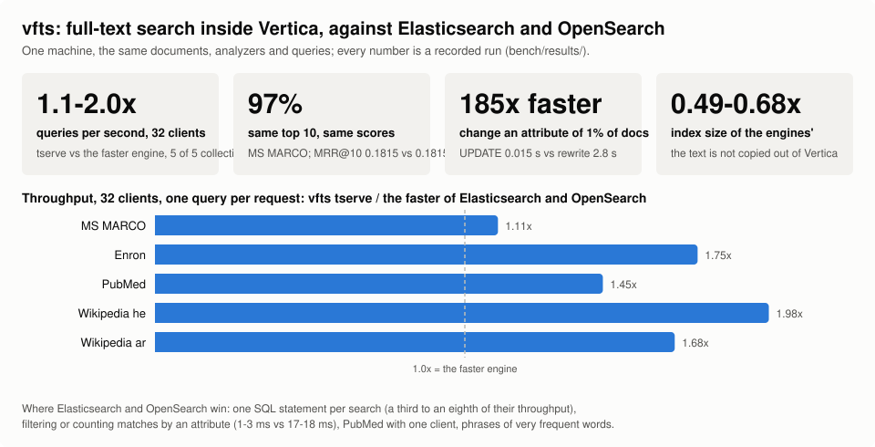
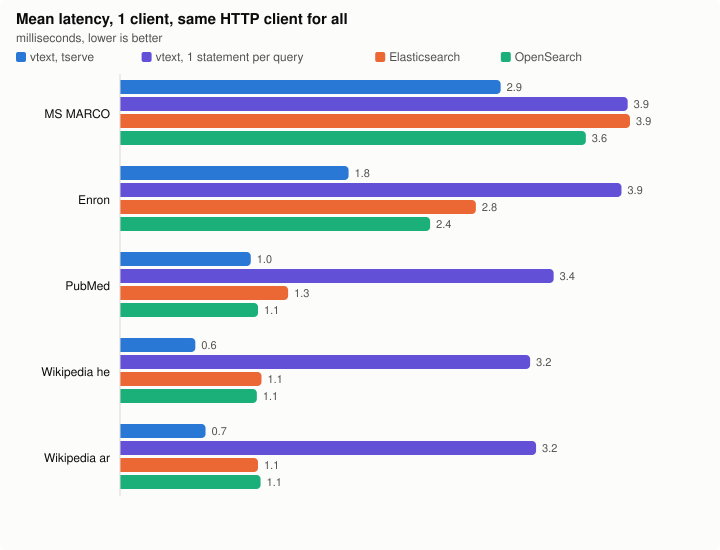
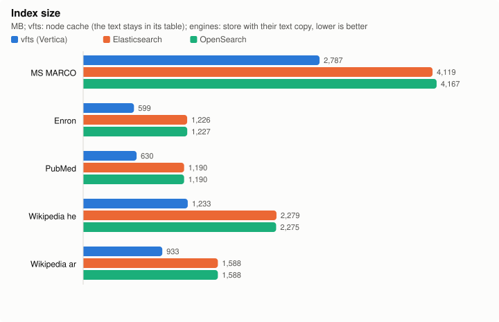

# vfts: full-text search for Vertica

- Full-text search inside Vertica, as a C++ UDx library: BM25 ranking, boolean, phrase and
proximity search (with the e-discovery operators `w/N` and `pre/N`), prefix, wildcard and fuzzy
words, every language written with spaces between words (Arabic and Hebrew included), new and
changed rows searchable at once without a rebuild, snippets, and hybrid search with
[vvector](https://github.com/mogomo/vertica-vector-db).

    SELECT r.rank, d.doc_id, vfts.tsnippet(d.body, 'contract w/5 indemn*' USING PARAMETERS index='emails') AS snippet
    FROM (SELECT vfts.tsearch(* USING PARAMETERS index='emails', query='contract w/5 indemn*', k=10) OVER()
          FROM app.emails_live) r
    JOIN app.emails d USING (doc_id)
    ORDER BY r.rank;

- 🎥 Watch the benchmark: https://youtu.be/txBx1-5FCOg

- Use cases it was built and measured for: legal e-discovery (Enron email), pharma literature search
(PubMed), support logs and general passage search (MS MARCO), Arabic and Hebrew text (Wikipedia).



## Full-text search in brief

`LIKE '%contract%'` finds a string. Full-text search finds *documents about* something:

- **Words, not strings.** Text is split into words (tokenized), normalized (case, accents, Unicode
  forms, Arabic letter variants, Hebrew points) and reduced to stems, so *Contracts*, *contract's*
  and *contracting* all match `contract`. Every language needs its own rules.
- **Ranking.** Thousands of documents match; the useful answer is the best ten. BM25 scores a
  document by how often it uses the query's words, how rare those words are, and how long the
  document is.
- **Structure in the query.** Phrases (`"mark to market"`), proximity (`fraud w/5 audit`),
  boolean logic, prefixes and wildcards (`indemn*`), typos (`holmse~`).
- **Speed at scale.** Reading every document per query is far too slow, so an *inverted index*
  maps each word to the documents that contain it, and top-k algorithms (MaxScore, block-max)
  skip documents that cannot reach the top ten.

The hard parts, for any engine: every language, exact and stable scores, fast top-k on millions of
documents, **new and changed rows searchable at once**, and **many users at the same time**.
Elasticsearch and OpenSearch solve them in a separate cluster; the price is a second copy of the
data, a pipeline that keeps it in sync, and a second security model. vfts solves them inside
Vertica.

## Why search inside Vertica

| | Search engine next to the database | vfts inside Vertica |
|---|---|---|
| Joins | none: copy every attribute into every document | search results are rows: `JOIN`, `GROUP BY`, window functions over any table |
| Changed attributes (owner, status, legal hold) | rewrite (and re-analyze) each affected document | `UPDATE` the attribute table; the text index is not touched |
| Consistency | eventually: searchable after a refresh, no transactions | ACID: a committed row is searchable at once (live view); a search sees one snapshot |
| Copies of the text | two (database + engine), plus a sync pipeline | one; the index is half to two thirds of the engines' size |
| Security, backup, operations | a second system for each | Vertica logins, grants, row access policies and resource pools; backed up with the database |
| Many small searches at once | fast | as fast or faster through `tserve` ([Performance](#performance)); slower as one SQL statement each |

Honest limits: a search engine is the better tool when every query is a tiny single search sent
as its own request and nothing joins with it; and a column mask on the indexed text makes vfts
refuse to search, rather than search the masked text ([Access policies](#access-policies)).

**Contents**

- New: [Improvements in 0.5.0](#improvements-in-050-an-index-that-looks-after-itself)
- Start: [Quick start](#quick-start) · [Install](#install) · [Prepare a table](#prepare-a-table)
- Use: [Reference](#reference) ([how to call the functions](#how-to-call-the-functions), [at a glance](#every-procedure-and-function-at-a-glance))
  - [Index management](#index-management): [create_index](#create_index), [info](#info), [tinfo](#tinfo), [refresh_index](#refresh_index), [merge](#merge), [rebuild](#rebuild), [load_all](#load_all), [maintain](#maintain), [cleanup](#cleanup), [check_access](#check_access), [alter_index](#alter_index), [export_index](#export_index), [import_index](#import_index), [drop_index](#drop_index), [add_attribute](#add_attribute), [refresh_attributes](#refresh_attributes-refresh_attribute), [drop_attribute](#drop_attribute), [the views](#the-views-_live-and-_snap), [access policies](#access-policies)
  - [Search functions](#search-functions): [tsearch](#tsearch), [tcount](#tcount), [tmatch](#tmatch), [tserve and vfts_broker](#tserve-and-vfts_broker-many-clients), [tsnippet](#tsnippet), [hybrid](#hybrid), [tokenize](#tokenize), [tversion](#tversion)
  - [Query syntax](#query-syntax), [Filter syntax](#filter-syntax)
  - [Search patterns](#search-patterns), [Semantic search](#semantic-search)
- Understand: [What it does](#what-it-does) · [Languages](#languages) · [No rebuild after loads, updates or upgrades](#no-rebuild-after-new-loads-updates-or-upgrades) · [How it was tested](#how-it-was-tested)
- Measure: [Performance](#performance) · [Run the benchmark yourself](#run-the-benchmark-yourself)
- More: [FAQ](#faq) · [Changes](#changes) · [Restrictions and future work](#restrictions-and-future-work) · [Files](#files) · [License](#license) · [Disclaimer](#disclaimer)

## Improvements in 0.5.0: an index that looks after itself

vfts 0.5.0 makes an index behave like part of its table: it needs nothing from the people who
write to the table, follows the table's grants, refreshes and repairs itself, survives reboots and
backups, and leaves nothing behind when it goes. Every change below was tested on one node
(Ubuntu) and on the 5-node Eon cluster (3 + 2 nodes, fenced), and is described in the reference
entries it changes; [Changes](#changes) lists what to do after an upgrade.

| Area | Before (0.4.1) | Now (0.5.0) |
|---|---|---|
| What the table needs | a `ver` column set on every write, and a journal row for every delete and for every update that kept `ver` | a unique doc_id: changes are found by Vertica's row epoch ([Prepare a table](#prepare-a-table)) |
| An `UPDATE` that sets no version column | never found | searchable at once through `<index>_live` |
| `DELETE`, `DROP_PARTITIONS`, `MOVE_PARTITIONS_TO_TABLE`, `TRUNCATE` without a journal row | the rows stayed searchable until a rebuild | gone at the next refresh, found by a count check ([refresh_index](#refresh_index)) |
| Rows moved, swapped or copied in by partition functions, a restore | not seen (their version was older) | searchable at once through `<index>_live` |
| Who may search | whoever had `SELECT` on the views, also after losing `SELECT` on the table | whoever may read the source table; a `REVOKE` counts at the next refresh or `check_access`, and old tokens stop working ([Access policies](#access-policies)) |
| Refresh | yours to schedule | every minute by itself (option `refresh_every`; [maintain](#maintain)) |
| Node caches after a reboot | lost (`/tmp/vfts`): every search failed until `load_all` | kept (`<catalog>/vfts` on each node) |
| A node that was down during a refresh | refused to answer until `load_all` | repaired by the next refresh; `load_all` writes only what is missing |
| `drop_index`, a dropped source table | caches left on other subclusters; the index of a dropped table stayed | `drop_index` works from anywhere and twice; [cleanup](#cleanup) removes the rest |
| Backup and restore of the source schema | the index answered with rows the restore took away | one refresh makes it equal to the restored table; [export_index](#export_index) / [import_index](#import_index) keep the index with the table |
| Case | always case folded | option `case=sensitive` ([create_index](#create_index)) |
| Merge into one segment | one thread | in parallel, the same bytes (MS MARCO, outside Vertica: 68.7 s on one thread, 25.4 s on 11) |
| Joining every match with a large table | the plain join could put the whole table in the hash table | the `IN` and `SYNTACTIC_JOIN` forms ([tmatch](#tmatch)): 1.0 s instead of 2.7 s on Enron |

What it costs, measured on a copy of MS MARCO (8,841,823 passages, one segment, one node): a
refresh that finds nothing 0.31 to 0.33 s; a refresh after deleting 1% of the rows (88,419, no
journal) 4.8 s, after updating 1% 5.6 s. The live view's filter on the row epoch skips every
storage container older than the last refresh (1.4 ms on the 8.8 million rows when nothing is
newer). Searches run the same engine code as in 0.4.1 (an index without `case=sensitive` analyzes
and stems exactly as before, and a merge on several threads writes the same bytes as one thread),
so the published search timings stay those of 0.4.1.

What stays the same: a deleted row is found until the next refresh (at most a minute with the
default schedule) unless a journal row hides it at once; on Eon, a statement reaches only its own
subcluster, so subclusters other than the one the trigger runs on need `maintain` from a session
on them ([Several nodes, Eon and subclusters](#several-nodes-eon-and-subclusters)).

## Quick start

Three steps on a Vertica node. The output shown is real (vfts 0.5.0, Vertica 26.3, one node).

**1. Install.** As the Linux user that runs Vertica (dbadmin), in a directory whose path has no
spaces, with a superuser's connection:

    git clone https://github.com/mogomo/vfts.git
    cd vfts
    export VSQL_USER=dbadmin VSQL_PASSWORD='...' VSQL_DATABASE=...
    ./install.sh

`install.sh` checks the environment, builds (the first time, ICU and the stemmers take 5 to 20
minutes), runs the unit tests, deploys into the database and runs every function once. It stops at
the first problem and says what to fix. It ends with:

```
== 4. Verify
   ok    vfts 0.5.0 (-O3 -ffp-contract=off -std=c++17 x86_64 g++-15.2.0, ICU 79.1)
   ok    every function ran on a test table (schema vfts_selftest, then removed)

== Installed
```

**2. Index a table and search it.** In `vsql`: a table with an id and a text, then one call to
index it:

```sql
CREATE SCHEMA quick;
CREATE TABLE quick.docs (doc_id INT NOT NULL, body LONG VARCHAR, lang VARCHAR(8));
INSERT INTO quick.docs (doc_id, body) VALUES (1, 'The supplier shall indemnify the buyer under this contract.');
INSERT INTO quick.docs (doc_id, body) VALUES (2, 'Contract renewal: payment within 30 days.');
INSERT INTO quick.docs (doc_id, body) VALUES (3, 'Sherlock Holmes'' notes on the Baskerville case.');
COMMIT;
   COMMIT
CALL vfts.create_index('docs', 'quick.docs', 'lang=en');
   NOTICE 2005:  vfts: index docs created on quick.docs. Search: SELECT * FROM (SELECT vfts.tsearch(* USING PARAMETERS index='docs', query='...', k=10) OVER() FROM quick.docs_live) r;
    create_index 
   --------------
               0
   (1 row)
```

A ranked search, joined to the table for the text (*contracts* also finds *contract*):

```sql
SELECT r.rank, r.doc_id, ROUND(r.score, 4) AS score, d.body
FROM (SELECT vfts.tsearch(* USING PARAMETERS index='docs', query='contracts', k=10) OVER() FROM quick.docs_live) r
JOIN quick.docs d USING (doc_id)
ORDER BY r.rank;
    rank | doc_id | score  |                            body                             
   ------+--------+--------+-------------------------------------------------------------
       1 |      2 | 0.2308 | Contract renewal: payment within 30 days.
       2 |      1 | 0.1955 | The supplier shall indemnify the buyer under this contract.
   (2 rows)
```

A new row is searchable as soon as it is committed, without any refresh (`w/5`: within five words;
`indemn*`: any word that starts with indemn):

```sql
INSERT INTO quick.docs (doc_id, body) VALUES (4, 'The new contract has an indemnity cap.'); COMMIT;
   COMMIT
SELECT r.rank, r.doc_id, d.body
FROM (SELECT vfts.tsearch(* USING PARAMETERS index='docs', query='contract w/5 indemn*', k=10) OVER() FROM quick.docs_live) r
JOIN quick.docs d USING (doc_id)
ORDER BY r.rank;
    rank | doc_id |                            body                             
   ------+--------+-------------------------------------------------------------
       1 |      4 | The new contract has an indemnity cap.
       2 |      1 | The supplier shall indemnify the buyer under this contract.
   (2 rows)
```

How many documents match:

```sql
SELECT * FROM (SELECT vfts.tcount(* USING PARAMETERS index='docs', query='holmes OR contract*') OVER() FROM quick.docs_live) c;
    qid | count 
   -----+-------
      0 |     4
   (1 row)
```

Remove it again:

```sql
CALL vfts.drop_index('docs');
DROP SCHEMA quick CASCADE;
   NOTICE 2005:  vfts: index docs dropped (caches removed on 1 nodes of this subcluster)
   DROP SCHEMA
```

The form `SELECT ... FROM (SELECT vfts.tsearch(* USING PARAMETERS ...) OVER() FROM <index>_live) r`
is how Vertica calls this kind of function: [How to call the functions](#how-to-call-the-functions)
explains each part.

**3. Next.**

- `scripts/demo.sh`: a guided tour of every function on a small table, with explanations.
- [Prepare a table](#prepare-a-table): the columns your own table needs, and when each kind of
  change (update, delete, partition operation) is searchable.
- [Install](#install): what `install.sh` does step by step, grants for the users who search,
  refresh schedules, several nodes and Eon, and the HTTP front end for many clients.
- [Reference](#reference): every procedure and function, each with its syntax, arguments,
  parameters, result and a real example.

## Install

Two ways to the same result: **A**, one command (recommended), or **B**, the same steps by hand
(to see each part, or to build on another machine). Then, for both: index a table and let users
search, nodes and subclusters, and the HTTP front end for many clients.

### A. One command

For any Vertica database (one node or many, Enterprise or Eon). On a Vertica node, as the Linux user
that runs Vertica, in a directory whose path has no spaces, with the connection of a superuser:

    git clone https://github.com/mogomo/vfts.git && cd vfts
    export VSQL_USER=dbadmin VSQL_PASSWORD='...' VSQL_DATABASE=...
    ./install.sh                 # or ./install.sh --fenced

`install.sh` checks the environment (connection, superuser, Vertica version, SDK, compiler, that
the session's node is this machine), builds the three static dependencies once and then vfts,
runs the engine tests, deploys the library, functions and procedures (copied to every node),
builds the tools, and runs every function on a test table to verify ([Quick start](#quick-start)
shows its output). It stops at the first problem and says what to fix. It can be run again (an
upgrade); its test uses the schema `vfts_selftest` and never touches anything else.

    ./install.sh --check                 # only check the environment
    ./install.sh --uninstall             # remove the library, functions and procedures; indexes stay
    ./install.sh --uninstall --drop      # also drop every index (views, node caches) and the schema vfts

### B. Step by step

What `install.sh` does, one part at a time.

#### 1. Check the environment

| Need | Check |
|---|---|
| Vertica 26.3 (tested: 26.3.0-2, Enterprise and Eon; 26.2 has the same SDK version, 26.2.0, but was not tested) | `SELECT version();` |
| The SDK of that version on the machine that builds (`/opt/vertica/sdk`, installed with the server) | `ls /opt/vertica/sdk/include/Vertica.h` |
| Linux x86-64 with g++ 8 or later, make, curl (tested: RHEL 8 with g++ 8.5, Ubuntu 26.04 with g++ 15.2) | `g++ --version` |
| A superuser (dbadmin) for the install (`CREATE LIBRARY`) | |
| Free disk on every node for the node caches (about the size of the index: half to two thirds of the text) | `df -h /tmp` |

Build on a Vertica node, or on a machine with the same Linux family and a glibc no newer than the
nodes' (the library links ICU, Snowball and CRoaring statically: nothing else is installed on the nodes).

#### 2. Build and test

    git clone https://github.com/mogomo/vfts.git && cd vfts
    make deps        # downloads and builds ICU 79.1, libstemmer_c 3.2.0, CRoaring 5.5.5 (pinned checksums)
    make             # build/libvfts.so
    make test        # engine unit tests, no database needed
    make tools       # optional: build/tools/vfts_broker (many clients), vfts_cli, httpload

#### 3. Deploy into the database

On a Vertica node (with the built `build/libvfts.so` and the repository's `sql/` directory):

    export VSQL_HOST=localhost VSQL_PORT=5433 VSQL_USER=dbadmin VSQL_PASSWORD=... VSQL_DATABASE=...
    make deploy                 # unfenced: fastest, runs inside the Vertica process
    make deploy FENCED=yes      # or fenced: a separate process per node, a crash cannot stop the node (slower)

`make deploy` (scripts/deploy.sh, sql/install.sql) creates the schema `vfts`, its tables, the
library, every function and procedure, and grants the functions to PUBLIC (the procedures are for
dbadmin, or `GRANT EXECUTE ON PROCEDURE ...`). `CREATE LIBRARY` reads the library as the database's
OS user (deploy.sh hands it a copy in /tmp) and copies it to every node of the cluster, so this runs
once per database. Nothing is stored in the
scripts: the connection comes from the `VSQL_*` variables.

#### 4. Verify

    vsql -c "SELECT * FROM (SELECT vfts.tversion() OVER()) v;"   # version, build, ICU, stemmers
    scripts/examples.sh         # every function on a small table (the examples of the Reference)
    tests/sql/run_all.sh        # the SQL tests (create and drop their own schemas)

### Index a table and let users search

1. [Prepare the table](#prepare-a-table): a unique `doc_id` and the text, optionally `lang`. Nothing else: writers
   need no rules.
2. `CALL vfts.create_index('docs', 'app.docs', 'lang=en');` as dbadmin (or a user with write
   access to the `vfts` tables and the source table: procedures run with the caller's privileges).
3. Users who may read the table may search it: whoever has `SELECT` on `app.docs` (granted to
   them, to one of their roles, to `PUBLIC`, or through the schema) gets `SELECT` on the views
   `app.docs_live` and `app.docs_snap` from vfts, and loses it when they lose `SELECT` on the table
   (at the next `refresh_index` or `check_access`; a token they copied stops working then too).
   They also need `USAGE` on the schema, as for the table. (Vertica checks the source table against
   the views' owner, the user who ran `create_index`: it must own the table or have
   `SELECT ... WITH GRANT OPTION` on it.) The views are the only way to search: a statement that
   makes its own input for `tsearch` is refused, and row access policies of the source table apply
   to every search ([Access policies](#access-policies)). To manage the views' grants yourself, use
   the option `grants=manual`.
4. Nothing to schedule: `create_index` sets up a Vertica schedule and trigger that refresh the index
   every minute (option `refresh_every`, in minutes; `0` turns it off, and then you run
   `CALL vfts.refresh_index('docs');` from any scheduler). New and updated rows are searchable at
   once anyway; the refresh keeps the live tail short, removes deleted rows and repairs nodes
   that are behind. Creating the trigger needs a superuser.

Where the node caches live: in `<catalog>/vfts` on each node, the node's catalog directory
(for example `/home/dbadmin/VDB/v_vdb_node0001_catalog/vfts`), which survives a reboot. Another
place: the index option `cache_dir=/data/vfts` at `create_index` (it must exist on every node,
writable by the database's OS user). The cache is a copy of the index tables: a node that lacks
it (a new node, a lost directory, a node that was down during a refresh) gets it at the next
refresh, or at once with `CALL vfts.load_all('docs');`, which writes only what is missing.

### Several nodes, Eon and subclusters

- **Enterprise, several nodes**: nothing more; `create_index` and `refresh_index` load every node,
  and a node that was down during a refresh is brought up to date by the next one.
- **Eon**: a statement reaches the nodes of its session's subcluster only, so each subcluster
  keeps its own caches. Run `create_index` on one subcluster; on each other subcluster, run
  `CALL vfts.maintain('docs');` from a session connected to it every minute or so (cron and
  `vsql`, or any scheduler that connects there): it refreshes the index when there are changes and
  loads what that subcluster lacks. Without it, a node of that subcluster refuses to answer after
  a refresh elsewhere, with what to do (`run CALL vfts.load_all('docs')`).
- **New node**: `CALL vfts.load_all('docs');` (or wait for the next refresh).

### Many clients (optional): vfts_broker

For many small searches at once, run `build/tools/vfts_broker` on a node, as the database's OS
user, and send searches to it over HTTP ([tserve and vfts_broker](#tserve-and-vfts_broker-many-clients)):

    build/tools/vfts_broker --port 9300 --schema app --mode serve --param "mode='stem'" &
    curl -XPOST localhost:9300/docs/_search -u alice:secret -d '{"query": "contract w/5 indemn*"}'

It listens on 127.0.0.1 by default (`--bind` to change); each user's searches run in that user's
own Vertica sessions.

### Upgrade and uninstall

    git pull && ./install.sh             # or: git pull && make && make deploy
                                         # replaces the library and functions; indexes and caches stay

What each version needs after the upgrade (most need nothing): [Changes](#changes).

    ./install.sh --uninstall             # removes library, functions and procedures; indexes stay
    ./install.sh --uninstall --drop      # also drops every index (views, node caches) and the schema vfts

An unfenced upgrade is safe while the database runs: the old library stays mapped for searches
still running.

## Prepare a table

**Source table contract.** One table, one text column, a unique id:

    doc_id  INT           NOT NULL                        -- unique
    body    LONG VARCHAR                                   -- the text
    lang    VARCHAR(8)                                     -- optional; ISO 639-1; NULL = the index language

That is all. vfts finds what changed by Vertica's row epoch (the commit epoch every row has), so
writers follow no rules: any `INSERT`, `UPDATE`, `DELETE`, `COPY`, `MERGE`, `TRUNCATE` and every
partition function is picked up. What each one needs before searches see it:

| Change | Through `<index>_live` | Through `<index>_snap` and in the index |
|---|---|---|
| `INSERT`, `COPY`, `UPDATE`, `MERGE` | at once (after `COMMIT`) | after the next `refresh_index` |
| `MOVE_PARTITIONS_TO_TABLE`, `SWAP_PARTITIONS_BETWEEN_TABLES`, `COPY_PARTITIONS_TO_TABLE` (rows that arrive), a vbr restore | at once | after the next `refresh_index` |
| `DELETE`, `DROP_PARTITIONS`, `MOVE_PARTITIONS_TO_TABLE` (rows that leave), `TRUNCATE` | after the next `refresh_index`; at once with a journal row `'D'` | after the next `refresh_index` |

Rows written in the session's own open transaction are not searched (committed rows are).
A refresh finds rows that left the table by comparing counts, so the doc_ids must be unique:
`refresh_index` says so in a notice when they are not.

**Journal** (optional: makes a delete visible through `<index>_live` before the next refresh):

    doc_id  INT
    op      CHAR(1)                                        -- 'D' (any other value is treated the same way)

- Columns with other names are mapped with the options `id_col`, `text_col`, `lang_col`.
- For tables with a high write rate, partition the source table by time (a load date, for
  example), so that the live view, which reads only rows committed after the last refresh, finds
  them in few storage containers (docs/VERTICA_NOTES.md).
- Tables made for vfts 0.4 and older, with a `ver` column and a journal with `ver`, work as they
  are; neither `ver` column is used any more.

Ready to run:

    CREATE SCHEMA app;
    CREATE TABLE app.emails (doc_id INT NOT NULL, body LONG VARCHAR, lang VARCHAR(8));
    -- load: COPY app.emails (doc_id, body, lang) FROM ... ;
    CALL vfts.create_index('emails', 'app.emails', 'lang=en');

    -- later: changes, any way you like
    UPDATE app.emails SET body = '...' WHERE doc_id = 42;
    DELETE FROM app.emails WHERE doc_id = 43;
    COMMIT;
    -- the update is searchable now through app.emails_live; both are folded into the index by:
    CALL vfts.refresh_index('emails');

With a journal, the delete is also hidden at once:

    CREATE TABLE app.emails_journal (doc_id INT, op CHAR(1));
    CALL vfts.create_index('emails', 'app.emails', 'lang=en journal=app.emails_journal');
    DELETE FROM app.emails WHERE doc_id = 43; INSERT INTO app.emails_journal VALUES (43, 'D'); COMMIT;

## Reference

Every object lives in schema `vfts`. Procedures manage indexes (`CALL vfts.x(...)`); functions
search (`SELECT ...`). Each entry below follows the layout of the Vertica documentation:
what it does, **Syntax**, **Arguments** and **Parameters**, **Returns**, **Privileges** and
**Examples**.

- In a syntax block, `[ ]` marks an optional part, `|` separates alternatives, `[,...]` means
  "more of the same", and lower-case words are placeholders.
- Procedures return 0 and report what they did as `NOTICE` messages. They run with the caller's
  privileges; `dbadmin` (a superuser) may run all of them. The search functions are granted to
  `PUBLIC`: what limits a search is `SELECT` on the index's views, which vfts grants to whoever
  may read the source table ([The views](#the-views-_live-and-_snap)).
- Every example that shows output is real: `scripts/examples.sh` runs them all, one after the
  other, on a table of its own (schema `ex`, index `notes`; vfts 0.5.0, Vertica 26.3, one node),
  and the blocks show each statement, then what vsql printed. Run it yourself after an install
  (`scripts/examples.sh`; `scripts/examples.sh --clean` removes it).

### How to call the functions

Three kinds of objects, three ways to call them:

| Kind | Objects | How |
|---|---|---|
| Procedures: manage an index | create_index, refresh_index, merge, info, ... | `CALL vfts.create_index('docs', 'app.docs', 'lang=en');` |
| Transform functions: return rows | tsearch, tcount, tmatch, tserve, hybrid, tokenize, tinfo, tversion | in a subquery, with `OVER()`: `SELECT ... FROM (SELECT vfts.tsearch(...) OVER() FROM ...) r` |
| Scalar function: returns one value per row | tsnippet | anywhere a value goes: `SELECT vfts.tsnippet(body, 'query' USING PARAMETERS index='docs') FROM ...` |

A search, part by part:

    SELECT r.rank, d.doc_id, d.body                        -- 5. what to show
    FROM (SELECT vfts.tsearch(*                            -- 1. the function, fed every column of ...
                 USING PARAMETERS index='docs',            -- 2. its parameters, by name
                                  query='contract w/5 indemn*', k=10)
                 OVER()                                    -- 3. required by Vertica for this kind of function
          FROM app.docs_live) r                            -- 4. ... the index's view: the input of every search
    JOIN app.docs d USING (doc_id)                         -- 6. the text stays in your table: join it
    ORDER BY r.rank;

1. `tsearch` is a *transform function* (Vertica's term for a function that turns input rows into
   any number of output rows), so it is called in a `FROM` subquery, with `OVER()`.
2. `USING PARAMETERS` passes the settings by name: `index` always, then `query`, `k` and the rest.
3. `*` hands it every column of the view `<index>_live` (every committed change) or `<index>_snap`
   (the index as of the last refresh). The views are the only input a search accepts, so `SELECT`
   on them is what allows a user to search ([The views](#the-views-_live-and-_snap)).
4. The result is rows (`qid, doc_id, score, rank`): join them, filter them, group them like any
   table.

### Every procedure and function at a glance

| Task | Procedure or function | Typical call |
|---|---|---|
| Create an index of a table | [create_index](#create_index) | `CALL vfts.create_index('docs', 'app.docs', 'lang=en');` |
| Add the rows written since the last refresh | [refresh_index](#refresh_index) | `CALL vfts.refresh_index('docs');` (runs every minute by itself) |
| Fewer, larger segments | [merge](#merge) | `CALL vfts.merge('docs');` |
| Look at an index | [info](#info), [tinfo](#tinfo) | `CALL vfts.info('docs');` |
| Fill the cache of a new node or subcluster | [load_all](#load_all) | `CALL vfts.load_all('docs');` |
| Refresh and repair, as the trigger does | [maintain](#maintain) | `CALL vfts.maintain('docs');` (every minute by itself) |
| Remove leftovers of dropped tables and indexes | [cleanup](#cleanup) | `CALL vfts.cleanup();` |
| Keep the index with the table in a backup | [export_index](#export_index), [import_index](#import_index) | `CALL vfts.export_index('docs');` |
| Read changed access policies and grants | [check_access](#check_access) | `CALL vfts.check_access('docs');` |
| Change options of an index | [alter_index](#alter_index) | `CALL vfts.alter_index('docs', 'grants=manual');` |
| Index everything again (recovery) | [rebuild](#rebuild) | `CALL vfts.rebuild('docs');` |
| Remove an index | [drop_index](#drop_index) | `CALL vfts.drop_index('docs');` |
| Filter and count by another table's column | [add_attribute](#add_attribute) | `CALL vfts.add_attribute('docs', 'owner', 'app.owners', 'doc_id', 'owner');` |
| Copy changed attribute values | [refresh_attributes, refresh_attribute](#refresh_attributes-refresh_attribute) | `CALL vfts.refresh_attributes('docs');` |
| Remove an attribute | [drop_attribute](#drop_attribute) | `CALL vfts.drop_attribute('docs', 'owner');` |
| The best k documents, ranked | [tsearch](#tsearch) | `SELECT * FROM (SELECT vfts.tsearch(* USING PARAMETERS index='docs', query='...', k=10) OVER() FROM app.docs_live) r;` |
| How many match (per attribute value) | [tcount](#tcount) | `... vfts.tcount(* USING PARAMETERS index='docs', query='...', by='owner') OVER() ...` |
| Every match, for joins and reports | [tmatch](#tmatch) | `... vfts.tmatch(* USING PARAMETERS index='docs', query='...') OVER() ...` |
| Many clients over HTTP | [tserve and vfts_broker](#tserve-and-vfts_broker-many-clients) | `build/tools/vfts_broker --port 9300 --schema app --mode serve` |
| The matching passages, marked | [tsnippet](#tsnippet) | `SELECT vfts.tsnippet(body, '...' USING PARAMETERS index='docs') FROM app.docs ...` |
| Words and vectors in one ranking | [hybrid](#hybrid) | [Semantic search](#semantic-search) |
| What the analyzer makes of a text | [tokenize](#tokenize) | `SELECT * FROM (SELECT vfts.tokenize('text' USING PARAMETERS lang='en') OVER()) t;` |
| Which build is installed | [tversion](#tversion) | `SELECT * FROM (SELECT vfts.tversion() OVER()) v;` |

The query language is in [Query syntax](#query-syntax), the filters in [Filter syntax](#filter-syntax).

### The examples

The examples run as one story, in this order, on the example table below:
[create_index](#create_index) and [info](#info); the searches ([tsearch](#tsearch),
[tcount](#tcount), [tmatch](#tmatch)); [add_attribute](#add_attribute) `owner` and the searches by
it; [refresh_attributes](#refresh_attributes-refresh_attribute) (note 3 moves to legal);
[tsnippet](#tsnippet); [refresh_index](#refresh_index) (note 6 is added); [merge](#merge),
[tinfo](#tinfo), [load_all](#load_all), [maintain](#maintain), [cleanup](#cleanup),
[check_access](#check_access), [export_index](#export_index), [alter_index](#alter_index),
[rebuild](#rebuild);
[tokenize](#tokenize), [hybrid](#hybrid), [tversion](#tversion), the [broker](#tserve-and-vfts_broker-many-clients);
then [drop_attribute](#drop_attribute) and [drop_index](#drop_index). An example that depends on an
earlier one says so in a line *Example state*.

### The example table

Five short notes in two languages, a journal for deletes, and a table of owners (for the
[attribute](#add_attribute) examples). The table layout is described in [Prepare a table](#prepare-a-table).

```sql
CREATE SCHEMA ex;
CREATE TABLE ex.notes (doc_id INT NOT NULL, body LONG VARCHAR, lang VARCHAR(8));
CREATE TABLE ex.notes_journal (doc_id INT, op CHAR(1));
CREATE TABLE ex.owners (doc_id INT, owner VARCHAR(20));
INSERT INTO ex.notes (doc_id, body) VALUES (1, 'The supplier shall indemnify the buyer under this contract.');
INSERT INTO ex.notes (doc_id, body) VALUES (2, 'Contract renewal: indemnity terms unchanged, payment within 30 days.');
INSERT INTO ex.notes (doc_id, body) VALUES (3, 'Meeting notes: mark to market accounting for the energy contracts.');
INSERT INTO ex.notes (doc_id, body) VALUES (4, 'Holmes'' notes on the Baskerville case.');
INSERT INTO ex.notes (doc_id, body, lang) VALUES (5, 'Le contrat prévoit une indemnité.', 'fr');
INSERT INTO ex.owners VALUES (1, 'legal'); INSERT INTO ex.owners VALUES (2, 'sales');
INSERT INTO ex.owners VALUES (3, 'trading'); INSERT INTO ex.owners VALUES (4, 'legal'); INSERT INTO ex.owners VALUES (5, 'legal');
COMMIT;
   COMMIT
```

### Index management

#### create_index

Registers a source table as an index, creates the views `<schema>.<index>_live` and
`<schema>.<index>_snap` in the table's schema, builds the index from every row and loads it on
every node of the session's subcluster.

**Syntax**

    CALL vfts.create_index ( 'index', 'schema.table' [, 'options' ] )

**Arguments**

| Argument | Meaning |
|---|---|
| index | the index name: 1 to 64 letters, digits or underscores; unique in the database |
| schema.table | the source table ([Prepare a table](#prepare-a-table)) |
| options | `key=value` pairs separated by spaces or commas, all optional (below) |

**Options**

| Option | Default | Meaning |
|---|---|---|
| lang | en | index language (ISO 639-1): for documents without a `lang` value, and the stemmer of Latin words |
| journal | none | `schema.table` with the columns doc_id and op: a row there hides that doc_id's indexed version at once (a delete before the next refresh); not needed for anything else |
| accent_fold | latin | `latin` (remove accents of Latin letters), `none`, `all` (also Greek and Cyrillic) |
| case | insensitive | `insensitive`: words are case folded (`Apple` = `apple`); `sensitive`: words keep their case in the index and in queries (`Apple` finds `Apple` only, `US` is not `us`); stems keep it too (`Apples` and `Apple` share the stem `Appl`, `apples` has `appl`). Set at `create_index`; changing it needs a new index |
| on_unsupported | error | `error` or `plain` for Chinese, Japanese, Korean, Thai, Lao, Khmer, Myanmar text |
| id_col, text_col, lang_col | doc_id, body, lang | column names in the source table |
| ver_col, margin | | options of vfts 0.4 and older: accepted and not used (changes are found by the row epoch) |
| threads | 0 | build threads per instance (0: a quarter of the cores); for a merge, its threads (0: half the cores) |
| max_segment_mb | 2048 | a build thread starts a new segment above this memory |
| merge_factor | 10 | segments per tier of the merge policy |
| cache_dir | `<catalog>/vfts` | directory of the node caches (default: `vfts` in each node's catalog directory) |
| refresh_every | 1 | minutes between automatic refreshes (a Vertica schedule and the trigger `vfts.refresh_<index>`, which runs [maintain](#maintain)): `0` (off), 1 to 59, or whole hours up to 1440. Needs a superuser |
| build | true | `false`: register and create the views only |
| access | auto | `auto`: follow the access policies of the source table ([Access policies](#access-policies)); `rows`: apply its row access policies to every search even before one exists |
| grants | source | `source`: the views' `SELECT` grants follow the source table's (users, roles, `PUBLIC`, its owner, privileges inherited from the schema), checked at every `refresh_index` and `check_access`; `manual`: vfts leaves the views' grants alone |
| reorder | true | merges number the documents by recursive graph bisection (smaller and faster index, same results); `false`: keep doc_id order |

**Returns**

0. What the procedure did is reported as `NOTICE` messages.

**Privileges**

Superuser, or the owner of the source table (vfts reads the table's access policies, which only
they can see) with `EXECUTE` on the procedure, write access to the `vfts` tables and `CREATE` on the
table's schema. The views belong to the user who ran `create_index`; Vertica checks the source
table against them, so that user must own the table or have `SELECT ... WITH GRANT OPTION` on it.

**Examples**

An English index with a journal for deletes:

```sql
CALL vfts.create_index('notes', 'ex.notes', 'lang=en journal=ex.notes_journal');
   NOTICE 2005:  vfts: index notes created on ex.notes. Search: SELECT * FROM (SELECT vfts.tsearch(* USING PARAMETERS index='notes', query='...', k=10) OVER() FROM ex.notes_live) r;
    create_index 
   --------------
               0
   (1 row)
```

Other forms:

    CALL vfts.create_index('docs', 'app.docs');                                          -- every default
    CALL vfts.create_index('mail', 'app.mail', 'id_col=msg_id text_col=content lang_col=language');
    CALL vfts.create_index('big', 'app.big', 'threads=16 max_segment_mb=4096');          -- a large table, more build threads

#### info

Segments, documents, the live tail, the last refresh, the access mode, the attributes and the
caches of the subcluster's nodes, as notices.

**Syntax**

    CALL vfts.info ( 'index' )

**Arguments**

| Argument | Meaning |
|---|---|
| index | the index name |

**Returns**

0. The facts are `NOTICE` messages, one line each.

**Privileges**

Any user (`EXECUTE` is granted to `PUBLIC`).

**Examples**

```sql
CALL vfts.info('notes');
   NOTICE 2005:  index notes: source ex.notes, generation 1, 1 segments, 5 documents (0 deleted), 0.0 MB
   NOTICE 2005:  boundary epoch 24944; live tail 0 rows (ex.notes_live); last refresh: full build: 5 rows into 1 segments, 0 tombstones, 0 journal rows
   NOTICE 2005:  automatic refresh: every 1 minutes
   NOTICE 2005:  access: open (open: no access policy; rows: each user searches the rows that row access policies show; masked:<column>: searches refused)
   NOTICE 2005:  attributes: (none)
   NOTICE 2005:  node caches: 1 of 1 nodes of this subcluster have generation 1 (details: SELECT * FROM (SELECT vfts.tinfo(USING PARAMETERS index='notes') OVER(PARTITION NODES) FROM vfts.probe) i;)
    info 
   ------
       0
   (1 row)
```

The same facts as tables, readable by every user: `vfts.indexes` (the manifest: one row per
index), `vfts.segments`, `vfts.index_stats` (one row per generation), `vfts.attributes`. Per node,
the function `tinfo` (below).

#### tinfo

The node cache of an index on every node: generation, segments, documents and bytes, and a
problem if the node's cache is missing or behind.

**Syntax**

    SELECT * FROM ( SELECT vfts.tinfo ( USING PARAMETERS index='index' [, cache_dir='dir' ] )
                    OVER ( PARTITION NODES ) FROM vfts.probe ) i;

`OVER (PARTITION NODES)` runs it once on every node; `vfts.probe` is a one-row table that gives each
node a row to start from.

**Parameters**

| Parameter | Default | Meaning |
|---|---|---|
| index | (required) | the index |
| cache_dir | `<catalog>/vfts` | the node cache directory, if the index uses another one |

**Returns**

`(node_name VARCHAR, gen INT, segments INT, docs INT, deleted INT, bytes INT, problem VARCHAR)`,
one row per node.

**Privileges**

Any user (`EXECUTE` is granted to `PUBLIC`; `vfts.probe` is readable by `PUBLIC`).

**Examples**

*Example state:* after the [merge](#merge) example (generation 3, one segment, six documents).


```sql
SELECT * FROM (SELECT vfts.tinfo(USING PARAMETERS index='notes') OVER(PARTITION NODES) FROM vfts.probe) i;
      node_name    | gen | segments | docs | deleted | bytes | problem 
   ----------------+-----+----------+------+---------+-------+---------
    v_vdb_node0001 |   3 |        1 |    6 |       0 |  5288 | 
   (1 row)
```

#### refresh_index

Indexes the rows committed since the last refresh into new segments, tombstones their older
versions, the journal's deletes and the documents that left the table (deleted, dropped with a
partition, moved to another table, truncated), loads every node, and moves the views' boundary.
Incremental; the table changes are one transaction. Then runs the tiered merge policy. (The name
`refresh` is a Vertica built-in function and cannot be a procedure.)

How it finds the changes: the rows to add are those whose epoch (Vertica's commit epoch of every
row) is newer than the last refresh. Rows that left the table have no epoch to find them by, so
the refresh compares the number of rows in the table with the number of documents the index will
hold (one scan of the id column, about 10 ms for 8.8 million rows) and, only when they differ,
looks for the documents that left (about 0.4 s for 8.8 million rows). The `NOTICE` says how many
it found.

**Syntax**

    CALL vfts.refresh_index ( 'index' )

When it runs: by itself, every minute (option `refresh_every` of [create_index](#create_index) and
[alter_index](#alter_index)); call it yourself whenever you like, for example right after a large
load. Inserts and updates are searchable without it (the live view reads the rows committed
since); deletes need it (or a journal row); a longer live tail costs query time, because every
tail row is analyzed per query (above 10,000 tail rows a search writes a warning to the server
log: parameter `tail_warn`). A
refresh also writes every segment a node of the subcluster lacks, so a node that was down or lost
its cache is repaired by it.

**Arguments**

| Argument | Meaning |
|---|---|
| index | the index name |

**Returns**

0. What the procedure did is reported as `NOTICE` messages.

**Privileges**

As [create_index](#create_index).

**Examples**

*Example state:* the five notes; this example adds note 6, which the later examples see.

A new row is found at once through the live view; through the snap view only after
`refresh_index`:

```sql
INSERT INTO ex.notes (doc_id, body) VALUES (6, 'Draft contract with an indemnity cap.'); COMMIT;
   COMMIT
SELECT 'live' AS view, doc_id FROM (SELECT vfts.tsearch(* USING PARAMETERS index='notes', query='cap') OVER() FROM ex.notes_live) r
UNION ALL
SELECT 'snap', doc_id FROM (SELECT vfts.tsearch(* USING PARAMETERS index='notes', query='cap') OVER() FROM ex.notes_snap) r;
    view | doc_id 
   ------+--------
    live |      6
   (1 row)
CALL vfts.refresh_index('notes');
   NOTICE 2005:  vfts: index notes generation 2: incremental: 1 rows into 1 segments, 0 tombstones, 0 journal rows (0.4 s)
    refresh_index 
   ---------------
                0
   (1 row)
SELECT 'snap' AS view, doc_id FROM (SELECT vfts.tsearch(* USING PARAMETERS index='notes', query='cap') OVER() FROM ex.notes_snap) r;
    view | doc_id 
   ------+--------
    snap |      6
   (1 row)
```

Updates and deletes (an update is searchable at once through the live view, a delete with its
journal row too; both are folded into the index by the next refresh, and a delete without a
journal row is seen then; [Prepare a table](#prepare-a-table)):

    UPDATE ex.notes SET body = '...' WHERE doc_id = 2;
    DELETE FROM ex.notes WHERE doc_id = 4; INSERT INTO ex.notes_journal (doc_id, op) VALUES (4, 'D');
    SELECT DROP_PARTITIONS('app.docs', '2024-01-01', '2024-12-31');     -- on a partitioned table: no journal needed
    COMMIT;
    CALL vfts.refresh_index('notes');

#### merge

Merges segments, dropping deleted documents, and numbers the documents so that documents with
similar words are next to each other (recursive graph bisection: smaller postings, more skipped
blocks; the same hits and scores; index option `reorder=false` keeps doc_id order). Searches keep
working on the previous generation while it runs.

**Syntax**

    CALL vfts.merge ( 'index' [, max_segments ] )

**Arguments**

| Argument | Meaning |
|---|---|
| index | the index |
| max_segments | merge the smallest segments until at most this many remain. Without it: the tiered policy (`merge_factor` segments of a size tier become one), which `refresh_index` also runs |

Fewer segments use less CPU per query; more segments are searched in parallel (lower latency for
one query at a time). The benchmark shows both ([Performance](#performance)).

**Returns**

0. What the procedure did is reported as `NOTICE` messages.

**Privileges**

As [create_index](#create_index).

**Examples**

*Example state:* after [refresh_index](#refresh_index): two segments (the first build, and note 6).

The tiered policy: two small segments are fewer than `merge_factor` (10), so nothing is merged:

```sql
CALL vfts.merge('notes');
    merge 
   -------
        0
   (1 row)
```

Into one segment, then the index's state:

```sql
CALL vfts.merge('notes', 1);
   NOTICE 2005:  vfts: index notes merged in 1 steps (0.4 s); 1 segments now
    merge 
   -------
        0
   (1 row)
CALL vfts.info('notes');
   NOTICE 2005:  index notes: source ex.notes, generation 3, 1 segments, 6 documents (0 deleted), 0.0 MB
   NOTICE 2005:  boundary epoch 24960; live tail 0 rows (ex.notes_live); last refresh: incremental: 1 rows into 1 segments, 0 tombstones, 0 journal rows
   NOTICE 2005:  automatic refresh: every 1 minutes
   NOTICE 2005:  access: open (open: no access policy; rows: each user searches the rows that row access policies show; masked:<column>: searches refused)
   NOTICE 2005:  attributes: owner text from ex.owners.owner (5 values, refreshed 2026-11-26 02:53:02)
   NOTICE 2005:  node caches: 1 of 1 nodes of this subcluster have generation 3 (details: SELECT * FROM (SELECT vfts.tinfo(USING PARAMETERS index='notes') OVER(PARTITION NODES) FROM vfts.probe) i;)
    info 
   ------
       0
   (1 row)
SELECT s.gen, s.n_segments, s.n_docs FROM vfts.index_stats s JOIN vfts.indexes i USING (index_id)
WHERE i.index_name = 'notes' ORDER BY s.gen DESC LIMIT 1;
    gen | n_segments | n_docs 
   -----+------------+--------
      3 |          1 |      6
   (1 row)
```

#### alter_index

Changes options of an existing index. An option not given keeps its value; the new values count
from the next refresh or merge (`grants=source`: at once).

**Syntax**

    CALL vfts.alter_index ( 'index', 'options' )

**Arguments**

| Argument | Meaning |
|---|---|
| index | the index name |
| options | `key=value` pairs separated by spaces or commas (below) |

**Options**

| Option | Meaning |
|---|---|
| grants | `source` or `manual`, as at [create_index](#create_index); `source` makes the views' grants follow the source table's at once |
| merge_factor | segments per tier of the merge policy (at least 2) |
| threads | build threads per instance (0: a quarter of the cores); for a merge, its threads (0: half the cores) |
| max_segment_mb | a build thread starts a new segment above this memory |
| reorder | `true` or `false`: whether merges number the documents by graph bisection |

**Returns**

0. What the procedure did is reported as a `NOTICE` message.

**Privileges**

As [create_index](#create_index).

**Examples**

```sql
CALL vfts.alter_index('notes', 'merge_factor=8 grants=source');
   NOTICE 2005:  vfts: index notes altered: merge_factor=8 grants=source
    alter_index 
   -------------
              0
   (1 row)
```

#### export_index

Copies an index into the table `<schema>.<index>_vfts_export` in the schema of its source table:
its options, the rows of its active segments, its tombstones and its attributes (not its key: an
imported index gets a new one). An object backup of that schema (`vbr`, object or schema scope)
then holds the index with the table, and [import_index](#import_index) makes the index again after
a restore without analyzing the text again. An earlier export of the index is replaced. The export
holds the words of the text: it is as sensitive as the source table (vfts grants nothing on it).

**Syntax**

    CALL vfts.export_index ( 'index' )

**Arguments**

| Argument | Meaning |
|---|---|
| index | the index name |

**Returns**

0. What the procedure did is reported as a `NOTICE` message.

**Privileges**

As [create_index](#create_index), and `CREATE` on the source table's schema.

**Examples**

```sql
CALL vfts.export_index('notes');
   NOTICE 2005:  vfts: index notes (generation 3, 1 segments) exported to ex.notes_vfts_export in 0.100000000000000 s; vfts.import_index('notes', 'ex.notes_vfts_export') makes it again
    export_index 
   --------------
               0
   (1 row)
SELECT kind, COUNT(*) FROM ex.notes_vfts_export GROUP BY kind ORDER BY kind;
    kind | COUNT 
   ------+-------
    A    |     1
    D    |     6
    M    |     1
    P    |    38
    Q    |    38
    S    |     1
    T    |    38
    V    |     5
   (8 rows)
```

#### import_index

Makes an index from a table written by [export_index](#export_index), for example after the schema
was restored from a backup: the options, segments, tombstones and attributes of the export, a new
key, the views and their grants, the node caches of the session's subcluster and the automatic
refresh. Then it runs [refresh_index](#refresh_index), which compares the index with the table as it
is now: rows that came or went after the export are found by the count check and indexed or
removed. A row changed in place between the export and the backup is not found (it has the same
doc_id): export right before the backup, when the table is quiet, or run [rebuild](#rebuild) after
the import.

**Syntax**

    CALL vfts.import_index ( 'index', 'schema.export_table' )

**Arguments**

| Argument | Meaning |
|---|---|
| index | the name of the new index (no index of that name may exist) |
| schema.export_table | the table written by `export_index` |

**Returns**

0. What the procedure did is reported as `NOTICE` messages.

**Privileges**

As [create_index](#create_index).

**Examples**

A backup with the index, and the restore (`vbr` with an object-scope configuration of your own
for the schema `app`):

    CALL vfts.refresh_index('docs');
    CALL vfts.export_index('docs');             -- app.docs_vfts_export
    -- vbr -t backup -c app_objects.ini
    ...
    -- vbr -t restore -c app_objects.ini        -- brings back app.docs and app.docs_vfts_export
    CALL vfts.drop_index('docs');               -- the index as it was before the restore
    CALL vfts.import_index('docs', 'app.docs_vfts_export');

Without an export, an index still answers like the restored table after one `refresh_index`
(restored rows get a new epoch and are indexed again; rows the restore took away are found by the
count check): `export_index` only saves analyzing the text again.

#### rebuild

For recovery only: indexes every row again as new segments and drops the old ones.

**Syntax**

    CALL vfts.rebuild ( 'index' )

**Arguments**

| Argument | Meaning |
|---|---|
| index | the index name |

**Returns**

0. What the procedure did is reported as `NOTICE` messages.

**Privileges**

As [create_index](#create_index).

**Examples**

```sql
CALL vfts.rebuild('notes');
    rebuild 
   ---------
          0
   (1 row)
```

#### load_all

Writes what the node caches of the session's subcluster lack, from the index tables: the segments a
node does not have (only those are read), the current generation and the attributes. For a new
node, a secondary subcluster (Eon), a node that was down during a refresh, or a lost or damaged
cache directory. Then removes the caches of indexes that no longer exist on these nodes.

**Syntax**

    CALL vfts.load_all ( 'index' )

On Eon, every subcluster keeps its own caches: run `load_all` (or [maintain](#maintain), which also
refreshes) from a session on each other subcluster after a refresh elsewhere. A node whose cache is
behind refuses to answer:
`cache of index cases is stale on this node (generation 3, the view needs 4): run CALL vfts.load_all('cases')`.

**Arguments**

| Argument | Meaning |
|---|---|
| index | the index name |

**Returns**

0. What the procedure did is reported as `NOTICE` messages.

**Privileges**

Superuser, or a user with `EXECUTE` on the procedure and write access to the `vfts` tables.

**Examples**

```sql
CALL vfts.load_all('notes');
   NOTICE 2005:  vfts: index notes generation 3 (1 segments, 0 written: the others were in every cache) loaded on the nodes of this subcluster in 0.300000000000000 s
    load_all 
   ----------
           0
   (1 row)
```

#### maintain

What the trigger of an index runs (option `refresh_every`): [refresh_index](#refresh_index) - skipped
while another refresh of the index runs; a failure is written to `vfts.indexes.refresh_note`
instead of being lost - then [load_all](#load_all) when a node of the session's subcluster is behind
(a refresh that finds no change does not touch the nodes), then the removal of caches of indexes
that no longer exist. Call it yourself from a scheduler of your own, for example from a session on
each Eon subcluster other than the one the trigger runs on.

**Syntax**

    CALL vfts.maintain ( 'index' )

**Arguments**

| Argument | Meaning |
|---|---|
| index | the index name |

**Returns**

0. What it did is reported as `NOTICE` messages (those of the procedures it runs).

**Privileges**

As [refresh_index](#refresh_index). The trigger runs it as the user who created the trigger
(`create_index` or `alter_index`, a superuser).

**Examples**

```sql
CALL vfts.maintain('notes');
    maintain 
   ----------
           0
   (1 row)
SELECT index_name, refresh_every, refresh_note FROM vfts.indexes WHERE index_name = 'notes';
    index_name | refresh_every | refresh_note 
   ------------+---------------+--------------
    notes      |             1 | no changes
   (1 row)
```

#### cleanup

Drops every index whose source table no longer exists (as [drop_index](#drop_index) does: views,
rows, trigger, node caches of this subcluster), then removes, on the nodes of the session's
subcluster, the cache directories of indexes that no longer exist (an index dropped from another
Eon subcluster, an older index of the same name). The automatic refresh and `load_all` remove such
caches too.

**Syntax**

    CALL vfts.cleanup ( )

**Returns**

0. What it removed is reported as `NOTICE` messages.

**Privileges**

Superuser (it drops indexes and removes files on the nodes).

**Examples**

```sql
CALL vfts.cleanup();
   NOTICE 2005:  vfts: cleanup done (0 indexes without a source table dropped)
    cleanup 
   ---------
          0
   (1 row)
```

#### check_access

Re-reads the access policies of the source table, makes a new key, and makes the views' grants
follow the source table's (option `grants=source`): run it after creating, changing, enabling or
dropping an access policy on the source table, and after granting or revoking `SELECT` on the
source table, to make it count at once (a token copied from a view before stops working).
`refresh_index` follows the grants too (with a new key when someone lost access), `merge` re-reads
the policies.

**Syntax**

    CALL vfts.check_access ( 'index' )

On Eon, the new key reaches the nodes of the session's subcluster: run `CALL vfts.load_all(index)`
from a session on each secondary subcluster afterwards, as after a refresh.

**Arguments**

| Argument | Meaning |
|---|---|
| index | the index name |

**Returns**

0. What the procedure did is reported as `NOTICE` messages.

**Privileges**

Superuser or the owner of the source table (the only users who see its policies).

**Examples**

```sql
CALL vfts.check_access('notes');
   NOTICE 2005:  vfts: index notes access open, new key active
    check_access 
   --------------
               0
   (1 row)
SELECT index_name, access, reorder FROM vfts.indexes WHERE index_name = 'notes';
    index_name | access | reorder 
   ------------+--------+---------
    notes      | open   | t
   (1 row)
```

`access` is `open` (no policy), `rows` (row access policies apply to every search) or
`masked:<column>` (searches refused): [Access policies](#access-policies).

#### drop_index

Removes the index: its automatic refresh (trigger), its rows (partitions), its attributes, the views
and the node caches of the subcluster. The source table is not touched. Dropping an index that does
not exist is not an error: it removes any trigger and node cache of that name on this subcluster
(for example after `drop_index` from another Eon subcluster). Caches on other subclusters are
removed by the next `load_all`, `maintain` or `cleanup` there.

**Syntax**

    CALL vfts.drop_index ( 'index' )

**Arguments**

| Argument | Meaning |
|---|---|
| index | the index name |

**Returns**

0. What the procedure did is reported as `NOTICE` messages.

**Privileges**

Superuser, or a user with `EXECUTE` on the procedure, write access to the `vfts` tables and the
right to drop the views.

**Examples**

```sql
CALL vfts.drop_index('notes');
   NOTICE 2005:  vfts: index notes dropped (caches removed on 1 nodes of this subcluster)
    drop_index 
   ------------
             0
   (1 row)
```

#### add_attribute

A column of another table (a custodian, a status, a date) copied into the index, so that searches
filter and count by it while they match (`filter`, `tcount ... by`), as search engines do with
doc values. The table stays the place where the value lives and is changed.

**Syntax**

    CALL vfts.add_attribute ( 'index', 'attribute', 'schema.table', 'key_column', 'value_column' )

**Arguments**

| Argument | Meaning |
|---|---|
| index | the index |
| attribute | the name in filters and in `by`: 1 to 64 letters, digits or underscores |
| schema.table | the table that holds the value |
| key_column | the index's doc_id: INT, unique in the table (a key twice is refused) |
| value_column | INT, BOOLEAN, DATE or VARCHAR (at most 1,024 bytes) |

Documents without a row, or with NULL, have no value: a comparison with them is unknown (as in
SQL), so a filter leaves them out, `by` does not count them, and `IS NULL` finds them.

- **A copy, made by a statement.** `add_attribute` and `refresh_attributes` copy the column into
  `vfts.attr_values` (replicated) and into every node's cache. Between an `UPDATE` of the table and
  `refresh_attributes`, searches see the old values (a running `tserve` sees a refresh within
  0.2 s). A refresh copies the whole column: Enron (517,401 values) 0.3 s, MS MARCO (8.8 million)
  2.6 to 3.0 s on the test machine. The text index is not touched.
- **Tables with access policies are refused** (row or column policies, also when one is added
  later: every refresh checks): a copy would show values that the policy hides from a user.
- `CALL vfts.info(index)` lists the attributes; `vfts.attributes` is the table of them (readable by
  every user); `load_all` writes them on new nodes; `drop_index` removes them.

**Returns**

0. What the procedure did is reported as `NOTICE` messages.

**Privileges**

Superuser or the owner of the attribute table (the only users who see its policies), with
`EXECUTE` on the procedure and write access to the `vfts` tables.

**Examples**

```sql
CALL vfts.add_attribute('notes', 'owner', 'ex.owners', 'doc_id', 'owner');
    add_attribute 
   ---------------
                0
   (1 row)
```

The attribute at work: [tsearch with filter](#tsearch), [tcount with by](#tcount), and the
[broker](#tserve-and-vfts_broker-many-clients).

#### refresh_attributes, refresh_attribute

After the attribute table changed: copy every attribute of the index again, or one of them.

**Syntax**

    CALL vfts.refresh_attributes ( 'index' )
    CALL vfts.refresh_attribute ( 'index', 'attribute' )

**Arguments**

| Argument | Meaning |
|---|---|
| index | the index |
| attribute | `refresh_attribute` only: the attribute to copy again |

**Returns**

0. What the procedure did is reported as `NOTICE` messages.

**Privileges**

As [add_attribute](#add_attribute).

**Examples**

*Example state:* after the `owner` examples of [tsearch](#tsearch) and [tcount](#tcount).

Document 3 moves from `trading` to `legal`; after the refresh, counts and filters see it:

```sql
UPDATE ex.owners SET owner = 'legal' WHERE doc_id = 3; COMMIT;
   COMMIT
CALL vfts.refresh_attributes('notes');
    refresh_attributes 
   --------------------
                     0
   (1 row)
SELECT value AS owner, count
FROM (SELECT vfts.tcount(* USING PARAMETERS index='notes', query='contract*', by='owner', filter='owner <> ''sales''') OVER() FROM ex.notes_live) c
ORDER BY owner;
    owner | count 
   -------+-------
    legal |     2
   (1 row)
```

One attribute, and its row in `vfts.attributes` (`version` counts the copies made so far):

```sql
CALL vfts.refresh_attribute('notes', 'owner');
   NOTICE 2005:  vfts: attribute owner of index notes refreshed: 5 values in 0.116 s
    refresh_attribute 
   -------------------
                    0
   (1 row)
SELECT a.attr_name, a.attr_type, a.source_table, a.version, a.n_rows FROM vfts.attributes a JOIN vfts.indexes i USING (index_id)
WHERE i.index_name = 'notes';
    attr_name | attr_type | source_table | version | n_rows 
   -----------+-----------+--------------+---------+--------
    owner     | text      | ex.owners    |       3 |      5
   (1 row)
```

#### drop_attribute

Removes an attribute from the index (its copy and its files on the nodes). The attribute table is
not touched.

**Syntax**

    CALL vfts.drop_attribute ( 'index', 'attribute' )

**Arguments**

| Argument | Meaning |
|---|---|
| index | the index |
| attribute | the attribute to remove |

**Returns**

0. What the procedure did is reported as `NOTICE` messages.

**Privileges**

Superuser, or a user with `EXECUTE` on the procedure and write access to the `vfts` tables.

**Examples**

```sql
CALL vfts.drop_attribute('notes', 'owner');
   NOTICE 2005:  vfts: attribute owner of index notes dropped (files removed on 1 nodes of this subcluster)
    drop_attribute 
   ----------------
                 0
   (1 row)
SELECT COUNT(*) AS attributes FROM vfts.attributes a JOIN vfts.indexes i USING (index_id) WHERE i.index_name = 'notes';
    attributes 
   ------------
             0
   (1 row)
```
#### The views _live and _snap

`create_index` makes two views in the schema of the source table; they are the input of `tsearch`,
`tcount`, `tmatch` and `tserve` (call the functions with `*`):

| View | Rows | Use |
|---|---|---|
| `<index>_live` | the live tail (rows committed after the last refresh: `epoch` above the index's boundary; journal rows since then) and one sentinel row | sees every committed insert and update, and deletes that have a journal row |
| `<index>_snap` | the sentinel row only | the segments only: ignores changes since the last refresh |

Both have the columns `(qid, query, doc_id, body, lang, op, gen)`. The sentinel carries the
generation, so a node with an old cache fails instead of answering from it, and an access token,
so the search functions accept the views' rows only. With a row access policy on the source table
the views also return the indexed documents the querying user may not see (rows with op `H`,
2,500 doc_ids each).

Who may read the views: with `grants=source` (the default), exactly the users and roles that may
read the source table; vfts grants and revokes `SELECT` on both views at every `refresh_index`
and `check_access` and makes a new key when someone lost access. So granting the table is all:

    GRANT USAGE ON SCHEMA ex TO analysts;
    GRANT SELECT ON ex.notes TO analysts;
    CALL vfts.check_access('notes');        -- or wait for the next refresh_index

With `grants=manual`, grant the views yourself (`GRANT SELECT ON ex.notes_live, ex.notes_snap TO
analysts;`) and run `check_access` after revoking them from someone.

#### Access policies

Searches follow Vertica's access rules (details and the reasons: docs/design.md "Access"):

| Source table has | What a user's search returns |
|---|---|
| no access policy | every document, to every user with SELECT on the views |
| a row access policy | only the documents that user sees in the source table; scores are those of an index of exactly those rows (statistics leave hidden rows out); through the snap view, rows changed since the last refresh are left out (their indexed version may not be the one the policy shows) |
| a column access policy (mask) on the id, text or lang column | an error for everyone: a search through the index would reveal words of the masked text |

- Only the views can feed the search functions: input made by the statement itself is refused,
  so a search needs `SELECT` on the views, which follows `SELECT` on the source table (option
  `grants`). The functions that write node caches are not granted to users.
- vfts reads the policies at `create_index`, `refresh_index`, `merge` and `check_access`. After
  creating or changing a policy, run `CALL vfts.check_access(index)`; or create the index with
  `access=rows` to apply row policies from the start.
- Cost with a row policy: each statement joins the index's doc_ids with the source table and
  checks a digest of the hidden rows (measured in [Performance](#performance)); `tserve` pays it
  once per statement, not per search.
- A mask on another column (one that is not indexed) does not matter.

For example, every user sees only the notes of their own department (a sketch; the users and the
`dept` column are not part of the example table):

    CREATE ACCESS POLICY ON app.docs FOR ROWS WHERE app.docs.dept = CURRENT_USER() ENABLE;
    CALL vfts.check_access('docs');      -- the views now apply the policy to every search

### Search functions

#### tsearch

The k best documents of a query, by BM25.

**Syntax**

    SELECT vfts.tsearch ( * USING PARAMETERS index='index' { , query='query' | , queries='lines' }
                          [, parameter=value [,...] ] ) OVER ()
    FROM schema.index_live | schema.index_snap

Call it in a subquery and join the result to the source table (`USING (doc_id)`) to show the text
or to filter, group and aggregate with SQL.

**Arguments**

| Argument | Meaning |
|---|---|
| * | every column of the index's view, `<index>_live` (every committed change) or `<index>_snap` (the index as of the last refresh): [The views](#the-views-_live-and-_snap) |

**Parameters**

| Parameter | Default | Meaning |
|---|---|---|
| index | (required) | the index |
| query | | the query ([Query syntax](#query-syntax)) |
| queries | | many queries in one statement: one per line, `qid<TAB>query` (or the query alone: qid = line number) |
| k | 10 | hits per query, 1 to 1,000,000 |
| mode | stem | `stem`: words match their stem group (running, runs, run); `exact`: the word only. `"match"` (quoted: MATCH is reserved in Vertica) works too |
| syntax | query | `plain`: no operators, every word is an OR clause (like a match query of Elasticsearch) |
| operator | or | the implicit operator between words: `or` or `and` |
| lang | the index language | language of the query (stemming) |
| stopwords | false | drop the query language's stopwords |
| max_expansions | 50 | prefix, wildcard and fuzzy words expand to at most this many terms (the most frequent first; fuzzy: fewest edits first) |
| prefix_length | 0 | fuzzy: leading letters that must match exactly |
| bm25 | lucene | `lucene`: the scores of Lucene and OpenSearch; `classic`: times (1 + k1), the scores of Elasticsearch (its LegacyBM25 scale) |
| filter | | only the matches the filter accepts ([Filter syntax](#filter-syntax)); scores unchanged |
| filter_cache | true | keep the filter's set of left-out documents per segment; `false`: ask the filter per candidate |
| threads | 0 | threads for this query (0: one per core). A large segment is cut into slices of documents, so one query can use every core; while many queries run, each gets its share |
| cache_dir | `<catalog>/vfts` | node cache directory (or the session parameter) |
| tail_warn | 10000 | a warning in the server log (`vertica.log` and the Data Collector table `dc_errors`; Vertica does not pass a function's warnings to the client) when the live tail has more rows than this (every search analyzes them all); `0`: never |

Session defaults (any parameter except index and query): `ALTER SESSION SET UDPARAMETER vfts_mode = 'exact';`
(any user; the name with the prefix `vfts_`), or `ALTER SESSION SET UDPARAMETER FOR vfts.vfts mode = 'exact';`
(only users with USAGE on the library: do not grant that to searchers, it would let them create
functions from the library's internal factories). With `ALTER SESSION SET UDPARAMETER vfts_debug_timing = '1'`,
`tsearch` writes the time of each of its stages to the node's vertica.log (`vfts timing: ...`).

**Returns**

`(qid INT, doc_id INT, score FLOAT, rank INT)`: rank 1 is the best; equal scores are ranked by
doc_id. `qid` is 0 for `query`, the line's number or qid for `queries`.

**Privileges**

`EXECUTE` (granted to `PUBLIC`), `USAGE` on the schema of the views and `SELECT` on the view.
With a row access policy on the source table, a user finds only the rows that user sees
([Access policies](#access-policies)).

**Examples**

Ranked search, joined to the source table for the text:

```sql
SELECT r.rank, r.doc_id, ROUND(r.score, 4) AS score, n.body
FROM (SELECT vfts.tsearch(* USING PARAMETERS index='notes', query='contract AND indemn*', k=10) OVER()
      FROM ex.notes_live) r
JOIN ex.notes n USING (doc_id)
ORDER BY r.rank;
    rank | doc_id | score  |                                 body                                 
   ------+--------+--------+----------------------------------------------------------------------
       1 |      1 | 1.2305 | The supplier shall indemnify the buyer under this contract.
       2 |      2 | 1.2305 | Contract renewal: indemnity terms unchanged, payment within 30 days.
   (2 rows)
```

Proximity (`w/5`: within five words) and a join with another table, aggregated:

```sql
SELECT o.owner, COUNT(*) AS hits
FROM (SELECT vfts.tsearch(* USING PARAMETERS index='notes', query='contract w/5 (indemnify OR indemnity OR market)', k=1000) OVER()
      FROM ex.notes_live) r
JOIN ex.owners o USING (doc_id)
GROUP BY o.owner ORDER BY hits DESC, o.owner;
     owner  | hits 
   ---------+------
    legal   |    1
    sales   |    1
    trading |    1
   (3 rows)
```

A batch of queries in one statement (parameter `queries`): one statement instead of three saves
the per-statement cost of Vertica (about 2 ms each). The French query finds the French note:

```sql
SELECT qid, rank, doc_id FROM (SELECT vfts.tsearch(* USING PARAMETERS index='notes', k=2,
       queries=E'1\tholmes\n2\t"mark to market"\n3\tcontrat') OVER() FROM ex.notes_snap) r
ORDER BY qid, rank;
    qid | rank | doc_id 
   -----+------+--------
      1 |    1 |      4
      2 |    1 |      3
      3 |    1 |      5
   (3 rows)
```

`mode='stem'` (the default) finds *contract* and *contracts*; `mode='exact'` only *contracts*;
`operator='and'` needs every word:

```sql
SELECT 'stem' AS mode, doc_id, rank FROM (SELECT vfts.tsearch(* USING PARAMETERS index='notes', query='contracts') OVER() FROM ex.notes_live) r
UNION ALL
SELECT 'exact', doc_id, rank FROM (SELECT vfts.tsearch(* USING PARAMETERS index='notes', query='contracts', mode='exact') OVER() FROM ex.notes_live) r
UNION ALL
SELECT 'and', doc_id, rank FROM (SELECT vfts.tsearch(* USING PARAMETERS index='notes', query='contract indemnity', operator='and') OVER() FROM ex.notes_live) r
ORDER BY 1 DESC, 3;
    mode  | doc_id | rank 
   -------+--------+------
    stem  |      1 |    1
    stem  |      2 |    2
    stem  |      3 |    3
    exact |      3 |    1
    and   |      2 |    1
   (5 rows)
```

*Example state:* after [add_attribute](#add_attribute) gave every note an `owner` (1, 4, 5 legal; 2 sales; 3 trading).

With a filter on an [attribute](#add_attribute): only the matches whose owner is legal or sales;
the scores stay those of the whole index (prefix words score a constant 1 each):

```sql
SELECT doc_id, ROUND(score, 4) AS score, rank
FROM (SELECT vfts.tsearch(* USING PARAMETERS index='notes', query='contract* OR indemn*', filter='owner IN (''legal'', ''sales'')') OVER()
      FROM ex.notes_live) r
ORDER BY rank;
    doc_id | score | rank 
   --------+-------+------
         1 |     2 |    1
         2 |     2 |    2
         5 |     1 |    3
   (3 rows)
```

Query rows `(qid, query)` added to the view's rows work as well as the parameter `queries`:

    SELECT * FROM (SELECT vfts.tsearch(* USING PARAMETERS index='notes', k=3) OVER()
                   FROM (SELECT * FROM ex.notes_live
                         UNION ALL SELECT 1, 'indemnity', NULL, NULL, NULL, NULL, NULL
                         UNION ALL SELECT 2, 'holmes', NULL, NULL, NULL, NULL, NULL) i) r
    ORDER BY qid, rank;

#### tcount

The number of matching documents (no scoring), or with `by` the number per value of an
[attribute](#add_attribute), counted while matching.

**Syntax**

    SELECT vfts.tcount ( * USING PARAMETERS index='index' { , query='query' | , queries='lines' }
                         [, by='attribute' ] [, parameter=value [,...] ] ) OVER ()
    FROM schema.index_live | schema.index_snap

**Arguments**

| Argument | Meaning |
|---|---|
| * | every column of the index's view, `<index>_live` (every committed change) or `<index>_snap` (the index as of the last refresh): [The views](#the-views-_live-and-_snap) |

**Parameters**

| Parameter | Default | Meaning |
|---|---|---|
| by | | count per value of this attribute instead of one total |
| index, query, queries, mode, syntax, operator, lang, stopwords, max_expansions, prefix_length, filter, filter_cache, threads, cache_dir | | as in [tsearch](#tsearch) (`k` and `bm25` do not apply) |

**Returns**

`(qid INT, count INT)`; with `by`: `(qid INT, value VARCHAR, count INT)`, one row per value that
has matches, in value order. `value` is VARCHAR (cast it: `value::INT`, `value::DATE`). Documents
without a value are not counted.

**Privileges**

As [tsearch](#tsearch).

**Examples**

```sql
SELECT * FROM (SELECT vfts.tcount(* USING PARAMETERS index='notes', query='contract') OVER() FROM ex.notes_live) c;
    qid | count 
   -----+-------
      0 |     3
   (1 row)
```

Several counts in one statement: a word, a boolean query with a prefix, a typo (`holmse~1`: one
edit away from *holmes*) and an ordered proximity (`pre/3`: *supplier* at most three words before
*indemnify*):

```sql
SELECT qid, count FROM (SELECT vfts.tcount(* USING PARAMETERS index='notes',
       queries=E'1\tcontract\n2\tcontract AND indemn*\n3\tholmse~1\n4\tsupplier pre/3 indemnify') OVER() FROM ex.notes_live) c
ORDER BY qid;
    qid | count 
   -----+-------
      1 |     3
      2 |     2
      3 |     1
      4 |     1
   (4 rows)
```

*Example state:* after [add_attribute](#add_attribute) (note 1 legal, 2 sales, 3 trading).

Matches per value of the attribute `owner` (`by`), counted while matching:

```sql
SELECT value AS owner, count
FROM (SELECT vfts.tcount(* USING PARAMETERS index='notes', query='contract*', by='owner') OVER() FROM ex.notes_live) c
ORDER BY owner;
     owner  | count 
   ---------+-------
    legal   |     1
    sales   |     1
    trading |     1
   (3 rows)
```

#### tmatch

Every matching document, without scores and in no order: the input for joins and `GROUP BY` over
all matches (a report of matches per owner, per month).

**Syntax**

    SELECT vfts.tmatch ( * USING PARAMETERS index='index' { , query='query' | , queries='lines' }
                         [, parameter=value [,...] ] ) OVER ()
    FROM schema.index_live | schema.index_snap

**Arguments**

| Argument | Meaning |
|---|---|
| * | every column of the index's view, `<index>_live` (every committed change) or `<index>_snap` (the index as of the last refresh): [The views](#the-views-_live-and-_snap) |

**Parameters**

As [tcount](#tcount), without `by`. For counts per value of an attribute, `tcount ... by` is
faster: no row per match.

**Joining every match with a large table.** Vertica does not know how many rows a function
returns, and may build its hash table from the large table (with its text) instead of from the
matches. Make the matches the inner side: an `IN` subquery, or `SYNTACTIC_JOIN` with the matches
written second (the inner side of a syntactic join is the right one):

    SELECT s.doc_id, s.body FROM app.docs s
    WHERE s.doc_id IN (SELECT doc_id FROM (SELECT vfts.tmatch(* USING PARAMETERS index='docs', query='...') OVER()
                                           FROM app.docs_live) m);

    SELECT /*+SYNTACTIC_JOIN*/ m.qid, s.doc_id, s.body
    FROM app.docs s JOIN (SELECT vfts.tmatch(* USING PARAMETERS index='docs', queries='...') OVER() FROM app.docs_live) m
    USING (doc_id);

Measured on Enron (517,401 emails, `california w/5 energy`, 6,872 matches, with the start of each
text): `FROM (tmatch ...) m JOIN bench.enron s` 2.72 s, the `IN` form 1.02 s, the
`SYNTACTIC_JOIN` form 1.01 s. With a wider declared text column the plain join can be far slower
(the hash table reserves the declared width per row). For `tsearch` with a small k the forms take
the same time (12 to 13 ms), and the plain join is fine.

**Returns**

`(qid INT, doc_id INT)`, one row per matching document.

**Privileges**

As [tsearch](#tsearch).

**Examples**

Matching documents per owner, by a join with the owners table:

```sql
SELECT o.owner, COUNT(*) AS documents
FROM (SELECT vfts.tmatch(* USING PARAMETERS index='notes', query='contract*') OVER() FROM ex.notes_live) m
JOIN ex.owners o USING (doc_id)
GROUP BY o.owner ORDER BY o.owner;
     owner  | documents 
   ---------+-----------
    legal   |         1
    sales   |         1
    trading |         1
   (3 rows)
```

#### tserve and vfts_broker: many clients

Every SQL statement costs Vertica about 2 ms of parsing, planning and executor set-up before vfts
runs, and statements that call a UDx peak at about 2,000 per second on the test machine however
many sessions send them. No person notices 2 ms, but a server answering thousands of small
searches per second does. `tserve` takes that cost away: one long statement per session answers
many searches. `tools/vfts_broker` (`make tools`) is the HTTP service in front of it that a search
application calls instead of sending SQL itself.

**Syntax**

The broker:

    build/tools/vfts_broker --port port --schema schema [--view snap | live] [--k n] [--bind address]
                            [--param "name=value" ...] [--mode sql | serve]
                            sql:   [--sessions n] [--max-batch n]
                            serve: [--channels n] [--workers n] [--socket path]

    POST /index/_search   {"query": "...", ["filter": "...",] ["k": n]}
                          -> {"hits": [{"id": doc_id, "score": score}, ...]}
    POST /index/_count    {"query": "...", ["filter": "...",] ["by": "attribute"]}
                          -> {"count": n}  or  {"buckets": [{"value": "...", "count": n}, ...]}

The statement that the broker runs in mode `serve`, one per channel (it is not meant to be typed
by hand):

    SELECT vfts.tserve ( * USING PARAMETERS index='index', endpoint='/tmp/vfts_broker.name.sock',
                         token='...' [, workers=n ] [, request_cache=true | false ]
                         [, any parameter of tsearch ] ) OVER ()
    FROM schema.index_snap

**Parameters**

The broker's options, and the parameters of `tserve` (`*` is the snap view's columns, as for [tsearch](#tsearch)):

| Option or parameter | Default | Meaning |
|---|---|---|
| `--mode serve` | | each session (`--channels`, default 1) runs one `tserve` statement; a search is then no statement of its own |
| `--mode sql` | | a request goes out at once as a `tsearch` statement when one of the user's sessions (`--sessions`, default 4) is idle; while all are busy, requests wait, and the next free session sends all of them (up to `--max-batch`) in one statement (parameter `queries`). No fixed wait. Each statement is labeled `vfts_broker` |
| `--schema`, `--view` | snap | the views searched: `<schema>.<index>_snap` (or `_live`) |
| `--k` | 10 | hits per search when a request has no `k` |
| `--bind` | 127.0.0.1 | the address the broker listens on |
| `--param` | | a default parameter of every search, for example `--param "mode='stem'"` |
| `--workers` | 0 | `serve`: the `workers` of each `tserve` statement (0: one per core) |
| `--socket` | /tmp/vfts_broker.\<port\>.sock | `serve`: the Unix socket the statements connect to |
| workers | one per core | `tserve`: search threads; each search uses one; a count uses its fair share of the cores (all of them when it runs alone, about one each under load) unless `threads` is given |
| request_cache | true | `tserve`: the answers of counts are kept while the statement runs and a repeated count is answered from memory, as Elasticsearch's shard request cache does; searches with hits are never kept. A kept answer names the attribute files it read, so a `refresh_attribute` while the statement runs is seen at once |

**Returns**

The broker: JSON, as above. `tserve` itself returns `(served INT)` when it ends: the number of
requests it answered.

**Privileges**

- **Every user has their own Vertica sessions.** The broker logs in with the credentials of the
  request (HTTP Basic; without them, the `VSQL_*` environment). Vertica checks the password, the
  grants on the view and the user's resource pool, and records the statements under that user:
  the same privileges as [tsearch](#tsearch).
- Run the broker on a node of the database, as the database's OS user, with its sessions connected
  to that node. `tserve` connects to the broker's Unix socket (mode 0600) with a token made for that
  statement only, and accepts only an endpoint named `vfts_broker.<name>.sock`.

Both modes give the same hits and scores as `tsearch` (tests/sql/test_serve.sh). `tserve` reads
the view when it starts, so it answers from that snapshot: the broker starts a new statement when
one ends; restart it after a refresh. Searches through `tserve` are not rows of `query_requests`:
Vertica records the session and the `tserve` statement, not each search. A `tserve` statement
holds one slot (and its memory) of the user's resource pool while it runs, and its search threads
are vfts's own, outside the pool's CPU accounting, like the threads of `tsearch`. Tested on one
Enterprise node and on a 3-node Eon subcluster (fenced). [Performance](#performance) has the
numbers of both modes.

**Examples**

*Example state:* six notes (note 6 from [refresh_index](#refresh_index)); note 3's owner is now legal ([refresh_attributes](#refresh_attributes-refresh_attribute)).

A search, a search with a filter on the attribute `owner`, and counts per owner, over HTTP:

```
build/tools/vfts_broker --port 9399 --schema ex --mode serve &
curl -s -XPOST localhost:9399/notes/_search -d '{"query": "contract AND indemn*"}'
   {"hits": [{"id": 6, "score": 1.21872902}, {"id": 1, "score": 1.18564403}, {"id": 2, "score": 1.18564403}]}
curl -s -XPOST localhost:9399/notes/_search -d '{"query": "contract*", "filter": "owner = '\''legal'\''", "k": 2}'
   {"hits": [{"id": 1, "score": 1}, {"id": 3, "score": 1}]}
curl -s -XPOST localhost:9399/notes/_count -d '{"query": "contract*", "by": "owner"}'
   {"buckets": [{"value": "legal", "count": 2}, {"value": "sales", "count": 1}]}
```

With a user's own credentials (HTTP Basic):

    curl -XPOST localhost:9300/enron/_search -u alice:secret -d '{"query": "fraud AND (audit OR sec)"}'

#### tsnippet

The parts of a text that match a query, with the matching words marked. A scalar function: pass
the text (joined from the source table) and the query.

**Syntax**

    vfts.tsnippet ( text, 'query' [, 'lang' ] USING PARAMETERS index='index'
                    [, mode='stem' | 'exact' ] [, words=n ] [, fragments=n ]
                    [, pre_tag='tag' ] [, post_tag='tag' ] [, separator='text' ] )

**Arguments**

| Argument | Meaning |
|---|---|
| text | the document's text (join the source table) |
| query | the query of the search ([Query syntax](#query-syntax)) |
| lang | optional: the document's language (its `lang` column); without it, the index language |

**Parameters**

| Parameter | Default | Meaning |
|---|---|---|
| index | | use that index's analyzer settings (recommended); without it: `lang`, `accent_fold` |
| mode | stem | as in [tsearch](#tsearch) |
| words | 20 | words per fragment |
| fragments | 2 | fragments at most (the best ones, in text order) |
| pre_tag, post_tag | `<b>`, `</b>` | marks around a hit |
| separator | ` ... ` | between fragments |
| prefix_length | 0 | fuzzy words: as in [tsearch](#tsearch) |

Hits are the words that match a word, stem, prefix, wildcard or fuzzy word of the query (not those
under NOT). Call it for the top hits only: it analyzes the text again.

**Returns**

VARCHAR: the fragments, with the hits marked.

**Privileges**

`EXECUTE` (granted to `PUBLIC`) and `SELECT` on the table that holds the text.

**Examples**

```sql
SELECT doc_id, vfts.tsnippet(body, 'indemnity contract' USING PARAMETERS index='notes', words=8) AS snippet
FROM ex.notes WHERE doc_id IN (1, 2) ORDER BY doc_id;
    doc_id |                                     snippet                                      
   --------+----------------------------------------------------------------------------------
         1 | ... supplier shall indemnify the buyer under this <b>contract</b>.
         2 | <b>Contract</b> renewal: <b>indemnity</b> terms unchanged, payment within 30 ...
   (2 rows)
```

The snippets of the top hits of a search, with tags of your own (the prefix `indemn*` marks
*indemnify* too):

```sql
SELECT r.rank, vfts.tsnippet(n.body, 'contract AND indemn*' USING PARAMETERS index='notes', words=6, pre_tag='[', post_tag=']') AS snippet
FROM (SELECT vfts.tsearch(* USING PARAMETERS index='notes', query='contract AND indemn*', k=3) OVER() FROM ex.notes_live) r
JOIN ex.notes n USING (doc_id)
ORDER BY r.rank;
    rank |                           snippet                            
   ------+--------------------------------------------------------------
       1 | ... [indemnify] the buyer under this [contract].
       2 | [Contract] renewal: [indemnity] terms unchanged, payment ...
   (2 rows)
```

#### hybrid

Fuses ranked lists by doc_id: BM25 from `tsearch` and vectors, for example from vvector's
`vsearch`. Embeddings are computed outside Vertica; vfts includes no model ([Semantic search](#semantic-search): the whole recipe, with real output).

**Syntax**

    SELECT vfts.hybrid ( source, doc_id, rank, score USING PARAMETERS [ k=n ] [, method='rrf' | 'weighted' ]
                         [, rrf_k=n ] [, weights='source=w,...' ] [, distance='source,...' ] ) OVER ()
    FROM ( list_1 UNION ALL list_2 [ UNION ALL ... ] ) u

**Arguments**

| Argument | Meaning |
|---|---|
| source | VARCHAR: the name of the list a row comes from (`'text'`, `'vector'`) |
| doc_id | INT: the document |
| rank | INT: its rank in that list (1 = best) |
| score | FLOAT: its score in that list |

**Parameters**

| Parameter | Default | Meaning |
|---|---|---|
| method | rrf | `rrf`: score = sum of w / (rrf_k + rank); `weighted`: sum of w * min-max normalized score |
| k | 10 | results |
| rrf_k | 60 | the constant of Reciprocal Rank Fusion |
| weights | 1 each | `'text=0.7,vector=0.3'` |
| distance | | sources whose score is a distance (smaller is better), for `weighted` |

**Returns**

`(doc_id INT, score FLOAT, rank INT, sources VARCHAR)`; `sources` shows the rank in each list
(`text:2 vector:1`).

**Privileges**

`EXECUTE` (granted to `PUBLIC`), and the privileges of the searches that make the lists.

**Examples**

*Example state:* six notes (note 6 from [refresh_index](#refresh_index)).

A text list from `tsearch` and a vector list (three fixed rows here), fused by rank:

```sql
SELECT h.rank, h.doc_id, ROUND(h.score, 5) AS score, h.sources
FROM (SELECT vfts.hybrid(src, doc_id, rank, score USING PARAMETERS k=3) OVER() FROM (
        SELECT 'text' AS src, doc_id, rank, score
        FROM (SELECT vfts.tsearch(* USING PARAMETERS index='notes', query='indemnity contract', k=10) OVER() FROM ex.notes_live) t
        UNION ALL
        SELECT 'vector', 3, 1, 0.91 UNION ALL SELECT 'vector', 2, 2, 0.88 UNION ALL SELECT 'vector', 6, 3, 0.80) u) h
ORDER BY h.rank;
    rank | doc_id |  score  |     sources     
   ------+--------+---------+-----------------
       1 |      6 | 0.03227 | text:1 vector:3
       2 |      2 | 0.03226 | text:2 vector:2
       3 |      3 | 0.03202 | text:4 vector:1
   (3 rows)
```

The same lists, weighted 0.7 for the words and 0.3 for the vectors (scores normalized to 0..1 per
list first):

```sql
SELECT h.rank, h.doc_id, ROUND(h.score, 4) AS score, h.sources
FROM (SELECT vfts.hybrid(src, doc_id, rank, score USING PARAMETERS k=3, method='weighted', weights='text=0.7,vector=0.3') OVER() FROM (
        SELECT 'text' AS src, doc_id, rank, score
        FROM (SELECT vfts.tsearch(* USING PARAMETERS index='notes', query='indemnity contract', k=10) OVER() FROM ex.notes_live) t
        UNION ALL
        SELECT 'vector', 3, 1, 0.91 UNION ALL SELECT 'vector', 2, 2, 0.88 UNION ALL SELECT 'vector', 6, 3, 0.80) u) h
ORDER BY h.rank;
    rank | doc_id | score  |     sources     
   ------+--------+--------+-----------------
       1 |      2 | 0.7784 | text:2 vector:2
       2 |      6 |    0.7 | text:1 vector:3
       3 |      3 |    0.3 | text:4 vector:1
   (3 rows)
```

#### tokenize

What the analyzer makes of a text: one row per word, with its stem and language. The first thing to
try when a search does not find what you expected.

**Syntax**

    SELECT vfts.tokenize ( text [, lang ] [ USING PARAMETERS [ lang='xx' ] [, accent_fold='latin' | 'none' | 'all' ]
                           [, on_unsupported='error' | 'plain' ] [, case_sensitive=true | false ] ] ) OVER () ...
    SELECT doc_id, vfts.tokenize ( text [, lang ] ) FROM table      -- beside other columns

**Arguments**

| Argument | Meaning |
|---|---|
| text | any text |
| lang | optional: its language (ISO 639-1), per row; overrides the parameter `lang` |

**Parameters**

| Parameter | Default | Meaning |
|---|---|---|
| lang | en | the language when the argument `lang` is not given |
| accent_fold | latin | as the index option of [create_index](#create_index) |
| on_unsupported | error | as the index option of [create_index](#create_index) |
| case_sensitive | false | `true`: as the index option `case=sensitive` of [create_index](#create_index) |

**Returns**

`(pos INT, term VARCHAR, stem VARCHAR, lang VARCHAR, start_byte INT, end_byte INT)`: the word's
position, the word as indexed, its stem, the language used and where it is in the text.

**Privileges**

`EXECUTE` (granted to `PUBLIC`).

**Examples**

A possessive, a plural and a hyphenated word:

```sql
SELECT pos, term, stem, lang FROM (SELECT vfts.tokenize('Holmes'' contracts, Holmes-style' USING PARAMETERS lang='en') OVER()) t ORDER BY pos;
    pos |   term    |   stem   | lang 
   -----+-----------+----------+------
      0 | holmes    | holm     | en
      1 | contracts | contract | en
      2 | holmes    | holm     | en
      3 | style     | style    | en
   (4 rows)
```

The rows of a table, beside their doc_id, each in its own language (accents of Latin letters
removed):

```sql
SELECT doc_id, pos, term, stem, lang FROM (SELECT doc_id, vfts.tokenize(body, lang) FROM ex.notes WHERE doc_id IN (4, 5)) t
ORDER BY doc_id, pos;
    doc_id | pos |    term     |    stem    | lang 
   --------+-----+-------------+------------+------
         4 |   0 | holmes      | holm       | en
         4 |   1 | notes       | note       | en
         4 |   2 | on          | on         | en
         4 |   3 | the         | the        | en
         4 |   4 | baskerville | baskervill | en
         4 |   5 | case        | case       | en
         5 |   0 | le          | le         | fr
         5 |   1 | contrat     | contrat    | fr
         5 |   2 | prevoit     | prevoit    | fr
         5 |   3 | une         | une        | fr
         5 |   4 | indemnite   | indemnit   | fr
   (11 rows)
```

#### tversion

Which build of vfts is installed.

**Syntax**

    SELECT vfts.tversion() OVER ()

**Arguments**

None.

**Returns**

`(version VARCHAR, build VARCHAR, icu VARCHAR, snowball VARCHAR)`: the library version, the
compiler and flags, the ICU version, and the Snowball stemmers linked in.

**Privileges**

`EXECUTE` (granted to `PUBLIC`).

**Examples**

```sql
SELECT version, build, icu FROM (SELECT vfts.tversion() OVER()) v;
    version |                       build                        | icu  
   ---------+----------------------------------------------------+------
    0.5.0   | -O3 -ffp-contract=off -std=c++17 x86_64 g++-15.2.0 | 79.1
   (1 row)
```

### Query syntax

| Syntax | Meaning | Example |
|---|---|---|
| `word` | one word, analyzed like the documents | `holmes` finds Holmes, Holmes', Holmes-style |
| `"words"` | phrase: adjacent words in order | `"indemnity clause"` |
| `"words"~N` | sloppy phrase (Lucene): within N moves; reversing two words costs 2 | `"contract supply"~2` finds "supply contract" |
| `a AND b`, `a && b` | both | `contract AND indemnity` |
| `a OR b`, `a \|\| b` | either | `fraud OR scandal` |
| `a NOT b`, `a AND NOT b`, `-b` | without | `contract NOT indemnify`, `contract -indemnify` |
| `+a` | required (with other words optional) | `+contract indemnity` |
| `( )` | grouping | `(fraud OR scandal) AND audit*` |
| `a b` | implicit operator: OR (`operator='and'` for AND) | `contract indemnity` |
| `a w/N b` | within N words, any order (adjacent = 1) | `contract w/5 indemnity` |
| `a pre/N b` | a before b by at most N words | `seller pre/3 indemnify` |
| `word*` | prefix | `indemn*` |
| `te?t`, `*tract` | wildcard: `?` one letter, `*` any | `contr?ct` |
| `word~`, `word~1` | fuzzy: at most 2 (or 1) edits, Damerau-Levenshtein | `holmse~1` |
| `\x` | the next character literally | `\AND` (the word "and") |

- Precedence, lowest first: implicit operator, OR, AND / NOT, unary (+ - NOT), w/N and pre/N.
- Operands of w/N and pre/N: words, phrases, prefix/wildcard/fuzzy words, OR groups of them, and
  other w/N or pre/N: `(contract OR agreement) w/5 indemn*`, `a w/3 b w/2 c`.
- A word that the analyzer splits (`Holmes-style`, `e-mail`) becomes a phrase.
- `AND`, `OR`, `NOT` are operators in upper case only. A Hebrew acronym in a query: write it with
  gershayim `צה״ל` or escape the quote `צה\"ל` (a plain `"` starts a phrase).
- Scores: words and stem groups BM25; phrases as Lucene's phrase queries (the sum of the words'
  idf; the number of matches, or for a sloppy phrase 1 / (1 + distance) per match); `w/N` and
  `pre/N` as Lucene's span queries (`span_near` with slop N - 1, in order for `pre/N`): the sum of
  the idf of their distinct words (every expansion of a prefix, wildcard or fuzzy word included),
  and 1 / (1 + width) per match (width: the gaps for `pre/N`, the length of the match for `w/N`),
  matches enumerated as Lucene does; prefix and wildcard words a
  constant 1 (as Elasticsearch's constant-score rewrite); fuzzy words like a stem group of the
  terms they match.

### Filter syntax

The parameter `filter` (of `tsearch`, `tcount`, `tmatch`, `tserve` and the broker's requests) is
SQL's `WHERE` over the index's [attributes](#add_attribute):

| Syntax | Example |
|---|---|
| `=`, `!=`, `<>`, `<`, `<=`, `>`, `>=` | `custodian = 17`, `sent >= '2001-06-01'`, `status <> 'closed'` |
| `IN (...)`, `NOT IN (...)` | `custodian IN (3, 17, 29)` |
| `BETWEEN a AND b` (both included) | `sent BETWEEN '2001-01-01' AND '2001-12-31'` |
| `IS NULL`, `IS NOT NULL` | `owner IS NULL` (documents without a value) |
| `AND`, `OR`, `NOT`, `( )` | `custodian IN (3, 17) AND NOT (status = 'closed' OR flag = TRUE)` |
| values | integers; `'text'` (`''` for a quote); `TRUE`, `FALSE`; dates `'YYYY-MM-DD'` or `DATE 'YYYY-MM-DD'` |

- Text compares byte by byte (Vertica's default, binary collation).
- A document without a value makes a comparison unknown, and a document is kept only when the whole
  filter is true: the result of `WHERE` with the same text on a `LEFT JOIN` of the attribute table
  (tests/sql/test_attributes.sh checks exactly that).
- A filter never changes a score: N, the average length and the document frequencies stay those of
  the whole index (as in Elasticsearch, where a filter clause does not score).
- The set of documents a filter leaves out is kept per segment and attribute version (512 MB, least
  recently used first); `filter_cache=false` asks the filter for each candidate document instead.

## Search patterns

**Join the hits to the table** (the function returns ids and scores; the text stays in your table):

    SELECT r.rank, d.doc_id, LEFT(d.body::VARCHAR(1000), 80) AS body, r.score
    FROM (SELECT vfts.tsearch(* USING PARAMETERS index='emails', query='contract w/5 indemnity', k=20) OVER()
          FROM app.emails_live) r
    JOIN app.emails d USING (doc_id)
    ORDER BY r.rank;

**Filter and count by other columns.** Make the column an attribute once; then every search filters
and counts while it matches (no rows leave the search):

    CALL vfts.add_attribute('emails', 'sent', 'app.emails', 'doc_id', 'sent');
    CALL vfts.add_attribute('emails', 'custodian', 'app.custodians', 'doc_id', 'custodian');

    SELECT * FROM (SELECT vfts.tsearch(* USING PARAMETERS index='emails', query='fraud', k=10,
                   filter='sent > ''2001-06-01'' AND custodian IN (3, 17)') OVER() FROM app.emails_live) r;
    SELECT value AS custodian, count FROM (SELECT vfts.tcount(* USING PARAMETERS index='emails', query='fraud',
                   by='custodian') OVER() FROM app.emails_live) c ORDER BY count DESC;

For a column that changes all the time, or a condition that needs a join, join in SQL instead
(every match leaves the search: `tmatch`, or `tsearch` with a large k; with many matches, make
them the inner side of the join, [tmatch](#tmatch)):

    SELECT /*+SYNTACTIC_JOIN*/ r.doc_id, r.score
    FROM app.emails d JOIN (SELECT vfts.tsearch(* USING PARAMETERS index='emails', query='fraud', k=1000) OVER()
                            FROM app.emails_live) r USING (doc_id)
    WHERE d.sent > '2001-06-01' ORDER BY r.score DESC LIMIT 10;

**E-discovery review set**: every matching document, no ranking needed (`tcount` for the size,
`tsearch` with a large k for the ids):

    SELECT * FROM (SELECT vfts.tcount(* USING PARAMETERS index='emails',
                   query='(shred* OR destroy*) w/5 document* AND NOT newsletter') OVER() FROM app.emails_live) c;

**A search box** (users type words, not syntax): `syntax='plain'`, optionally `operator='and'`:

    SELECT * FROM (SELECT vfts.tsearch(* USING PARAMETERS index='kb', query='how do I reset my password?',
                   syntax='plain', k=10) OVER() FROM app.kb_live) r;

**Several languages in one table**: give each row its `lang`; give the query its `lang`:

    SELECT * FROM (SELECT vfts.tsearch(* USING PARAMETERS index='news', query='الكتاب', lang='ar', k=10) OVER()
                   FROM app.news_live) r;

**Hybrid: BM25 + vectors** with an approximate vector index (a sketch: a vvector index `kb_vec` on the same ids; the whole recipe, with exact vectors and real output, is [Semantic search](#semantic-search)):

    SELECT h.rank, h.doc_id, h.sources
    FROM (SELECT vfts.hybrid(src, doc_id, rank, score USING PARAMETERS k=10) OVER() FROM (
            SELECT 'text' AS src, doc_id, rank, score FROM (SELECT vfts.tsearch(* USING PARAMETERS index='kb',
                   query='reset password', syntax='plain', k=50) OVER() FROM app.kb_live) t
            UNION ALL
            SELECT 'vector', id, rank, score FROM (SELECT vvector.vsearch(qid, qvec, id, vec, del, ver, snapshot_id
                   USING PARAMETERS index_name='kb_vec', query='[0.12, -0.03, ...]', k=50) OVER() FROM app.kb_vec_snap) v) u) h
    ORDER BY h.rank;

## Semantic search

Full-text search finds the words of a question; semantic search finds its meaning, also in
documents that share no word with it, and across languages. The meaning is a vector (an
embedding) that a language model computes for each document and for each question; similar
meanings have similar vectors.

vfts includes no language model. The recipe below computes the vectors outside Vertica with any
[sentence-transformers](https://www.sbert.net/) model, keeps them in an `ARRAY[FLOAT]` column next
to the text, compares them with Vertica's built-in `COSINE_SIMILARITY`, and fuses that list with
the BM25 list of `tsearch` by [hybrid](#hybrid). For large tables, an approximate vector index
([vvector](https://github.com/mogomo/vertica-vector-db), see [Search patterns](#search-patterns))
replaces the exact comparison. Elasticsearch and OpenSearch can also run the model inside the
engine, at index and at query time; here it is a step of the load job and of the application.

`scripts/semantic_example.sh` runs every step below on a small table of its own and prints the
output shown here (removed again with `--clean`). Run on Vertica 26.3, vfts 0.4.1, Python 3.14,
sentence-transformers 6.3.0 (PyTorch 2.15 CPU), model
`sentence-transformers/paraphrase-multilingual-MiniLM-L12-v2` (384 dimensions, 50+ languages):

    python3 -m venv ~/venv && ~/venv/bin/pip install torch --index-url https://download.pytorch.org/whl/cpu
    ~/venv/bin/pip install sentence-transformers
    EMBED_PY=~/venv/bin/python scripts/semantic_example.sh

**1. The text and its word index.** Note 2 has the meaning "compensation for losses"; note 6 says
in Hebrew "the supplier will indemnify the buyer for any damage":

```sql
CREATE TABLE sem.kb (doc_id INT NOT NULL, body LONG VARCHAR, lang VARCHAR(8),
                     ver TIMESTAMPTZ NOT NULL DEFAULT CLOCK_TIMESTAMP());
INSERT INTO sem.kb (doc_id, body) VALUES (1, 'The supplier shall indemnify the buyer under this contract.');
INSERT INTO sem.kb (doc_id, body) VALUES (2, 'The vendor must compensate the purchaser for any losses.');
INSERT INTO sem.kb (doc_id, body) VALUES (3, 'Contract renewal: payment within 30 days.');
INSERT INTO sem.kb (doc_id, body) VALUES (4, 'Meeting notes: mark to market accounting for the energy contracts.');
INSERT INTO sem.kb (doc_id, body) VALUES (5, 'Holmes'' notes on the Baskerville case.');
INSERT INTO sem.kb (doc_id, body, lang) VALUES (6, 'הספק ישפה את הקונה על כל נזק.', 'he');
COMMIT;
CALL vfts.create_index('kb_sem', 'sem.kb', 'lang=en');
```

**2. A table for the vectors, and one for the questions.** The array size is the model's:

```sql
CREATE TABLE sem.kb_vec (doc_id INT NOT NULL, vec ARRAY[FLOAT, 384]);
CREATE TABLE sem.questions (qid INT NOT NULL, question VARCHAR(500), qvec ARRAY[FLOAT, 384]);
INSERT INTO sem.questions (qid, question) VALUES (1, 'damage compensation');
COMMIT;
```

**3. Embed the documents, and load the vectors.** `scripts/embed.py` reads `id<TAB>text` lines
and writes `id|[v1,v2,...]` lines, which `COPY` loads into the array column as they are:

```sh
vsql -At -F $'\t' -c "SELECT doc_id, REGEXP_REPLACE(body, '\s+', ' ') FROM sem.kb" \
    | python3 scripts/embed.py > kb_vec.txt
   6 rows, 384 dimensions, model sentence-transformers/paraphrase-multilingual-MiniLM-L12-v2
vsql -c "COPY sem.kb_vec FROM LOCAL 'kb_vec.txt' DELIMITER '|' ABORT ON ERROR;"
    Rows Loaded
   -------------
              6
```

**4. Embed the question with the same model** (an application does this per question and passes
the vector as a parameter; the example stores it in `sem.questions.qvec`):

```sh
vsql -At -F $'\t' -c "SELECT qid, question FROM sem.questions" | python3 scripts/embed.py > q.txt
vsql -c "CREATE LOCAL TEMP TABLE qv (qid INT, qvec ARRAY[FLOAT, 384]) ON COMMIT PRESERVE ROWS;
         COPY qv FROM LOCAL 'q.txt' DELIMITER '|' ABORT ON ERROR;
         UPDATE sem.questions q SET qvec = qv.qvec FROM qv WHERE q.qid = qv.qid; COMMIT;"
```

**5. Words only.** `tsearch` finds the one note that shares a word (`compensat*`) with the question:

```sql
SELECT r.rank, r.doc_id, ROUND(r.score, 4) AS score, LEFT(k.body::VARCHAR(500), 60) AS body
FROM (SELECT vfts.tsearch(* USING PARAMETERS index='kb_sem', query='damage compensation', syntax='plain', k=10) OVER()
      FROM sem.kb_sem_live) r JOIN sem.kb k USING (doc_id)
ORDER BY r.rank;
    rank | doc_id | score |                           body
   ------+--------+-------+----------------------------------------------------------
       1 |      2 |  0.66 | The vendor must compensate the purchaser for any losses.
   (1 row)
```

**6. Meaning only.** Every vector compared with the question's. The Hebrew note comes first,
found by an English question without a common word:

```sql
SELECT ROW_NUMBER() OVER (ORDER BY s.sim DESC) AS rank, s.doc_id, ROUND(s.sim, 4) AS similarity,
       LEFT(k.body::VARCHAR(500), 60) AS body
FROM (SELECT v.doc_id, COSINE_SIMILARITY(v.vec, q.qvec) AS sim
      FROM sem.kb_vec v CROSS JOIN sem.questions q WHERE q.qid = 1) s JOIN sem.kb k USING (doc_id)
ORDER BY rank;
    rank | doc_id | similarity |                             body
   ------+--------+------------+--------------------------------------------------------------
       1 |      6 |     0.6348 | הספק ישפה את הקונה על כל נזק.
       2 |      2 |      0.437 | The vendor must compensate the purchaser for any losses.
       3 |      3 |     0.2124 | Contract renewal: payment within 30 days.
       4 |      1 |     0.2015 | The supplier shall indemnify the buyer under this contract.
       5 |      4 |     0.1813 | Meeting notes: mark to market accounting for the energy cont
       6 |      5 |     0.0241 | Holmes' notes on the Baskerville case.
   (6 rows)
```

**7. Both, fused by rank.** `sources` shows where each result came from: note 2 from both lists,
note 6 from the meaning alone:

```sql
SELECT h.rank, h.doc_id, ROUND(h.score, 5) AS score, h.sources, LEFT(k.body::VARCHAR(500), 60) AS body
FROM (SELECT vfts.hybrid(src, doc_id, rank, score USING PARAMETERS k=3) OVER() FROM (
        SELECT 'text' AS src, doc_id, rank, score
        FROM (SELECT vfts.tsearch(* USING PARAMETERS index='kb_sem', query='damage compensation', syntax='plain', k=50) OVER()
              FROM sem.kb_sem_live) t
        UNION ALL
        SELECT 'vector', doc_id, ROW_NUMBER() OVER (ORDER BY sim DESC), sim
        FROM (SELECT v.doc_id, COSINE_SIMILARITY(v.vec, q.qvec) AS sim
              FROM sem.kb_vec v CROSS JOIN sem.questions q WHERE q.qid = 1
              ORDER BY sim DESC LIMIT 50) s) u) h
     JOIN sem.kb k USING (doc_id)
ORDER BY h.rank;
    rank | doc_id |  score  |     sources     |                           body
   ------+--------+---------+-----------------+----------------------------------------------------------
       1 |      2 | 0.03252 | text:1 vector:2 | The vendor must compensate the purchaser for any losses.
       2 |      6 | 0.01639 | vector:1        | הספק ישפה את הקונה על כל נזק.
       3 |      3 | 0.01587 | vector:3        | Contract renewal: payment within 30 days.
   (3 rows)
```

**What to keep in mind.**

- **One model for both sides.** Documents and questions must be embedded by the same model; a new
  model means embedding every document again.
- **Freshness.** A committed row is in the word index at once (the `_live` view). Its vector exists
  only after the embedding step has run for it: run that step in the load job, for new and changed
  rows. Until then the row is found by its words only.
- **Security.** A row access policy on the text table does not cover the vector table. Give the
  vector table the same policy, or join the vector list to the text table inside the vector list,
  so that hidden rows are not ranked.
- **Cost.** `COSINE_SIMILARITY` compares the question with every vector, so its time grows with the
  table; for large tables use an approximate index such as vvector. Neither path is part of the
  measured benchmark in [Performance](#performance).
- **Quality depends on the model.** This small model ranks the note "shall indemnify the buyer"
  only fourth for this question. Larger models, or models trained for your domain, change the order;
  the gain in answer quality on a real collection has not been measured here yet.

## What it does

| | |
|---|---|
| Ranking | BM25 (k1 = 1.2, b = 0.75) with the formula and float arithmetic of Lucene: the scores of OpenSearch by default, of Elasticsearch with `bm25='classic'`; phrases, `w/N` and `pre/N` scored as Lucene's phrase and span queries. The benchmark compares the top 10 of every query with both engines ([Performance](#performance)) |
| Queries | words; `"exact phrases"`; `AND`, `OR`, `NOT`, `-word`, `+word`, `( )`; `"phrase"~N`; `a w/N b` (within N words, any order); `a pre/N b` (a before b, at most N words); `indemn*`; `te?t`; `holmse~`, `holmse~1` (Damerau-Levenshtein); or plain text (`syntax='plain'`) |
| Matching | `mode='stem'` (default: running, runs, run) or `mode='exact'`; one index serves both |
| Languages | every language written with spaces: ICU word boundaries, NFKC with case folding, accent folding, Snowball stemmers, Arabic/Persian normalization, Hebrew points and prefixes ([Languages](#languages)) |
| Freshness | inserts, updates and deletes are searchable at once (the live tail); `refresh_index` adds segments incrementally; a tiered merge keeps their number small ([No rebuild](#no-rebuild-after-new-loads-updates-or-upgrades)) |
| Scale | segments searched in parallel; global statistics, so scores do not depend on segments or nodes; Enterprise and Eon (also secondary subclusters) |
| Storage | the index is in Vertica tables (backed up with the database); every node keeps a memory-mapped copy |
| Many clients | `tserve` with `tools/vfts_broker`: an HTTP front end, each user's own Vertica sessions, searches over a channel instead of one statement each; with 32 clients 1.1 to 2.0 times the queries per second of Elasticsearch and OpenSearch on the benchmark ([tserve](#tserve-and-vfts_broker-many-clients)) |
| Attributes | a column of another table (custodian, status, date) copied into the index with `add_attribute`: searches filter by it (`filter='custodian IN (3, 17)'`) and count by it (`tcount ... by='custodian'`) while they match, as search engines do with doc values; `refresh_attributes` after the table changes ([Attributes](#add_attribute)) |
| Extras | `tcount` (matches only), `tmatch` (every matching doc_id, for joins), `tsnippet` (marked fragments), `hybrid` (BM25 + vectors with Reciprocal Rank Fusion), `tokenize` |

## Languages

**Which languages work, and why.** Every language written with spaces between words works with
three generic steps, and no dictionary or thesaurus: ICU finds the words (Unicode word boundaries),
ICU normalizes them (NFKC, case folding, accents), and a rule-based stemmer reduces them to a stem.
An index made with `case=sensitive` keeps the case of every word ([create_index](#create_index)).
BM25, phrases, proximity and fuzzy search need nothing more: only word positions, a few counts and
the list of distinct words.

| Group | Examples | Stemming |
|---|---|---|
| Latin script | English, Italian, French, Spanish, Portuguese, German, Dutch, Nordic languages, Polish, Czech, Romanian, Hungarian, Finnish, Estonian, Lithuanian, Turkish, Indonesian, Irish, Basque, Catalan, Esperanto, Sesotho | Snowball |
| Greek, Cyrillic, Armenian | Greek, Russian, Serbian, Ukrainian, Armenian | Snowball |
| Arabic script | Arabic, Persian | Snowball, after Arabic/Persian normalization (diacritics, tatweel, alef forms, ى, ة, ك/ک, ي/ی); Arabic also removes the prefixes ال وال بال كال فال لل و first |
| Hebrew script | Hebrew, Yiddish | Hebrew: points removed, light prefix stripping (up to two of ו ה ב כ ל מ ש while 3 letters remain); Yiddish: Snowball |
| Indic | Hindi, Nepali, Tamil | Snowball |
| Others with spaces | Georgian, Slovak, Croatian, Bulgarian, ... | none: exact words |

The Snowball stemmers linked in (libstemmer_c 3.2.0, `SELECT * FROM (SELECT vfts.tversion() OVER()) v;`):
arabic, armenian, basque, catalan, czech, danish, dutch, english, esperanto, estonian, finnish,
french, german, greek, hindi, hungarian, indonesian, irish, italian, lithuanian, nepali, norwegian,
persian, polish, portuguese, romanian, russian, serbian, sesotho, spanish, swedish, tamil, turkish,
ukrainian, yiddish.

A word that runs across scripts without a space (`lewisi.הכנסת`, `لبنان.McCrudden`, common in
Wikipedia) is cut where the script changes before the words are found, as Lucene's ICU tokenizer
does: `הכנסת` is found.

A document's language is its `lang` column (ISO 639-1), or the index language. Words in another
script are stemmed with that script's default: an English word inside a Hebrew document is
stemmed as English. Hebrew has no free stemmer; recall in Hebrew is good but below a full
morphological analyser. Hybrid search with vvector covers most of that gap.

**Excluded, and why.**

| Language | Reason |
|---|---|
| Chinese, Japanese | no spaces: words are found with a dictionary |
| Thai, Lao, Khmer, Myanmar | no spaces: words are found with a dictionary |
| Korean | spaces exist, but useful search needs a morphological analyser |

Text in these scripts raises a clear error. With the index option `on_unsupported=plain` it is
indexed as ICU splits it, without stemming.

**Stopwords** are never removed from the index (that would break exact phrases). A query can drop
them with `stopwords=true`.

## No rebuild after new loads, updates or upgrades

**An index is built once.** vfts works the way Lucene does:

1. **New and changed rows are searchable as soon as they are committed.** Rows committed since the
   last refresh are searched at query time: the view `<index>_live` returns them, and `tsearch`
   analyzes them on the fly (the **live tail**). Deleted rows are hidden at the next refresh, or at
   once with a journal row.
2. **Changed and deleted rows** are hidden with a tombstone bitmap. An update is a delete plus an
   insert.
3. **`refresh_index` adds the live tail as small new segments.** Nothing indexed is rewritten. It
   is needed for speed, not for correct answers: every query analyzes every tail row (a tail of
   88,418 MS MARCO rows: 2.0 s per query), so run it often, every minute or every hour.
4. **`refresh_index` then runs a tiered merge** that combines small segments and drops deleted
   documents. Searches keep using the previous generation while it runs.

vfts needs nothing from the source table but a unique doc_id: what changed is found by the row
epoch, and what left the table by a count at each refresh ([Prepare a table](#prepare-a-table)).
A journal table is optional, for deletes that must disappear before the next refresh.

**Vertica upgrades.** The index is stored in ordinary Vertica tables (backed up and restored with
the database) and in node cache files whose format belongs to vfts, not to Vertica, so an upgrade
of Vertica keeps it. The library may need to be compiled again for the new Vertica version
(`make && make deploy`); the index does not need a rebuild. Not tested yet: vfts was tested on
Vertica 26.3.0-2 only.

**vfts upgrades** (`git pull && make && make deploy`) keep the index too, unless a version changes
the analyzer (how words are found, normalized and stemmed, for example a new Snowball release) or
the file format. Such a version says so under [Changes](#changes), and
the index is built again, so that old and new rows are analyzed the same way. 0.3.0 is one: it
renamed vtext to vfts. 0.3.1 is one for text with typographic quote characters.
BM25 statistics (number of documents, average length, document frequencies) are computed over all
segments, the live tail and all nodes, minus tombstones: scores do not depend on how rows are split
into segments or nodes.

## How it was tested

- **Engine unit tests** (`make test`, no Vertica): the analyzer per language group (Latin,
  Greek/Cyrillic/Armenian, Arabic, Hebrew, Indic, others) including the Sherlock Holmes
  punctuation cases; the segment format against a brute-force model (140,000 documents, several
  65,536-document chunks), with a byte-identical round trip through the table rows; 1,000 random
  queries (boolean, phrase, w/N, pre/N, exact and stem) against a brute-force search (written
  after Lucene's span classes for w/N and pre/N), on one segment and on three segments with
  tombstones and a live tail; the pruned top 10 against the full result; 1,000 fuzzy expansions
  against the edit distance of every term; merges, in doc_id order and reordered by graph
  bisection (bit-identical scores before and after, the same counts and matches, the table round
  trip, masks); the node cache; snippets.
- **SQL tests** (`tests/sql/*.sh`, on Vertica): results of every operator equal plain SQL over a
  table tokenized with the same analyzer; BM25 scores equal the formula computed in SQL (1e-4);
  freshness (inserts, updates with and without a new version, deletes: searched without refresh,
  after refreshes, merges and a rebuild, always equal to an index built from scratch; merged
  segments leave no rows behind); session defaults; every
  language group and the hand-written Arabic and Hebrew cases; snippets; hybrid fusion with known
  answers and with vvector; `tserve` and the broker (both modes) equal to `tsearch`, batches equal
  to single queries; access (`tests/sql/test_access.sh`): input not made by the views refused, a
  copied token refused after `check_access`, with a row access policy every user's ids, ranks and
  scores equal to an index of the rows that user sees (snap, live tail, after refresh and merge),
  views with a hidden id left out or replayed by another user refused, a column mask refused,
  internal functions refused to users.
- **Systems**: Vertica 26.3.0-2 Enterprise (single node, Ubuntu 26.04, g++ 15.2, unfenced and
  fenced) and Vertica 26.3.0-2 Eon (5 nodes: a primary subcluster of 3 and a secondary of 2, RHEL
  8.10, g++ 8.5, fenced and unfenced). The same corpus and queries give identical ids, ranks and
  scores on 1 node, on 3 nodes and on the secondary subcluster (`tests/sql/digest.sql`). Multi-node
  Enterprise was not available for testing. Every hit and score of every benchmark query (k = 10
  and 100) and every count are the same before and after the speed changes of the engine.
- **Benchmark** against Elasticsearch 9.5.6 and OpenSearch 3.10.0 on the same machine with the
  same data and equivalent analyzers ([Performance](#performance)): the same matches and, for 97%
  of the MS MARCO queries and 133 of 140 syntax queries, the same top 10 with the same scores.
  MS MARCO relevance: MRR@10 0.1815 (vfts), 0.1815 (Elasticsearch), 0.1813 (OpenSearch).

## Performance

vfts against Elasticsearch 9.5.6 and OpenSearch 3.10.0, on one machine, with the same documents,
equivalent analyzers and the same queries. Every number below is in `bench/results/` (the full
tables: [bench/results/summary.md](bench/results/summary.md)), and one script runs it all again
([Run the benchmark yourself](#run-the-benchmark-yourself)).

**In short.**

- **Throughput, 32 clients, one query per request** (the same native HTTP load generator for all
  three, median of 3 rounds in alternating order): with `tserve` through `vfts_broker`, vfts
  serves 1.1 to 2.0 times the queries per second of the faster of Elasticsearch and OpenSearch on
  every collection: Enron 6,832 against 3,902; PubMed 11,740 against 8,122; MS MARCO 3,218 against
  2,907; Hebrew Wikipedia 20,138 against 10,166; Arabic Wikipedia 17,559 against 10,469.
- **One SQL statement per query** is the slow way to send many small searches: 928 to 1,313
  queries per second, a third to an eighth of the engines. Any statement that calls a UDx peaks at
  about 2,000 per second on this machine (`SELECT 1`: 6,000), whatever vfts does inside. Batches
  of whatever is waiting (`--mode sql`) reach 1,801 to 3,554.
- **Latency, one client** through the same HTTP client: vfts `tserve` is faster on all five
  collections (Hebrew Wikipedia 0.58 ms against 1.06 to 1.09; Enron 1.77 against 2.40 and 2.75;
  PubMed 1.01 against 1.07 and 1.30; MS MARCO 2.95 against 3.60 and 3.95). As one SQL statement
  per query, vfts takes 3.2 to 3.9 ms.
- **Same answers.** The engines and vfts return the same matches (counts equal for all 140
  syntax queries) and, query by query, the same top 10 with the same scores: 97% of the 6,980
  MS MARCO queries and 133 of 140 syntax queries have identical scores at every rank. Relevance on
  MS MARCO: MRR@10 0.1815 (vfts), 0.1815 (Elasticsearch), 0.1813 (OpenSearch).
- **Search next to other data** (an attribute per document, vfts 0.4.1): adding it to all
  517,401 Enron emails takes 0.5 s against 231 s and 240 s (MS MARCO: 3.2 s against 888 s and
  956 s); changing it for 1% takes 0.3 s against 2.7 s. Filtering and counting by it through
  `tserve` is faster than both engines in every test but the filtered top 10 on MS MARCO at 32
  clients (OpenSearch 4,336 against 3,978 per second); counting every match of a MS MARCO question
  per custodian takes 0.81 ms against 76 and 94 ms with the caches off.
- **Many searches at once** (a report, a nightly run; vfts 0.4.1): the 6,980 MS MARCO questions in
  one batch, top 10 each, in 2.05 s against 2.28 and 2.40 s; the matches of each in 0.53 s
  against 2.37 and 2.51 s; 500 Enron search terms, top 10 each, 0.026 s against 0.032 and 0.037 s
  (their counts: 0.020 s against 0.015 and 0.019 s). Each user's batch can run as that user, under
  Vertica's security, at no measurable cost; on a cluster a batch is split, one statement per node
  ([Many searches at once](#many-searches-at-once-batches)).
- **Proximity**: `w/N` over OR groups is where vfts is fastest; `california w/5 (energy OR power OR
  electricity)` on Enron: 10.5 ms against 26.3 ms (Elasticsearch) and 34.7 ms (OpenSearch).
- **Index size**: vfts's node cache is half to two thirds of the engines' store (the engines also
  keep their copy of the text); the index tables in Vertica are a third of it or less.
- **Build** (vfts: build + merge into one segment): OpenSearch is the fastest everywhere. vfts is
  faster than Elasticsearch on Enron (65 s against 90 s), PubMed (73 against 100) and both
  Wikipedias (154 against 159, 111 against 119), and slower on MS MARCO (377 s against 214 s).
- **Document order**: renumbering the documents by graph bisection at the merge made Enron and
  PubMed 17 to 19% faster at 32 clients (engine only), with the same answers; MS MARCO and the
  Arabic Wikipedia got slower, so they keep their own order ([Document order](#document-order-graph-bisection)).
- **Access policies**: a row access policy of the source table applies to every search, with the
  scores of an index of the rows the user sees; it costs a join per statement (Enron: 86 to 320 ms
  instead of 2 ms; `tserve` once per statement) ([Access policies: cost](#access-policies-cost)).
- **New rows**: searchable in vfts at once, without a refresh (the live tail); a refresh of 1% of
  MS MARCO (88,418 rows) takes 3.1 s against 8.6 s and 8.1 s. But a live tail that large is slow to
  search (2.0 s for one query): refresh often, so that the tail stays small.







### Throughput, 32 clients (queries per second)

32 closed-loop clients, each sending one query and waiting for the answer
([tools/httpload.cpp](tools/httpload.cpp): keep-alive HTTP, one thread per client), on the same
machine as the server. Each round sends at least 20,000 requests (the query set repeated) three
times; the table shows the median over 3 rounds of each round's best run, and the range. The
engines and vfts ran in a different order in each round. CPU frequency governor `performance`.

| Collection | vfts, tserve | vfts, batches | vfts, one statement per query | Elasticsearch | OpenSearch |
|---|---:|---:|---:|---:|---:|
| Enron | **6,832** (6,810-7,225) | 2,366 | 1,246 | 3,902 (3,684-4,044) | 3,881 (3,782-3,918) |
| PubMed | **11,740** (11,560-11,905) | 3,029 | 1,269 | 7,964 (7,813-8,339) | 8,122 (8,075-8,290) |
| MS MARCO | **3,218** (3,210-3,219) | 1,801 | 928 | 2,729 (2,581-2,798) | 2,907 (2,732-2,991) |
| Wikipedia, Hebrew | **20,138** (20,062-20,271) | 3,554 | 1,297 | 10,100 (10,057-10,181) | 10,166 (10,041-10,305) |
| Wikipedia, Arabic | **17,559** (17,330-17,810) | 3,413 | 1,313 | 10,050 (10,013-10,134) | 10,469 (10,455-10,528) |

The three vfts columns are three ways of sending the same searches through
[vfts_broker](#tserve-and-vfts_broker-many-clients), all on the snap view:

- **tserve**: one `vfts.tserve` statement per user session; the searches travel over a Unix
  socket to that statement, so a search is not a SQL statement of its own.
- **batches**: `--mode sql --sessions 8`: whatever waits while the 8 sessions are busy goes out as
  one `tsearch` statement (parameter `queries`).
- **one statement per query**: `--mode sql --sessions 32 --max-batch 1`, what an application
  that sends `SELECT ... vfts.tsearch(...)` for every search gets.

Why one statement per query cannot win on this machine: Vertica parses, plans and starts an
executor for every statement, and statements that call a UDx peak at about 2,000 per second at 8
to 64 sessions with most cores idle (`SELECT 1`: 6,000 per second). Measured on this machine at 32
sessions: transform UDx 1,844 statements per second, scalar UDx 1,448 (VOLATILE) and 2,571 (STABLE,
folded into a constant by the planner), `SELECT 1` 6,024 (`bench/plan_c/stage1.sh s1`).

Earlier runs of this benchmark sent the engines' queries from one Python process with 32 threads;
that client limited Elasticsearch and OpenSearch (PubMed, the same 1,000 requests: 4,138 queries
per second through it, 5,943 through the native client). Every number above uses the native client
for all three.

### Latency, one client

Through the same native HTTP client, one request at a time; per query the best of 3 runs, then
the mean (and the 99th percentile), median of the 3 rounds.

| Collection | vfts, tserve | vfts, one statement per query | Elasticsearch | OpenSearch |
|---|---:|---:|---:|---:|
| Enron | **1.77 ms** (p99 18.2) | 3.88 (14.1) | 2.75 (31.4) | 2.40 (28.7) |
| PubMed | **1.01** (4.9) | 3.36 (5.6) | 1.30 (5.3) | 1.07 (2.8) |
| MS MARCO | **2.95** (13.8) | 3.93 (6.0) | 3.95 (16.2) | 3.60 (16.0) |
| Wikipedia, Hebrew | **0.58** (3.2) | 3.17 (5.2) | 1.09 (4.5) | 1.06 (4.1) |
| Wikipedia, Arabic | **0.66** (5.2) | 3.22 (6.7) | 1.07 (4.2) | 1.09 (4.3) |

`tserve` runs every search on one thread (the right choice for many clients); `tsearch` cuts a
large segment into slices for all cores, which gives it the lowest 99th percentile of all.

The first run of the benchmark (vsql as the client, one statement per query, live and snap views,
before the engine changes that made phrases and patterns faster) is in
[bench/results/summary.md](bench/results/summary.md) with every query's time.

### Search next to other data (attributes)

Every document gets an attribute, its custodian (150 values, as in an e-discovery case); 10
custodians are on legal hold. vfts keeps the attribute in a table and copies it into the index with
`add_attribute` ([attributes](#add_attribute)); Elasticsearch and
OpenSearch, which have no joins, keep it in every document (`_update_by_query` on a clone of their
index). J1 adds it to every document; J2 moves 1% of the documents to another custodian; J3 is the
top 10 of a query among the custodians on hold (`filter=`); J4 counts the matches of a query per
custodian (`tcount ... by=`). J3 and J4 run through the same native HTTP client: one client (40
queries, best of 3 each, mean) and 32 clients (20,000 requests, best of 3 runs). Method, every
number and the answers: [bench/results/joins.md](bench/results/joins.md).

Both engines keep answers by default, and a benchmark that repeats its queries measures those
caches: the shard request cache answers a repeated J4 from memory, the node query cache keeps the
matches of the J3 filter. So every test runs twice: as shipped, and with the caches off (the
engines: `index.queries.cache.enabled=false`, `index.requests.cache.enable=false`; vfts:
`filter_cache=false`, `request_cache=false`). vfts has the same two kinds of cache: the documents a
filter leaves out, per segment, and `tserve`'s answers of counts while the statement runs.

Enron, 517,401 emails, 40 queries:

| Test | vfts, one SQL statement | vfts, tserve | Elasticsearch | OpenSearch |
|---|---:|---:|---:|---:|
| J1 add the attribute to every document (s) | 0.505 | (same) | 231.491 | 240.056 |
| J2 move 1% of the documents to another custodian (s) | 0.329 | (same) | 2.727 | 2.720 |
| J3 top 10 among the custodians on hold, 1 client (ms) | 3.37 | 0.93 | 2.01 | 1.74 |
| J3 top 10 among the custodians on hold, 32 clients (q/s) | 1,262 | 14,178 | 8,345 | 8,559 |
| J3 top 10 among the custodians on hold, caches off, 1 client (ms) | | 0.98 | 1.34 | 1.45 |
| J3 top 10 among the custodians on hold, caches off, 32 clients (q/s) | | 13,694 | 7,806 | 7,804 |
| J4 matches per custodian, 1 client (ms) | 4.15 | 0.04 | 0.51 | 0.40 |
| J4 matches per custodian, 32 clients (q/s) | 1,201 | 88,248 | 39,910 | 39,355 |
| J4 matches per custodian, caches off, 1 client (ms) | | 1.06 | 2.29 | 2.22 |
| J4 matches per custodian, caches off, 32 clients (q/s) | | 6,097 | 4,500 | 4,745 |

MS MARCO, 8,841,823 passages, the first 40 questions of the dev set:

| Test | vfts, one SQL statement | vfts, tserve | Elasticsearch | OpenSearch |
|---|---:|---:|---:|---:|
| J1 add the attribute to every document (s) | 3.205 | (same) | 888.303 | 955.758 |
| J2 move 1% of the documents to another custodian (s) | 2.812 | (same) | 12.115 | 11.891 |
| J3 top 10 among the custodians on hold, 1 client (ms) | 4.06 | 2.48 | 3.69 | 3.32 |
| J3 top 10 among the custodians on hold, 32 clients (q/s) | 939 | 3,978 | 3,881 | 4,336 |
| J3 top 10 among the custodians on hold, caches off, 1 client (ms) | | 3.77 | 3.95 | 3.63 |
| J3 top 10 among the custodians on hold, caches off, 32 clients (q/s) | | 2,828 | 2,625 | 2,858 |
| J4 matches per custodian, 1 client (ms) | 4.52 | 0.06 | 0.45 | 0.39 |
| J4 matches per custodian, 32 clients (q/s) | 865 | 61,000 | 40,651 | 42,030 |
| J4 matches per custodian, caches off, 1 client (ms) | | 0.81 | 76.30 | 93.52 |
| J4 matches per custodian, caches off, 32 clients (q/s) | | 2,280 | 136 | 118 |

- **Changing data around the text**: an attribute of every document in 0.5 s (Enron) and 3.2 s (MS
  MARCO) against 231 to 956 s; 1% of it changed in 0.3 s and 2.8 s against 2.7 to 12.1 s (and a
  force merge of 35 to 410 s afterwards for the engines' full speed). An attribute is a column:
  `UPDATE` touches only it, `refresh_attributes` copies it again. A search engine rewrites and
  re-analyzes every document it changes.
- **Filtering and counting through `tserve`**: faster than both engines in every J3 and J4 test,
  except J3 on MS MARCO, where OpenSearch leads at 32 clients (4,336 against 3,978 searches per
  second as shipped, 2,858 against 2,828 with the caches off) and, with the caches off, with one
  client too (3.63 against 3.77 ms; as shipped vfts is faster, 2.48 against 3.32).
  With the caches off, counting every match of the MS MARCO questions (up to 7.8 million each) takes
  0.81 ms against 76 and 94 ms, and 32 clients get 2,280 counts per second against 136 and 118
  (vfts 0.4.0: 5.44 ms and 238; 0.4.1 reads the documents of frequent words as bit sets, see
  docs/design.md, "Counting an OR"). As shipped, repeated counts come from the caches on both
  sides: 0.04 to 0.06 ms in vfts against 0.39 to 0.51 ms, 61,000 to 88,248 per second against
  39,355 to 42,030.
- **As one SQL statement per search**, vfts takes 3.4 to 4.1 ms (J3) and 4.2 to 4.5 ms (J4) with
  one client: the statement's own cost (see [Where Elasticsearch and OpenSearch win, and why](#where-elasticsearch-and-opensearch-win-and-why)),
  while the engines take 1.7 to 3.7 ms (J3) and, from their caches, 0.4 to 0.5 ms (J4). Without
  attributes, the same questions as a plain SQL join (every match a row, joined and grouped in
  Vertica) took 16.8 and 18.7 ms on Enron and 906 and 835 ms on MS MARCO.
- **The same answers** as the plain SQL join, query by query; against the engines, J4's counts are
  identical for all 40 Enron queries and for 29 of 40 MS MARCO questions (the others within
  0.097% of the matches: words the analyzers see differently), and J3 has the same documents above
  the 10th score for 40 of 40 and 39 of 40 queries.

### Many searches at once (batches)

A report, a review of a list of search terms, a nightly run of saved searches: the questions are
known up front, and what counts is the time until every result is stored. vfts takes them in one
statement (the parameter `queries`, or query rows) and can write the results straight into a
table; Elasticsearch and OpenSearch take them in `_msearch` requests. Timed from the start until
every result is stored (vfts: into a file through vsql, or a table; the engines: a file), with the
connections open first; best of 3 runs after a warm-up, the best configuration of each side
(vfts: 1 to 8 statements at once; the engines: batch sizes and requests at once); counts with the
engines' caches off. Method, every configuration and the answers:
[bench/results/bulk.md](bench/results/bulk.md).

| Batch | vfts | Elasticsearch | OpenSearch |
|---|---:|---:|---:|
| 6,980 MS MARCO questions, top 10 each | **2.05 s** | 2.40 s | 2.28 s |
| 500 Enron search terms (words, prefixes, phrases, w/5), top 10 each | **0.026 s** | 0.037 s | 0.032 s |
| 500 Enron search terms, matching emails of each | 0.020 s | **0.015 s** | 0.019 s |
| 6,980 MS MARCO questions, matching passages of each | **0.53 s** | 2.51 s | 2.37 s |
| The same, first run after a restart: MS MARCO top 10 | **2.05 s** | 3.84 s | 3.40 s |
| First run after a restart: MS MARCO counts | **0.62 s** | 3.25 s | 3.32 s |

- **The same answers**: the Enron counts are equal for all 500 terms; the MS MARCO counts for 4,909
  of 6,980 questions and within 0.1% for 6,934 (the rest: words Lucene's older Snowball English
  stems differently, "organization" to "organ"); the top 10 has the same scores at every rank for
  442 of 443 Enron terms with matches and 6,786 of 6,980 MS MARCO questions.
- **Into a table**: `INSERT ... SELECT` of all 69,800 MS MARCO results and `COMMIT` take about
  the same as writing them to a file (2.22 s with 4 statements, 2.73 s with one).
- **Many users, each with their own batch**: 10 users, each running their share as themselves
  (their grants, and the row access policies of the table if it has any), all results into one
  table with a row access policy `requester = CURRENT_USER()`: 2.01 s for the 6,980 MS MARCO
  questions, against 2.08 s when one service user runs all of them. Each user reads back exactly
  their own rows. Security in Vertica costs nothing measurable here, so batches need no superuser.
- **A cluster**: every node keeps a full copy of the index, and a statement runs on the node it
  connects to; a batch spreads over the cluster as one statement per node. On a 5-node Eon test
  cluster (2 cores per node), 50,000 Enron searches into a table: top 10 each 25.8 s on one node,
  6.1 s on 3 and 7.9 s on 5; matches of each 27.3 s on one node, 9.4 s on 2, 5.2 s on 3 and 3.6 s
  on 5 (best of 3; the runs vary a lot on these small machines, every run in bulk.md).
- **Where the engines lead**: the 500 Enron counts, by 5 ms (0.015 against 0.020 s): a statement
  costs vfts about 4 ms before it searches, a large share of a small report.

    -- a batch, results into a table: one statement, then COMMIT
    INSERT /*+DIRECT*/ INTO app.report (qid, doc_id, rank, score)
    SELECT qid, doc_id, rank, score FROM (SELECT vfts.tsearch(* USING PARAMETERS index='enron', k=10,
           queries=E'1\tfraud\n2\t"special purpose entities"\n3\tcontract w/5 indemn*') OVER() FROM app.enron_snap) r;
    COMMIT;

### Index build and size

| Dataset | vfts build + merge (s) | Elasticsearch (s) | OpenSearch (s) | vfts cache (MB) | vfts tables (MB) | Elasticsearch (MB) | OpenSearch (MB) |
|---|---:|---:|---:|---:|---:|---:|---:|
| MS MARCO | 376.8 | 214.3 | 207.2 | 2,787 | 1,599 | 4,119 | 4,167 |
| Enron | 65.3 | 90.1 | 52.8 | 599 | 289 | 1,226 | 1,227 |
| PubMed | 73.4 | 100.0 | 51.3 | 630 | 395 | 1,190 | 1,190 |
| Wikipedia, Hebrew | 154.1 | 159.1 | 66.1 | 1,233 | 745 | 2,279 | 2,275 |
| Wikipedia, Arabic | 111.1 | 119.0 | 47.3 | 933 | 525 | 1,588 | 1,588 |

vfts: `create_index` (analysis, index tables, node cache) and `merge(name, 1)`; the COPY of the
text into Vertica is not included (MS MARCO 275 s). The engines: bulk load, refresh and force merge
into one segment. Without the merge, vfts's MS MARCO build takes 167 s (16 segments); the merge was
single-threaded in 0.4.1 (0.5.0 merges in parallel: [Changes](#changes)). Enron and PubMed are
merged with document reordering (a few seconds of their merge;
[Document order](#document-order-graph-bisection)), which also makes their node cache 1 to 5% and
their index tables 3 to 16% smaller.

### Document order (graph bisection)

A merge can number the documents by recursive graph bisection (index option `reorder`, default
on; [merge](#merge), docs/design.md "Merge"): documents that share words get nearby docnos. It
never changes an answer: every hit and score of every benchmark query, k = 10 and k = 100, was
the same in both orders. Whether it is faster depends on the order the documents already have.
Engine only (`vfts_cli`, the benchmark's one-segment index of each collection, the benchmark's
queries; `bench/plan_c/reorder_ab.sh`), median of 3 rounds:

| Collection | Postings (MB) | Mean, 1 client (ms) | 32 clients (q/s) | Merge into one segment (s) | Used in the benchmark |
|---|---:|---:|---:|---:|---|
| Enron | 264 → 246 | 1.89 → **1.59** | 6,362 → **7,383** | 10.1 → 16.9 | yes |
| PubMed | 288 → 283 | 1.08 → **0.90** | 11,508 → **13,660** | 11.7 → 23.1 | yes |
| Wikipedia, Hebrew | 543 → 531 | 1.10 → 1.05 | 10,580 → 10,937 | 18.6 → 30.3 | no: 3% more q/s, 6% longer build |
| Wikipedia, Arabic | 387 → 359 | **1.65** → 1.69 | 6,746 → 6,848 | 13.1 → 20.5 | no: phrases 16 to 43% slower |
| MS MARCO | 1,337 → 1,277 | **2.76** → 2.90 | **3,815** → 3,544 | 58.9 → 169.1 | no: slower |

Postings get smaller everywhere, but the queries of MS MARCO and of the Wikipedias are about as
fast or faster in the collection's own order. A likely reason (not measured further): MS MARCO
stores the passages grouped by the search they were collected for, and the Wikipedia dumps start
with the oldest, most linked articles; in both orders the best documents of a query come early
and the threshold of the top 10 rises sooner. Searching the windows with the highest bounds first
was tried and made both orders slower (computing the bounds cost more than it saved). The
benchmark indexes MS MARCO and the Wikipedias with `reorder=false`; measure your own data with
`bench/plan_c/reorder_ab.sh` (it works on copies of the node cache) before you choose.

### Access policies: cost

Enron (517,401 documents), a one-word `tsearch` through the snap view as one SQL statement
(Vertica's request time; `bench/plan_c/access_cost.sh`):

| Access mode | 1 session (ms) | 32 sessions (statements/s) |
|---|---:|---:|
| open (no policy; the benchmark) | 1.97 | 1,543 |
| rows, the user sees every row | 86 | 65 |
| rows, a policy hides half of the documents (258,701) from the user | 320 | 13.6 |

With a row access policy each statement compares the index's documents with the rows the user
sees (one join over all doc_ids) and computes a digest of the hidden ones (one MD5 each, in SQL;
the search function's own part is 37 ms of the 320). `tserve` pays it once per statement, not per
search. For large tables with row policies and many small searches, `tserve` is the way.

### Same answers

| Dataset | Queries | Same count | Same scores at every rank (vs ES / OS) | Same documents above the 10th score |
|---|---:|---:|---:|---:|
| MS MARCO | 6,980 | - | 6,786 / 6,786 | 6,920 |
| Enron | 40 | 40 | 39 / 39 | 39 |
| PubMed | 40 | 40 | 39 / 39 | 40 |
| Wikipedia, Hebrew | 30 | 30 | 29 / 29 | 29 |
| Wikipedia, Arabic | 30 | 30 | 26 / 26 | 29 |

Elasticsearch is compared with vfts's `bm25='classic'` (its scale), OpenSearch with the default.
The Hebrew and Arabic answers were measured again with vfts 0.3.1, which reads a geresh used as a
quotation mark as the engines do (with 0.3.0, one Hebrew query counted 9,853 matches against
9,854). Only the answers: 0.3.1 changes nothing else, and the Hebrew index build took 149 s with
it against 151 s with 0.3.0 on the same machine. The differences that remain: fuzzy words (the engines blend the statistics of the expansions; one
query each in Enron and PubMed), and words the analyzers see differently: Snowball 3.2 (vfts)
against Lucene's older Snowball (`international` stems to `internat` in one and `intern` in the
other), and a few tokens in mixed or broken text. Ties (documents with the same score) are broken
by doc_id in vfts and by internal order in the engines.

### Where Elasticsearch and OpenSearch win, and why

- **Many small searches sent as SQL.** One statement per query: 928 to 1,313 queries per second
  against 2,729 to 10,469. Every Vertica statement is parsed, planned and executed; statements that
  call a UDx peak at about 2,000 per second on this machine. `tserve` exists for this case.
- **One search as one SQL statement** on a small collection: 3.2 to 3.9 ms through vfts (vsql or
  the broker in sql mode) against 1.1 to 2.8 ms; vfts's own work for a word query on Enron is
  0.02 ms. On the reordered collections this path got slower (Enron 3.39 to 3.88 ms, PubMed 3.18
  to 3.36): a single `tsearch` cuts the segment into slices for all cores, and on a reordered
  segment proximity queries stop scaling beyond 2 to 4 threads (Enron's `california w/5 (...)`,
  engine only: 4.2 ms on 22 threads in doc_id order, 9.9 ms reordered; on one thread, as `tserve`
  searches, 19.2 and 16.0 ms).
- **PubMed's 99th percentile with one client**: OpenSearch 2.8 ms against vfts `tserve` 4.9 ms
  (the mean is lower in vfts: 1.01 against 1.07 ms).
- **Filtering by an attribute on MS MARCO at 32 clients** (J3, the top 10 among 10 of 150
  custodians): OpenSearch 4,336 searches per second against `tserve`'s 3,978 (2,858 against 2,828
  with the caches off). Filtered or counted as one SQL statement per search, vfts pays the
  statement (3.4 to 4.5 ms against the engines' 0.4 to 3.7 ms with one client). Until vfts 0.4.0,
  filtering and counting by an attribute was a join in Vertica (17 to 19 ms on Enron); attributes
  inside the index turned that around ([Search next to other data](#search-next-to-other-data-attributes)).
- **Small batches of counts**: 500 Enron search terms counted in 0.015 s (Elasticsearch) and
  0.019 s (OpenSearch) against vfts's 0.020 s: the statement's own cost, about 4 ms, is a large
  share of a report this small (top 10 of the same terms: vfts 0.026 s, the engines 0.032 and
  0.037 s).
- **Phrases of very frequent words and single fuzzy words**: Lucene's phrase matching and its
  Levenshtein automaton are faster for these (vfts's engine: "case report" on PubMed 3.0 ms; fuzzy
  words about 1.7 ms against about 1.4 ms in Elasticsearch's profile).
- **Build of large collections** (as measured with vfts 0.4.1, above): the merge into one segment
  ran on one thread; vfts 0.5.0 merges in parallel (MS MARCO's merge, outside Vertica: 68.7 s on
  one thread, 25.4 s on 11; [Changes](#changes)).
- **The live view** costs about 1 ms more than the snap view per statement (a `UNION ALL` in the
  plan); and a large live tail is analyzed for every query. `tserve` serves the snap view.

### Where vfts wins

- **Throughput at 32 clients through `tserve`**: 1.1 times (MS MARCO) to 2.0 times (Hebrew
  Wikipedia) the faster engine, on every collection.
- **Latency with one client through `tserve`** on all five collections; on the Wikipedias
  0.58 to 0.66 ms against 1.06 to 1.09 ms; MS MARCO 2.95 ms against 3.60 and 3.95; PubMed 1.01
  against 1.07 and 1.30.
- **Proximity over OR groups** (`w/N`, `pre/N`): on Enron `california w/5 (energy OR power OR
  electricity)` 10.5 ms against 26.3 and 34.7 ms, `(stock OR shares) w/3 (sell OR sold OR selling)`
  4.3 ms against 13.3 and 10.0 ms (first run, through vsql).
- **Search next to other data**: an attribute of every document added in 0.5 s (Enron) and 3.2 s
  (MS MARCO) against 231 to 956 s, 1% of it changed in 0.3 to 2.8 s against 2.7 to 12.1 s; and
  filtering and counting by it through `tserve` faster than both engines in every test but one
  (MS MARCO's filtered top 10 at 32 clients): counting every match per custodian with the caches
  off, MS MARCO 0.81 ms against 76 and 94 ms, Enron 1.06 against 2.22 and 2.29 ms.
- **Batches** (all the questions known up front, every result stored): the 6,980 MS MARCO
  questions, top 10 each, 2.05 s against 2.28 and 2.40 s; their counts 0.53 s against 2.37 and
  2.51 s; first runs after a restart 2.05 and 0.62 s against 3.40 to 3.84 and 3.25 to 3.32 s.
- **Size**: half to two thirds of the engines' store; the text is not copied.
- **Freshness**: every committed row is searchable without a refresh; a refresh of 88,418 rows
  takes 3.1 s against about 8.5 s.
- **No second system**: the index is in Vertica tables, backed up and secured with the database,
  searched with SQL next to the data, and `tserve` answers as the user who logged in.

### Method

- Machine: Intel Core Ultra 7 165H (22 logical cores), 61 GB RAM, NVMe disk, Ubuntu 26.04.1.
  Vertica 26.3.0-2 Enterprise, one node; vfts 0.2.0 for the search tests (then named vtext; 0.3.0
  changes only the name) and vfts 0.4.1 for search next to other data and batches, g++ 15.2, -O3, unfenced (fenced: 10.1 ms against 5.0 ms on MS MARCO, live view).
  Elasticsearch 9.5.6 and OpenSearch 3.10.0 from their tarballs, 16 GB heap, security off,
  1 shard, 0 replicas, force-merged into one segment. One engine runs at a time; the clients run
  on the same machine (127.0.0.1).
- Data (`bench/data/fetch.sh`, `prepare.py`): MS MARCO passage ranking (8.8M passages, the 6,980
  dev queries with judgements), Enron email (CMU release), PubMed (every citation with an abstract
  in the first 60 baseline files: 932,746), Hebrew and Arabic Wikipedia (the first 300,000
  articles of the CirrusSearch dumps). The same prepared file is loaded into Vertica (COPY) and into the engines
  (`_bulk`).
- Analyzers: the engines use `icu_tokenizer`, `icu_normalizer` (nfkc_cf), Latin accent folding,
  Lucene's Arabic and Persian normalization, Hebrew points removed, and English Snowball on a
  stemmed field next to an exact one (`bench/load_engines.py`); vfts's own analyzer does the same
  steps. English sets are searched with stemming, Hebrew and Arabic in exact mode (no equivalent
  stemmer in the engines).
- Queries: MS MARCO as plain text (a `match` query; vfts `syntax='plain'`); the other sets with 40
  or 30 syntax queries each (`bench/queries/`), translated from vfts's parsed query into the
  engines' query DSL (`bench/run_engines.py`: bool, match_phrase, span_near, span_multi, prefix,
  wildcard, fuzzy). Throughput uses each set repeated 25 times. Top 10, no total hit count.
- Throughput and one-client latency (the tables above): `bench/run_all.sh throughput`
  (bench/plan_c/stage1.sh, step f1). The same client, [tools/httpload](tools/httpload.cpp), sends
  the requests to Elasticsearch, OpenSearch and vfts_broker: closed loop, keep-alive, one
  connection per client. The engines' requests are the bodies `bench/run_engines.py` sends
  (`_source: false`, `track_total_hits: false`, size 10). Each round: one warm-up run of the
  request file, then 3 measured runs (32 clients: the best q/s; 1 client: the best time per
  query); 3 rounds, the engines in a different order each time; CPU governor `performance` during
  the step. The broker, the load generator and the server share the machine's 22 logical cores, as
  the load generator and Elasticsearch or OpenSearch do. Raw results:
  `bench/results/throughput.jsonl`.
- Earlier tables (summary.md, the first run): one warm-up run, then 3 measured runs; per query the
  best of the 3. Client time is the whole round trip seen by the client (vsql `\timing`; HTTP);
  server time (Vertica's `query_requests`, the engines' `took`) is in the full tables. Every client
  connection sends one unmeasured request first.

### Run the benchmark yourself

On a Linux machine with Vertica (one node is enough), 22 cores or more recommended, 32 GB of RAM
and about 40 GB of free disk:

    # 1. vfts
    git clone <this repository> && cd vfts
    export VSQL_HOST=localhost VSQL_PORT=5433 VSQL_USER=dbadmin VSQL_PASSWORD=... VSQL_DATABASE=...
    ./install.sh

    # 2. data (downloads about 12 GB into ~/vfts_data; check each dataset's license, see fetch.sh)
    bench/run_all.sh data

    # 3. Elasticsearch and OpenSearch (tarballs into ~/vfts_bench, ports 9200 and 9201, 127.0.0.1 only)
    bench/run_all.sh engines

    # 4. everything else: vfts, fenced, Elasticsearch, OpenSearch, refresh, throughput, report
    #    (about 3 hours; throughput alone: bench/run_all.sh throughput report, about 70 minutes,
    #    needs passwordless sudo for the CPU governor and the indexes of the steps before it)
    bench/run_all.sh env vfts fenced es os refresh throughput report

    # 5. optional: batches and the resource pool
    bench/pool_test.sh msmarco enron

    # 6. optional: document order (engine only, on copies of the node caches) and the cost of
    #    access policies (adds a row policy to bench.enron for a while, then removes it)
    bench/plan_c/reorder_ab.sh enron pubmed msmarco wiki_he wiki_ar
    bench/plan_c/access_cost.sh

    # 7. optional: batches (about 40 minutes; b1cold restarts the database and the engines,
    #    b2 makes 10 test users and drops them again), then the tables
    python3 -I bench/queries/make_terms.py ~/vfts_data/enron/docs.dat > bench/queries/enron_terms.tsv   # as committed
    bench/plan_c/bulk.sh b1 b1cold b2
    python3 -I bench/plan_c/bulk_report.py bench/out/bulk/results.jsonl --answers bench/out/bulk
    #    on a cluster (run on one of its nodes, the index enron loaded on every subcluster used):
    BULK_HOSTS=node1,node2,... BULK_X=100 BULK_INTO=bench.bulk_results BULK_RES=bench/out/bulk/eon.jsonl bench/plan_c/bulk.sh b3

The results are appended to `bench/results/*.jsonl`; `python3 -I bench/report.py` writes
`bench/results/summary.md` and the charts again. `VFTS_SETS="enron pubmed"` limits the datasets,
`VFTS_REPEAT` changes the number of measured runs. Every step is capped in time, so a stalled
download or engine never blocks the run.

## FAQ

**Why not Vertica's built-in text index?** It stores `(token, doc_id)` rows only: no ranking, no
positions, no phrases, no fuzzy words, and its tokenizer keeps punctuation (`Holmes'`, `Holmes,` and
`Holmes-style` are not `holmes`: an earlier test missed 5 of 37 Sherlock Holmes films that way).

**Are the scores those of Elasticsearch and OpenSearch?** With equivalent analyzers, yes: the same
BM25 (k1 1.2, b 0.75, Lucene's one-byte document lengths, float arithmetic) and the same
statistics. OpenSearch uses Lucene's BM25, vfts's default; Elasticsearch multiplies every BM25
score by k1 + 1 = 2.2 (its legacy scale), which `bm25='classic'` reproduces. The order of the
results is the same on both scales. The benchmark compares the top 10 of every query with both
engines ([Performance](#performance)); the differences that remain come from the analyzers
(Snowball versions, ICU versions), not from the scoring.

**Do I have to refresh?** No: every index refreshes itself every minute (option `refresh_every`).
Searches over `<index>_live` see every committed insert and update at once; deleted rows are gone
at the next refresh (or at once with a journal row). A refresh also folds the changes into
segments, so queries do not analyze them again and again. Search over
`<index>_snap` when the changes since the last refresh do not matter and the last millisecond does:
the live view costs about 1 ms more per statement (Vertica's `UNION ALL` of the tail and the
sentinel row, measured in docs/VERTICA_NOTES.md). The snap view gives the guarantee Elasticsearch
and OpenSearch give: a document is searchable after a refresh.

**What does a refresh cost?** Proportional to the rows written since the last one, plus a load
of the new segments on every node. The benchmark measures 1% of MS MARCO.

**How do I schedule refreshes?** With Vertica's scheduler: `CREATE SCHEDULE s USING CRON '*/5 * * * *';
CREATE TRIGGER t ON SCHEDULE s EXECUTE PROCEDURE vfts.refresh_index('emails') AS DEFINER;`.
On Eon the trigger runs on the primary subcluster; a secondary subcluster needs `load_all` from a
session there (docs/design.md).

**Is the cache safe to delete?** Yes. It is a copy of the index tables; `CALL vfts.load_all('<index>')`
writes it again. A node without its cache answers with an error that says so.

**Fenced or unfenced?** Unfenced is faster (no process boundary): on MS MARCO 5.0 ms per query
against 10.1 ms fenced, because the input rows and the results cross into a separate process.
Fenced protects the node from a crash in the library. Both are tested.

**How much memory?** The node cache is memory-mapped: the operating system keeps the used parts in
its file cache, shared by every query. A build needs about the size of the segments it writes; a
search needs a few MB per query plus the live tail it analyzes.

**Does it work with a column other than `body`?** Yes: `create_index(..., 'text_col=content id_col=id')`.
One text column per index; index several columns by concatenating them in a view or a table.

**Can I search several indexes at once?** One function call searches one index. Combine results in
SQL (UNION ALL, `vfts.hybrid` with weights).

## Changes

What changed in each version, and what to do after the upgrade (newest first). Upgrade:
`git pull && ./install.sh` ([Upgrade and uninstall](#upgrade-and-uninstall)).

**0.5.0.** A unique doc_id is all a source table needs, and every way a table changes is seen
([Prepare a table](#prepare-a-table)):

- Changes are found by the row epoch (Vertica's commit epoch of every row) instead of a `ver`
  column: an `UPDATE` that does not touch a version column, `MERGE`, `COPY`, and rows that arrive by
  `MOVE_PARTITIONS_TO_TABLE`, `SWAP_PARTITIONS_BETWEEN_TABLES`, `COPY_PARTITIONS_TO_TABLE` or a
  restore are searchable through `<index>_live` at once. Before, an update that set neither `ver`
  nor a journal row was never seen.
- `refresh_index` finds the documents that left the table without a journal row (`DELETE`,
  `DROP_PARTITIONS`, `MOVE_PARTITIONS_TO_TABLE`, `TRUNCATE`) and removes them from the index. Before,
  they stayed searchable until a rebuild.
- The journal is optional and needs only `doc_id` and `op`. The options `ver_col` and `margin`
  are accepted and not used.

Search access follows the source table ([Access policies](#access-policies)): with the new option
`grants=source` (the default, also for existing indexes) whoever may `SELECT` from the source table
may search it, and nobody else. vfts grants and revokes `SELECT` on the views at every
`refresh_index` and `check_access`, and makes a new key when someone lost access, so a token
they copied stops working. Before, a user who lost `SELECT` on the table could still search it
through the views. `grants=manual` (with the new procedure `alter_index`) keeps the views' grants
as you set them.

Indexes look after themselves ([Install](#index-a-table-and-let-users-search)):

- **Automatic refresh.** `create_index` makes a Vertica schedule of the index's own
  (`vfts.refresh_<index>_schedule`) and the trigger `vfts.refresh_<index>`, which runs the new
  procedure `maintain` every minute (option `refresh_every`, minutes; `0`: off): refresh, repair
  nodes that are behind, remove leftovers. A failure is written to `refresh_note`. A search writes
  a warning to the server log (`vertica.log`, `dc_errors`) when the live tail has more than 10,000
  rows (parameter `tail_warn`).
- **Node caches survive a reboot.** The default cache directory is `<catalog>/vfts` on each node,
  no longer `/tmp/vfts` (a tmpfs on many systems: after a reboot every search failed until
  `load_all`). The install moves existing caches there (`vfts.upgrade_caches`).
- **Nodes repair themselves.** A refresh writes every segment a node lacks, not only its new ones,
  so a node that was down or lost its cache is up to date after the next refresh; `load_all`
  writes only what is missing (after a reboot with the cache in place it reads nothing).
- **No leftovers.** `drop_index` also removes the trigger, and works for an index that is already
  gone (it removes that name's caches on this subcluster); the new procedure `cleanup` drops the
  indexes whose table is gone and the caches of indexes that no longer exist; a cache knows its
  index's id, so an index created again with the same name never meets an old cache.

Backups: the new procedures `export_index` and `import_index` keep an index in a table of its
source table's schema, so that an object backup of the schema holds the index too, and make it
again after a restore. Without them, one `refresh_index` after a restore makes the index equal to
the restored table (before 0.5.0 an index answered with rows the restore had taken away, also
after a refresh).

Faster merges: a merge writes its postings and stem groups on several threads (index option
`threads`; 0 = half the cores), with the same bytes as one thread. MS MARCO's 22 segments into one,
measured outside Vertica with `vfts_cli merge`: 68.7 s on one thread, 25.4 s on 11. Inside Vertica
most of a large merge is now storing the new segment's rows in the index tables (MS MARCO in 16
segments: 164 s in all, 70 s of it storing; docs/design.md "Merge").

Case-sensitive search: the index option `case=sensitive` keeps the case of words in the index and
in queries (`Apple` finds `Apple`, not `apple`; stems keep the case too). Indexes made without it
are unchanged, byte for byte.

Fixed: a merge of segments whose documents were all deleted (after a `TRUNCATE`, for example)
made an empty segment, which the other nodes of a cluster could not load: the merge failed there.
Such a merge now only retires its inputs.

After the upgrade: existing indexes keep their settings and get no trigger; give them one with
`CALL vfts.alter_index(index, 'refresh_every=1')`. On Eon, run `CALL vfts.upgrade_caches()` from a
session on each subcluster other than the one you installed from. An existing index keeps its `ver`
boundary until its next `refresh_index`, which moves it to the epoch; its views' grants follow the
source table's from its next `refresh_index` or `check_access` (run
`CALL vfts.alter_index(index, 'grants=manual')` first to keep grants you gave by hand).

**0.4.1.** Counts faster: `tcount`, `tcount ... by=` and `tmatch` read the documents of frequent
words as bit sets, and a batch of counts (`queries`) shares the cores slice by slice. The answers
do not change; nothing to do after the upgrade.

**0.4.0.** Adds attributes (filters and counts by another table's column): the upgrade adds the
tables `vfts.attributes` and `vfts.attr_values` and the function `tattr`; indexes need nothing.
It also fixes `vfts_broker --mode sql`, whose vsql session ended at the first failing statement.

**0.3.1.** Fixes the analyzer for typographic quote characters: ’ ʼ ＇ ׳ ״ are now unified with
' and " before the word boundaries are found, as they always were meant to be. Before, a Hebrew
geresh used as a quotation mark stayed on the word: in ׳תיאטרון מסך׳ the word was ׳תיאטרון,
which a search for תיאטרון did not find. An index whose text has these characters: run
`CALL vfts.rebuild(index)` after the upgrade.

**0.3.0.** vfts was named vtext up to version 0.2.0 (version numbers before 0.3.0 in these documents are
vtext's). vfts 0.3.0 only renames it: the schema, the library, the tools, the session parameters,
the cache file names and the file formats' magic bytes. It does not read vtext's indexes: remove
vtext with its own `./install.sh --uninstall --drop`, install vfts, and create the indexes again.

## Restrictions and future work

- Languages without spaces between words (Chinese, Japanese, Thai, Lao, Khmer, Myanmar) and Korean
  are not supported ([Languages](#languages)); `on_unsupported=plain` indexes them without stemming.
- Hebrew uses light prefix stripping, not a morphological analyser. The Arabic stemmer is Snowball
  after Lucene's normalization and light prefixes.
- Fuzzy words are scored like a stem group of the terms they match; Elasticsearch and OpenSearch
  blend the statistics of the expansions (top_terms_blended_freqs), so fuzzy scores differ (the
  matches are the same).
- Every statement pays Vertica's statement cost (about 2 ms for a UDx call over a view, measured
  in docs/VERTICA_NOTES.md); batches (`queries`) spread it over many queries, `tserve` avoids it.
- **Access policies.** A column mask on an indexed column makes every search of that index fail
  (searching the masked text would need the whole column analyzed per query). Policies created
  after the last `refresh_index`, `merge` or `check_access` are not seen until the next one (or use
  `access=rows`). With a row policy each statement costs a join over the index's doc_ids
  ([Access policies](#access-policies)).
- Phrases of very frequent words (`"case report"` in PubMed) are checked in every document whose
  bound can still reach the top k; Lucene's phrase matching is faster for these.
- One text column per index. Byte offsets of words are not stored: `tsnippet` needs the text.
- A sloppy phrase with the same word twice (`"run run"~2`) uses Lucene's rules without its
  special handling of repeated words.
- Words longer than 255 bytes (after normalization) are not indexed.
- The live tail is analyzed for every query (thousands of rows are fine; above 10,000 a search
  writes a warning to the server log). The automatic refresh keeps it short.
- Deleted rows are found by every search until the next refresh (at most `refresh_every` minutes,
  one by default), unless a journal row hides them at once.
- A search reads the cache of its node; a node that missed a refresh refuses to answer until the
  next refresh on its subcluster or `load_all`. On Eon, a statement reaches only its own
  subcluster: every subcluster other than the one the trigger runs on needs `maintain` (or
  `load_all`) from a session on it after each refresh.
- Tested on Vertica 26.3.0-2, single node Enterprise and 5-node Eon. Multi-node Enterprise
  was not available for testing.

- **Document order.** Graph bisection at the merge (`reorder`, default on) can make queries slower
  on collections whose own order already serves their queries well (MS MARCO and the Arabic
  Wikipedia in the benchmark), and on a reordered segment a single search split over all cores
  scales worse for proximity queries ([Document order](#document-order-graph-bisection)). Measure
  with `bench/plan_c/reorder_ab.sh`; `reorder=false` keeps doc_id order.

**Future work** (out of scope for this version):

- Storing a large merged segment in the index tables (70 s of the 164 s that MS MARCO's merge into
  one segment takes in Vertica): fewer, wider rows, or a load straight from the merging node.
- Slices by work rather than by document count for a reordered segment (so one search on all cores
  scales as in doc_id order).
- Row policies without a join per statement (allowed-document bitmaps per user and role set,
  kept between statements).
- Attributes from tables with access policies (per-user copies), attributes kept current without a
  refresh statement, TIMESTAMP and FLOAT attributes, and `by` over two attributes at once.

- Dictionary-based lemmatization.
- German compound splitting.
- Synonyms and thesauri (MeSH, UMLS, legal thesauri). Meaning-based search: [Semantic search](#semantic-search)
  (vectors next to the text, fused by `hybrid`).
- Languages written without spaces (they need dictionaries).

## Files

| Path | What it is for |
|---|---|
| `install.sh` | the one install for any Vertica database: check, build, test, deploy, verify (`--fenced`, `--check`, `--uninstall`) |
| `Makefile` | `make deps`, `make`, `make test`, `make tools`, `make deploy [FENCED=yes]`, `make undeploy` |
| **Engine** `src/engine/` | plain C++17, no Vertica: usable and tested on its own |
| `analyzer.*`, `language.*`, `stemmer.*`, `stopwords.*` | tokenizer (ICU word boundaries), normalization, language rules, Snowball stemmers, stopword lists |
| `segment.*`, `segment_writer.*`, `postings.h` | the index format (docs/format.md): terms, postings with impacts, positions, norms; reading and writing |
| `builder.*`, `merge.*`, `reorder.*` | documents into a segment; merging segments; document order by recursive graph bisection |
| `query.*`, `expand.*` | query parser; prefix, wildcard, fuzzy and stem expansion over the term dictionary |
| `search.*`, `parallel.h` | BM25 top k (MaxScore, phrase and w/N bounds), counting, batches; the process-wide thread pool |
| `cache.*`, `table_codec.*` | the per-node memory-mapped cache; segments to and from table rows |
| `attribute.*` | attributes: their cache files, the filter language, the filter cache, codes per segment |
| `snippet.*`, `md5.h`, `version.h` | snippets; MD5 for the access tokens; version |
| **Vertica functions** `src/udx/` | thin adapters from the SDK to the engine |
| `tsearch.cpp`, `tserve.cpp`, `tsnippet.cpp`, `tokenize.cpp`, `hybrid.cpp`, `tversion.cpp` | the search functions of the [Reference](#reference) |
| `tbuild.cpp`, `tload.cpp`, `tmerge.cpp`, `nodes.cpp`, `tattr.cpp` | used by the procedures: build, load node caches, merge, node information, attribute files |
| `udx_common.h`, `search_options.h`, `view_input.h`, `library.cpp` | parameters and shared code; the views' rows and the access check; `tprobe.cpp`: scalar probes for the statement-cost measurements |
| **SQL** `sql/` | `install.sql` (schema, tables, functions), `procedures.sql` (create_index, refresh_index, ...), `uninstall.sql` |
| **Tools** `tools/` | `vfts_broker.cpp` (HTTP front end, `tserve` / batches), `httpload.cpp` (load generator of the benchmark), `vfts_cli.cpp` (the engine without Vertica: build, search, merge, explain) |
| **Tests** `tests/engine/`, `tests/sql/` | unit tests against brute-force models; SQL tests against plain SQL, freshness, languages, snippets, hybrid, serve, access, attributes; `digest.sql` for comparing systems |
| **Benchmark** `bench/` | `run_all.sh` runs everything; `data/` download and preparation; `engines/` Elasticsearch and OpenSearch install and start; `load_*`, `run_*` loaders and runners; `join_test.py` search next to other data; `report.py` tables and charts; `plan_c/` throughput measurements (`stage1.sh j1`: joins with attributes at 1 and 32 clients; also `reorder_ab.sh`: document order, `access_cost.sh`: access policies); `results/` every recorded number |
| `scripts/` | `deploy.sh` (used by make deploy), `demo.sh` (every function on a small table, one command), `examples.sh` (every example of the Reference), `semantic_example.sh` and `embed.py` ([Semantic search](#semantic-search)) |
| `docs/` | `design.md`, `format.md` (index layout), `VERTICA_NOTES.md` (measured Vertica behavior), `PLAN.md` (milestones) |
| `blog/` | the article, with its charts |
| `third_party/` | download and static build of ICU, Snowball and CRoaring |

## License

MIT, see LICENSE. The libraries linked in have their own licenses: ICU (Unicode License),
libstemmer_c (BSD), CRoaring (Apache 2.0 / MIT). The benchmark datasets are not part of this
repository; their licenses are listed in `bench/data/fetch.sh`.

## Disclaimer

This repository is provided "as is", without warranty of any kind, express or implied. It is a
personal demonstration: a use case of what a Vertica UDx can do. It is not part of Rocket Software's Vertica offering and is not
endorsed or supported by Rocket Software. All product names, trademarks and brands mentioned here
belong to their respective owners and are used for identification and reference only.
