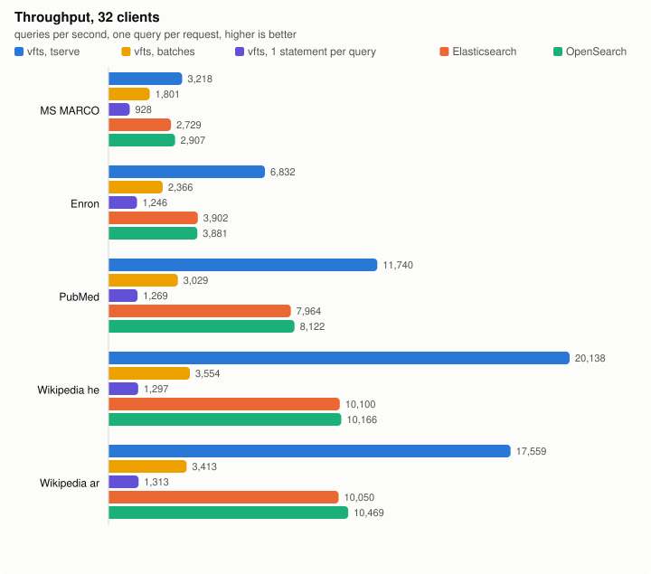
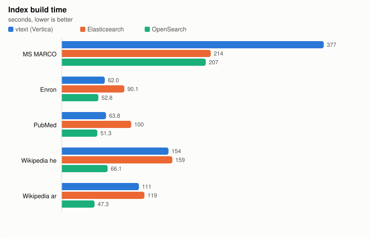

# vertica-text-udx (vtext)

Full-text search inside Vertica, as a C++ UDx library: BM25 ranking, boolean, phrase and
proximity search (with the e-discovery operators `w/N` and `pre/N`), prefix, wildcard and fuzzy
words, every language written with spaces between words (Arabic and Hebrew included), new and
changed rows searchable at once without a rebuild, snippets, and hybrid search with
[vvector](https://github.com/mogomo/vertica-vector-db).

    SELECT r.rank, d.doc_id, vtext.tsnippet(d.body, 'contract w/5 indemn*' USING PARAMETERS index='emails') AS snippet
    FROM (SELECT vtext.tsearch(* USING PARAMETERS index='emails', query='contract w/5 indemn*', k=10) OVER()
          FROM app.emails_live) r
    JOIN app.emails d USING (doc_id)
    ORDER BY r.rank;

Use cases it was built and measured for: legal e-discovery (Enron email), pharma literature search
(PubMed), support logs and general passage search (MS MARCO), Arabic and Hebrew text (Wikipedia).


## Full-text search in brief

`LIKE '%contract%'` finds a string. Full-text search finds *documents about* something:

- **Words, not strings.** Text is split into words (tokenized), normalized (case, accents, Unicode
  forms, Arabic letter variants, Hebrew points) and reduced to stems, so *Contracts*, *contract's*
  and *contracting* all match `contract`. Every language needs its own rules.
- **Ranking.** Thousands of documents match; the useful answer is the best ten. BM25 scores a
  document by how often it uses the query's words, how rare those words are, and how long the
  document is.
- **Structure in the query.** Phrases (`"mark to market"`), proximity (`fraud w/5 audit`),
  boolean logic, prefixes and wildcards (`indemn*`), typos (`holmse~`).
- **Speed at scale.** Reading every document per query is far too slow, so an *inverted index*
  maps each word to the documents that contain it, and top-k algorithms (MaxScore, block-max)
  skip documents that cannot reach the top ten.

The hard parts, for any engine: every language, exact and stable scores, fast top-k on millions of
documents, **new and changed rows searchable at once**, and **many users at the same time**.
Elasticsearch and OpenSearch solve them in a separate cluster; the price is a second copy of the
data, a pipeline that keeps it in sync, and a second security model. vtext solves them inside
Vertica.

## Why search inside Vertica

| | Search engine next to the database | vtext inside Vertica |
|---|---|---|
| Joins | none: copy every attribute into every document | search results are rows: `JOIN`, `GROUP BY`, window functions over any table |
| Changed attributes (owner, status, legal hold) | rewrite (and re-analyze) each affected document | `UPDATE` the attribute table; the text index is not touched |
| Consistency | eventually: searchable after a refresh, no transactions | ACID: a committed row is searchable at once (live view); a search sees one snapshot |
| Copies of the text | two (database + engine), plus a sync pipeline | one; the index is half to two thirds of the engines' size |
| Security, backup, operations | a second system for each | Vertica logins, grants and resource pools; backed up with the database |
| Many small searches at once | fast | as fast or faster through `tserve` ([Performance](#performance)); slower as one SQL statement each |

Honest limits: a search engine is the better tool when every query is a tiny single search sent
as its own request and nothing joins with it; and vtext does not yet apply row access policies of
the source table to the snap view ([Restrictions](#restrictions-and-future-work)).

<!-- toc -->
- [Full-text search in brief](#full-text-search-in-brief)
- [Why search inside Vertica](#why-search-inside-vertica)
- [What it does](#what-it-does)
- [How it was tested](#how-it-was-tested)
- [Quick start](#quick-start)
- [Languages](#languages)
- [No rebuild after new loads](#no-rebuild-after-new-loads)
- [Install](#install)
- [Prepare a table](#prepare-a-table)
- [Reference](#reference)
  - [Index management](#index-management): create_index, refresh_index, merge, rebuild, load_all, info, drop_index
  - [Search functions](#search-functions): tsearch, tcount, tmatch, tserve and vtext_broker, tsnippet, hybrid, tokenize, tversion
  - [Query syntax](#query-syntax)
- [Search patterns](#search-patterns)
- [Performance](#performance)
- [FAQ](#faq)
- [Restrictions and future work](#restrictions-and-future-work)
- [Files](#files)
- [License](#license)

## What it does

| | |
|---|---|
| Ranking | BM25 (k1 = 1.2, b = 0.75) with the formula and float arithmetic of Lucene: the scores of OpenSearch by default, of Elasticsearch with `bm25='classic'`; phrases, `w/N` and `pre/N` scored as Lucene's phrase and span queries. The benchmark compares the top 10 of every query with both engines ([Performance](#performance)) |
| Queries | words; `"exact phrases"`; `AND`, `OR`, `NOT`, `-word`, `+word`, `( )`; `"phrase"~N`; `a w/N b` (within N words, any order); `a pre/N b` (a before b, at most N words); `indemn*`; `te?t`; `holmse~`, `holmse~1` (Damerau-Levenshtein); or plain text (`syntax='plain'`) |
| Matching | `mode='stem'` (default: running, runs, run) or `mode='exact'`; one index serves both |
| Languages | every language written with spaces: ICU word boundaries, NFKC with case folding, accent folding, Snowball stemmers, Arabic/Persian normalization, Hebrew points and prefixes ([Languages](#languages)) |
| Freshness | inserts, updates and deletes are searchable at once (the live tail); `refresh_index` adds segments incrementally; a tiered merge keeps their number small ([No rebuild](#no-rebuild-after-new-loads)) |
| Scale | segments searched in parallel; global statistics, so scores do not depend on segments or nodes; Enterprise and Eon (also secondary subclusters) |
| Storage | the index is in Vertica tables (backed up with the database); every node keeps a memory-mapped copy |
| Many clients | `tserve` with `tools/vtext_broker`: an HTTP front end, each user's own Vertica sessions, searches over a channel instead of one statement each; with 32 clients 1.1 to 2.0 times the queries per second of Elasticsearch and OpenSearch on the benchmark ([tserve](#tserve-and-vtext_broker-many-clients)) |
| Extras | `tcount` (matches only), `tmatch` (every matching doc_id, for joins), `tsnippet` (marked fragments), `hybrid` (BM25 + vectors with Reciprocal Rank Fusion), `tokenize` |

## How it was tested

- **Engine unit tests** (`make test`, no Vertica): the analyzer per language group (Latin,
  Greek/Cyrillic/Armenian, Arabic, Hebrew, Indic, others) including the Sherlock Holmes
  punctuation cases; the segment format against a brute-force model (140,000 documents, several
  65,536-document chunks), with a byte-identical round trip through the table rows; 1,000 random
  queries (boolean, phrase, w/N, pre/N, exact and stem) against a brute-force search (written
  after Lucene's span classes for w/N and pre/N), on one segment and on three segments with
  tombstones and a live tail; the pruned top 10 against the full result; 1,000 fuzzy expansions
  against the edit distance of every term; merges (bit-identical scores before and after); the
  node cache; snippets.
- **SQL tests** (`tests/sql/*.sh`, on Vertica): results of every operator equal plain SQL over a
  table tokenized with the same analyzer; BM25 scores equal the formula computed in SQL (1e-4);
  freshness (inserts, updates with and without a new version, deletes: searched without refresh,
  after refreshes, merges and a rebuild, always equal to an index built from scratch; merged
  segments leave no rows behind); session defaults; every
  language group and the hand-written Arabic and Hebrew cases; snippets; hybrid fusion with known
  answers and with vvector; `tserve` and the broker (both modes) equal to `tsearch`, batches equal
  to single queries.
- **Systems**: Vertica 26.3.0-2 Enterprise (single node, Ubuntu 26.04, g++ 15.2, unfenced and
  fenced) and Vertica 26.3.0-2 Eon (5 nodes: a primary subcluster of 3 and a secondary of 2, RHEL
  8.10, g++ 8.5, fenced and unfenced). The same corpus and queries give identical ids, ranks and
  scores on 1 node, on 3 nodes and on the secondary subcluster (`tests/sql/digest.sql`). Multi-node
  Enterprise was not available for testing. Every hit and score of every benchmark query (k = 10
  and 100) and every count are the same before and after the speed changes of the engine.
- **Benchmark** against Elasticsearch 9.5.6 and OpenSearch 3.10.0 on the same machine with the
  same data and equivalent analyzers ([Performance](#performance)): the same matches and, for 97%
  of the MS MARCO queries and 133 of 140 syntax queries, the same top 10 with the same scores.
  MS MARCO relevance: MRR@10 0.1815 (vtext), 0.1815 (Elasticsearch), 0.1813 (OpenSearch).

## Quick start

On a Vertica node, with the `vsql` connection variables of dbadmin set ([Install](#install)):

    ./install.sh             # checks, builds, tests, deploys and verifies
    scripts/demo.sh          # every function on a small table, with explanations

By hand:

    CREATE TABLE app.docs (doc_id INT NOT NULL, body LONG VARCHAR, lang VARCHAR(8),
                           ver TIMESTAMPTZ NOT NULL DEFAULT CLOCK_TIMESTAMP());
    INSERT INTO app.docs (doc_id, body) VALUES (1, 'The indemnity clause of the supply contract.');
    INSERT INTO app.docs (doc_id, body) VALUES (2, 'Sherlock Holmes'' notes, Holmes-style.');
    COMMIT;
    CALL vtext.create_index('docs', 'app.docs', 'lang=en');
    SELECT * FROM (SELECT vtext.tsearch(* USING PARAMETERS index='docs', query='contract w/5 indemnity', k=10) OVER()
                   FROM app.docs_live) r;

## Languages

**Which languages work, and why.** Every language written with spaces between words works with
three generic steps, and no dictionary or thesaurus: ICU finds the words (Unicode word boundaries),
ICU normalizes them (NFKC, case folding, accents), and a rule-based stemmer reduces them to a stem.
BM25, phrases, proximity and fuzzy search need nothing more: only word positions, a few counts and
the list of distinct words.

| Group | Examples | Stemming |
|---|---|---|
| Latin script | English, Italian, French, Spanish, Portuguese, German, Dutch, Nordic languages, Polish, Czech, Romanian, Hungarian, Finnish, Estonian, Lithuanian, Turkish, Indonesian, Irish, Basque, Catalan, Esperanto, Sesotho | Snowball |
| Greek, Cyrillic, Armenian | Greek, Russian, Serbian, Ukrainian, Armenian | Snowball |
| Arabic script | Arabic, Persian | Snowball, after Arabic/Persian normalization (diacritics, tatweel, alef forms, ى, ة, ك/ک, ي/ی); Arabic also removes the prefixes ال وال بال كال فال لل و first |
| Hebrew script | Hebrew, Yiddish | Hebrew: points removed, light prefix stripping (up to two of ו ה ב כ ל מ ש while 3 letters remain); Yiddish: Snowball |
| Indic | Hindi, Nepali, Tamil | Snowball |
| Others with spaces | Georgian, Slovak, Croatian, Bulgarian, ... | none: exact words |

The Snowball stemmers linked in (libstemmer_c 3.2.0, `SELECT * FROM (SELECT vtext.tversion() OVER()) v;`):
arabic, armenian, basque, catalan, czech, danish, dutch, english, esperanto, estonian, finnish,
french, german, greek, hindi, hungarian, indonesian, irish, italian, lithuanian, nepali, norwegian,
persian, polish, portuguese, romanian, russian, serbian, sesotho, spanish, swedish, tamil, turkish,
ukrainian, yiddish.

A word that runs across scripts without a space (`lewisi.הכנסת`, `لبنان.McCrudden`, common in
Wikipedia) is cut where the script changes before the words are found, as Lucene's ICU tokenizer
does: `הכנסת` is found.

A document's language is its `lang` column (ISO 639-1), or the index language. Words in another
script are stemmed with that script's default: an English word inside a Hebrew document is
stemmed as English. Hebrew has no free stemmer; recall in Hebrew is good but below a full
morphological analyser. Hybrid search with vvector covers most of that gap.

**Excluded, and why.**

| Language | Reason |
|---|---|
| Chinese, Japanese | no spaces: words are found with a dictionary |
| Thai, Lao, Khmer, Myanmar | no spaces: words are found with a dictionary |
| Korean | spaces exist, but useful search needs a morphological analyser |

Text in these scripts raises a clear error. With the index option `on_unsupported=plain` it is
indexed as ICU splits it, without stemming.

**Stopwords** are never removed from the index (that would break exact phrases). A query can drop
them with `stopwords=true`.

## No rebuild after new loads

**Why no rebuild is needed.** vtext works the way Lucene does:

1. New rows go into small new index segments (`refresh_index`). Nothing indexed is rewritten.
2. Rows that are not indexed yet are searched directly at query time: the view `<index>_live`
   returns them, and `tsearch` analyzes them on the fly (the **live tail**). Results are always exact.
3. Deleted and replaced rows are hidden with a tombstone bitmap. An update is a delete plus an insert.
4. A background merge combines small segments and drops deleted documents.

The one thing vtext needs from the source table is a version column (`ver`, the time a row was
written) and, for deletes and for updates that keep `ver`, a journal table that records them.
BM25 statistics (number of documents, average length, document frequencies) are computed over all
segments, the live tail and all nodes, minus tombstones: scores do not depend on how rows are split
into segments or nodes.

## Install

**One command, for any Vertica database** (one node or many, Enterprise or Eon). On a Vertica
node, as a user that can read the repository, with the connection of a superuser:

    git clone <this repository> && cd vertica-text-udx
    export VSQL_USER=dbadmin VSQL_PASSWORD=... VSQL_DATABASE=...
    ./install.sh                 # or ./install.sh --fenced

`install.sh` checks the environment (connection, superuser, Vertica version, SDK, compiler, that
the session's node is this machine), builds the three static dependencies once and then vtext,
runs the engine tests, deploys the library, functions and procedures (copied to every node),
builds the tools, and runs every function on a test table to verify. It stops at the first
problem and says what to fix. `./install.sh --check` only checks; `./install.sh --uninstall
[--drop]` removes vtext. The steps below are what it does, for reference and for the parts that
come after the install (indexing, grants, Eon subclusters, the broker).

### 1. Check the environment

| Need | Check |
|---|---|
| Vertica 26.3 (tested: 26.3.0-2, Enterprise and Eon; 26.2 has the same SDK version, 26.2.0, but was not tested) | `SELECT version();` |
| The SDK of that version on the machine that builds (`/opt/vertica/sdk`, installed with the server) | `ls /opt/vertica/sdk/include/Vertica.h` |
| Linux x86-64 with g++ 8 or later, make, curl (tested: RHEL 8 with g++ 8.5, Ubuntu 26.04 with g++ 15.2) | `g++ --version` |
| A superuser (dbadmin) for the install (`CREATE LIBRARY`) | |
| Free disk on every node for the node caches (about the size of the index: half to two thirds of the text) | `df -h /tmp` |

Build on a Vertica node, or on a machine with the same Linux family and a glibc no newer than the
nodes' (the library links ICU, Snowball and CRoaring statically: nothing else is installed on the nodes).

### 2. Build and test

    git clone <this repository> && cd vertica-text-udx
    make deps        # downloads and builds ICU 79.1, libstemmer_c 3.2.0, CRoaring 5.5.5 (pinned checksums)
    make             # build/libvtext.so
    make test        # engine unit tests, no database needed
    make tools       # optional: build/tools/vtext_broker (many clients), vtext_cli, httpload

### 3. Deploy into the database

On a Vertica node (with the built `build/libvtext.so` and the repository's `sql/` directory):

    export VSQL_HOST=localhost VSQL_PORT=5433 VSQL_USER=dbadmin VSQL_PASSWORD=... VSQL_DATABASE=...
    make deploy                 # unfenced: fastest, runs inside the Vertica process
    make deploy FENCED=yes      # or fenced: a separate process per node, a crash cannot stop the node (slower)

`make deploy` (scripts/deploy.sh, sql/install.sql) creates the schema `vtext`, its tables, the
library, every function and procedure, and grants their use to PUBLIC. `CREATE LIBRARY` copies the
library to every node of the cluster, so this runs once per database. Nothing is stored in the
scripts: the connection comes from the `VSQL_*` variables.

### 4. Verify

    vsql -c "SELECT * FROM (SELECT vtext.tversion() OVER()) v;"   # version, build, ICU, stemmers
    scripts/examples.sh         # every function on a small table (the examples of the Reference)
    tests/sql/run_all.sh        # the SQL tests (create and drop their own schemas)

### 5. Index a table and let users search

1. [Prepare the table](#prepare-a-table): `doc_id`, the text, optionally `lang`, and a version column `ver`.
2. `CALL vtext.create_index('docs', 'app.docs', 'lang=en');` as dbadmin (or a user with write
   access to the `vtext` tables and the source table: procedures run with the caller's privileges).
3. Users who search need `USAGE` on the schema and `SELECT` on the views:
   `GRANT USAGE ON SCHEMA app TO analysts; GRANT SELECT ON app.docs_live, app.docs_snap TO analysts;`
   (Vertica checks the source table against the view's owner, the user who ran `create_index`: it
   must own the table or have `SELECT ... WITH GRANT OPTION` on it.) To show the text, they also
   need `SELECT` on the source table for the join.
4. Run `CALL vtext.refresh_index('docs');` on a schedule (a cron job or any scheduler): new rows
   are searchable at once anyway; refresh keeps the live tail short.

Where the node caches live: `/tmp/vtext` by default. Use a directory that survives a reboot for
production: the index option `cache_dir=/data/vtext` at `create_index` (it must exist on every node,
writable by the database's OS user). A lost cache is rebuilt from the index tables with `load_all`.

### 6. Several nodes, Eon and subclusters

- **Enterprise, several nodes**: nothing more; `create_index` and `refresh_index` load every node.
- **Eon**: run `create_index` and `refresh_index` on the primary subcluster; on each secondary
  subcluster, run `CALL vtext.load_all('docs');` from a session connected to it after each
  refresh (a node that is behind refuses to answer, with that message).
- **New node**: `CALL vtext.load_all('docs');`.

### 7. Many clients (optional): vtext_broker

For many small searches at once, run `build/tools/vtext_broker` on a node, as the database's OS
user, and send searches to it over HTTP ([tserve and vtext_broker](#tserve-and-vtext_broker-many-clients)):

    build/tools/vtext_broker --port 9300 --schema app --mode serve --param "mode='stem'" &
    curl -XPOST localhost:9300/docs/_search -u alice:secret -d '{"query": "contract w/5 indemn*"}'

It listens on 127.0.0.1 by default (`--bind` to change); each user's searches run in that user's
own Vertica sessions.

### Upgrade and uninstall

    git pull && make && make deploy      # replaces the library and functions; indexes and caches stay
    make undeploy                        # removes library and functions; index tables stay
    scripts/deploy.sh --undeploy --drop  # also drops the schema vtext with every index

An unfenced upgrade is safe while the database runs: the old library stays mapped for searches
still running.

## Prepare a table

**Source table contract.** One table, one text column:

    doc_id  INT           NOT NULL                        -- unique
    body    LONG VARCHAR                                   -- the text
    lang    VARCHAR(8)                                     -- optional; ISO 639-1; NULL = the index language
    ver     TIMESTAMPTZ   NOT NULL DEFAULT CLOCK_TIMESTAMP()   -- when the row was written

**Journal** (optional; needed for deletes and for updates that do not set `ver`):

    doc_id  INT
    op      CHAR(1)                                        -- 'I', 'U', 'D'
    ver     TIMESTAMPTZ   DEFAULT CLOCK_TIMESTAMP()

Rules:

- Use `TIMESTAMPTZ` and `CLOCK_TIMESTAMP()`: the clock at write time. (`NOW()` is the transaction
  start and is not suitable; plain `TIMESTAMP` depends on the session time zone.)
- An update either sets `ver = CLOCK_TIMESTAMP()` or writes a journal row `'U'`. A delete writes
  a journal row `'D'`.
- Columns with other names are mapped with the options `id_col`, `text_col`, `lang_col`, `ver_col`.
- For tables with a high write rate, partition the source table by `(ver AT TIME ZONE 'UTC')::DATE`
  so the live tail reads only the newest storage containers (docs/VERTICA_NOTES.md).

Ready to run:

    CREATE SCHEMA app;
    CREATE TABLE app.emails (doc_id INT NOT NULL, body LONG VARCHAR, lang VARCHAR(8),
                             ver TIMESTAMPTZ NOT NULL DEFAULT CLOCK_TIMESTAMP());
    CREATE TABLE app.emails_journal (doc_id INT, op CHAR(1), ver TIMESTAMPTZ DEFAULT CLOCK_TIMESTAMP());
    -- load: COPY app.emails (doc_id, body, lang) FROM ... ;
    CALL vtext.create_index('emails', 'app.emails', 'lang=en journal=app.emails_journal');

    -- later: changes
    UPDATE app.emails SET body = '...', ver = CLOCK_TIMESTAMP() WHERE doc_id = 42;
    DELETE FROM app.emails WHERE doc_id = 43; INSERT INTO app.emails_journal (doc_id, op) VALUES (43, 'D');
    COMMIT;
    -- searchable now through app.emails_live; folded into the index with:
    CALL vtext.refresh_index('emails');

## Reference

Every object lives in schema `vtext`. Procedures manage indexes (`CALL vtext.x(...)`); functions
search (`SELECT ...`). Short examples use the demo table `demo.cases` of `scripts/demo.sh`; every
function also has a full example with its real output in
[Examples: every function](#examples-every-function-with-its-output) (`scripts/examples.sh`).

### Index management

#### create_index

[Full example with output](#example-create_index)

Registers a source table as an index, creates the views `<schema>.<index>_live` and
`<index>_snap` in the table's schema, builds the index from every row and loads it on every node of
the session's subcluster.

    CALL vtext.create_index(index, source_table [, options]);

| Argument | Meaning |
|---|---|
| index | 1 to 64 letters, digits or underscores; unique |
| source_table | `schema.table` ([Prepare a table](#prepare-a-table)) |
| options | space or comma separated `key=value` pairs, all optional (below) |

| Option | Default | Meaning |
|---|---|---|
| lang | en | index language (ISO 639-1): documents without a `lang` value, and the stemmer of Latin words |
| journal | none | `schema.table` with columns doc_id, op, ver |
| margin | 60 | seconds the boundary stays behind a refresh (clock differences between nodes; 0 is fine on one node) |
| accent_fold | latin | `latin` (remove accents of Latin letters), `none`, `all` (also Greek and Cyrillic) |
| on_unsupported | error | `error` or `plain` for Chinese, Japanese, Korean, Thai, Lao, Khmer, Myanmar text |
| id_col, text_col, lang_col, ver_col | doc_id, body, lang, ver | column names in the source table |
| threads | 0 | build threads per instance (0: a quarter of the cores) |
| max_segment_mb | 2048 | a build thread starts a new segment above this memory |
| merge_factor | 10 | segments per tier of the merge policy |
| cache_dir | /tmp/vtext | directory of the node caches |
| build | true | `false`: register and create the views only |

    CALL vtext.create_index('cases', 'demo.cases', 'lang=en journal=demo.cases_journal margin=0');

#### refresh_index

[Full example with output](#example-refresh_index-a-new-row-is-found-at-once-through-the-live-view-after-refresh_index-through-snap)

Indexes the rows written since the last refresh into new segments, tombstones their older versions
and the journal's deletes, loads every node, and moves the views' boundary. Incremental; the table
changes are one transaction. Then runs the tiered merge policy. (The name `refresh` is a Vertica
built-in function and cannot be a procedure.)

    CALL vtext.refresh_index(index);

When to run it: whenever convenient - every minute, every hour. Searches are exact without it; a
longer live tail only costs query time (every tail row is analyzed per query).

#### merge

[Full example with output](#example-merge-into-one-segment)

Merges segments into one, dropping deleted documents. Searches keep working on the previous
generation while it runs.

    CALL vtext.merge(index);                -- the tiered policy (also run by refresh_index)
    CALL vtext.merge(index, max_segments);  -- merge the smallest segments until at most max_segments remain

Fewer segments use less CPU per query; more segments are searched in parallel (lower latency for
one query at a time). The benchmark shows both ([Performance](#performance)).

#### rebuild

[Full example with output](#example-rebuild-recovery-only)

For recovery only: indexes every row again as new segments and drops the old ones.

    CALL vtext.rebuild(index);

#### load_all

[Full example with output](#example-load_all-write-missing-node-caches-from-the-index-tables)

Writes the node cache of every node of the session's subcluster from the index tables: for a new
node, a secondary subcluster (Eon), or a damaged cache directory. Segments a node has already are
not written again.

    CALL vtext.load_all(index);

On Eon, every subcluster keeps its own caches: run `load_all` from a session on each secondary
subcluster after a refresh on the primary. A node whose cache is behind refuses to answer:
`cache of index cases is stale on this node (generation 3, the view needs 4): run CALL vtext.load_all('cases')`.

#### info

[Full example with output](#example-info)

Segments, documents, the live tail, the last refresh and the caches of the subcluster, as notices.

    CALL vtext.info(index);

Per node: `SELECT * FROM (SELECT vtext.tinfo(USING PARAMETERS index='cases') OVER(PARTITION NODES) FROM vtext.probe) i;`
Tables to read: `vtext.indexes` (the manifest), `vtext.segments`, `vtext.index_stats`.

#### drop_index

[Full example with output](#example-drop_index)

Removes the index: its rows (partitions), the views and the node caches of the subcluster.

    CALL vtext.drop_index(index);

#### The views _live and _snap

`create_index` makes two views in the schema of the source table; they are the input of `tsearch`
and `tcount` (call the functions with `*`):

| View | Rows | Use |
|---|---|---|
| `<index>_live` | the live tail (rows written after the boundary of the last refresh, journal changes) and one sentinel row | always exact: sees every committed change |
| `<index>_snap` | the sentinel row only | the segments only: ignores changes since the last refresh |

Both have the columns `(qid, query, doc_id, body, lang, op, gen)`. The sentinel carries the
generation, so a node with an old cache fails instead of answering from it. Grant SELECT on the
views (and the source table) to the users who search.

### Search functions

#### tsearch

[Full example with output](#example-tsearch-ranked-search-joined-to-the-source-table)

The k best documents of a query, by BM25.

    SELECT vtext.tsearch(* USING PARAMETERS index='name', query='...' [, parameter=value ...]) OVER()
    FROM <schema>.<index>_live;

Output: `(qid, doc_id, score, rank)`; rank 1 is the best; ties by doc_id. Join to the source
table with `USING (doc_id)`.

| Parameter | Default | Meaning |
|---|---|---|
| index | (required) | the index |
| query | | the query ([Query syntax](#query-syntax)); or query rows (below) |
| k | 10 | hits per query, 1 to 1,000,000 |
| mode | stem | `stem`: words match their stem group (running, runs, run); `exact`: the word only. `"match"` (quoted: MATCH is reserved in Vertica) works too |
| syntax | query | `plain`: no operators, every word is an OR clause (like a match query of Elasticsearch) |
| operator | or | the implicit operator between words: `or` or `and` |
| lang | the index language | language of the query (stemming) |
| stopwords | false | drop the query language's stopwords |
| max_expansions | 50 | prefix, wildcard and fuzzy words expand to at most this many terms (the most frequent first; fuzzy: fewest edits first) |
| prefix_length | 0 | fuzzy: leading letters that must match exactly |
| queries | | many queries in one statement: one per line, `qid<TAB>query` (or the query alone: qid = line number) |
| bm25 | lucene | `lucene`: the scores of Lucene and OpenSearch; `classic`: times (1 + k1), the scores of Elasticsearch (its LegacyBM25 scale) |
| threads | 0 | threads for this query (0: one per core). A large segment is cut into slices of documents, so one query can use every core; while many queries run, each gets its share |
| cache_dir | /tmp/vtext | node cache directory (or the session parameter) |

Many queries in one statement (a batch saves the per-statement cost of Vertica, about 2 ms): the
parameter `queries`, one query per line,

    SELECT qid, rank, doc_id FROM (SELECT vtext.tsearch(* USING PARAMETERS index='cases', k=3,
                                   queries=E'1\tindemnity\n2\tholmes') OVER() FROM demo.cases_live) r
    ORDER BY qid, rank;

or query rows `(qid, query)` added to the view's rows:

    SELECT * FROM (SELECT vtext.tsearch(* USING PARAMETERS index='cases', k=3) OVER()
                   FROM (SELECT * FROM demo.cases_live
                         UNION ALL SELECT 1, 'indemnity', NULL, NULL, NULL, NULL, NULL
                         UNION ALL SELECT 2, 'holmes', NULL, NULL, NULL, NULL, NULL) i) r
    ORDER BY qid, rank;

Session defaults: `ALTER SESSION SET UDPARAMETER FOR vtext.vtext mode = 'exact';` (any parameter except
index and query).

#### tcount

[Full example with output](#example-tcount)

The number of matching documents (no scoring).

    SELECT vtext.tcount(* USING PARAMETERS index='name', query='...' [, mode, syntax, operator, lang, ...]) OVER()
    FROM <schema>.<index>_live;

Output: `(qid, count)`.

#### tmatch

[Full example with output](#example-tmatch-every-match-without-scores-for-joins-and-group-by-over-all-matches)

Every matching document, without scores and in no order: the input for joins and `GROUP BY` over
all matches (a report of matches per owner, per month).

    SELECT vtext.tmatch(* USING PARAMETERS index='name', query='...' [, mode, syntax, operator, lang, ...]) OVER()
    FROM <schema>.<index>_live;

Output: `(qid, doc_id)`. Same parameters as `tcount`.

#### tserve and vtext_broker: many clients

[Full example with output](#example-tserve-through-vtext_broker-mode-serve-http-in-the-users-own-vertica-session-one-tserve-statement)

Every SQL statement costs Vertica about 2 ms of parsing, planning and executor set-up before vtext
runs, and statements that call a UDx peak at about 2,000 per second on the test machine however
many sessions send them. For many small searches at once there are two front ends in
`tools/vtext_broker` (`make tools`), an HTTP service that a search application calls instead of
sending SQL itself:

    build/tools/vtext_broker --port 9300 --schema bench --mode serve [--param "mode='stem'" ...]
    curl -XPOST localhost:9300/enron/_search -u alice:secret -d '{"query": "fraud AND (audit OR sec)"}'
    # {"hits": [{"id": 134348, "score": 5.11062765}, ...]}

- **Every user has their own Vertica sessions.** The broker logs in with the credentials of the
  request (HTTP Basic; without them, the `VSQL_*` environment). Vertica checks the password, the
  grants on the view and the user's resource pool, and records the statements under that user.
- `--mode sql`: a request goes out at once as a `tsearch` statement when one of the user's
  sessions (`--sessions`, default 4) is idle; while all are busy, requests wait, and the next free
  session sends all of them (up to `--max-batch`) in one statement (parameter `queries`). No fixed
  wait. Each statement is labeled `vtext_broker`.
- `--mode serve`: each session (`--channels`, default 1) runs one long statement,

      SELECT vtext.tserve(* USING PARAMETERS index='enron', endpoint='/tmp/vtext_broker.9300.sock',
                          token='<made by the broker>', k=10, ...) OVER() FROM bench.enron_snap;

  which connects to the broker's Unix socket (mode 0600) with a token made for that statement only,
  and answers searches until the broker closes it or the statement is canceled. A search is then no
  statement of its own. `tserve` takes the parameters of `tsearch` plus `workers` (search threads,
  default one per core; each search uses one). It reads the view when it starts, so it answers from
  that snapshot: the broker starts a new statement when one ends; restart it after a refresh. It
  accepts only an endpoint named `vtext_broker.<name>.sock`.

Both modes give the same hits and scores as `tsearch` (tests/sql/test_serve.sh). Searches through
`tserve` are not rows of `query_requests`: Vertica records the session and the `tserve` statement,
not each search. A `tserve` statement holds one slot (and its memory) of the user's resource pool
while it runs, and its search threads are vtext's own, outside the pool's CPU accounting, like
the threads of `tsearch`. Run the broker on a node of the database, as the database's OS user,
with its sessions connected to that node (the Unix socket is local); tested on one Enterprise node
and on a 3-node Eon subcluster (fenced). [Performance](#performance) has the numbers of both modes.

#### tsnippet

[Full example with output](#example-tsnippet)

The parts of a text that match a query, with the matching words marked. A scalar function: pass
the text (joined from the source table) and the query.

    vtext.tsnippet(body, query [, lang] USING PARAMETERS index='name' [, mode, words, fragments, pre_tag, post_tag, separator])

| Parameter | Default | Meaning |
|---|---|---|
| index | | use that index's analyzer settings (recommended); without it: `lang`, `accent_fold` |
| words | 20 | words per fragment |
| fragments | 2 | fragments at most (the best ones, in text order) |
| pre_tag, post_tag | `<b>`, `</b>` | marks around a hit |
| separator | ` ... ` | between fragments |

Hits are the words that match a word, stem, prefix, wildcard or fuzzy word of the query (not those
under NOT). Call it for the top hits only: it analyzes the text again.

#### hybrid

[Full example with output](#example-hybrid-two-ranked-lists-fused-with-reciprocal-rank-fusion)

Fuses ranked lists by doc_id: BM25 from `tsearch` and vectors from vvector's `vsearch`.

    SELECT vtext.hybrid(source, doc_id, rank, score USING PARAMETERS [k, method, rrf_k, weights, distance]) OVER()
    FROM (<list 1> UNION ALL <list 2> ...) u;

| Parameter | Default | Meaning |
|---|---|---|
| method | rrf | `rrf`: score = sum of w / (rrf_k + rank); `weighted`: sum of w * min-max normalized score |
| k | 10 | results |
| rrf_k | 60 | the constant of Reciprocal Rank Fusion |
| weights | 1 each | `'text=0.7,vector=0.3'` |
| distance | | sources whose score is a distance (smaller is better), for `weighted` |

Output: `(doc_id, score, rank, sources)`; sources shows the rank in each list (`text:2 vector:1`).
Embeddings are computed outside Vertica; vtext includes no model.

#### tokenize

[Full example with output](#example-tokenize-what-the-analyzer-sees)

What the analyzer makes of a text: one row per word.

    SELECT vtext.tokenize(text [, lang] [USING PARAMETERS lang, accent_fold, on_unsupported]) OVER() ...;
    SELECT doc_id, vtext.tokenize(body, lang) FROM t;      -- beside other columns

Output: `(pos, term, stem, lang, start_byte, end_byte)`.

#### tversion

[Full example with output](#example-tversion)

    SELECT vtext.tversion() OVER();

Output: library version, build flags, ICU version, the Snowball stemmers linked in.

### Examples: every function, with its output

Run by `scripts/examples.sh` on a table of its own (schema `ex`); the outputs are copied from that run
(Vertica 26.3, one node). Each block is the statement, then what vsql printed.

#### Example: the source table

```sql
CREATE SCHEMA ex;
CREATE TABLE ex.notes (doc_id INT NOT NULL, body LONG VARCHAR, lang VARCHAR(8),
                       ver TIMESTAMPTZ NOT NULL DEFAULT CLOCK_TIMESTAMP());
CREATE TABLE ex.notes_journal (doc_id INT, op CHAR(1), ver TIMESTAMPTZ DEFAULT CLOCK_TIMESTAMP());
CREATE TABLE ex.owners (doc_id INT, owner VARCHAR(20));
INSERT INTO ex.notes (doc_id, body) VALUES (1, 'The supplier shall indemnify the buyer under this contract.');
INSERT INTO ex.notes (doc_id, body) VALUES (2, 'Contract renewal: indemnity terms unchanged, payment within 30 days.');
INSERT INTO ex.notes (doc_id, body) VALUES (3, 'Meeting notes: mark to market accounting for the energy contracts.');
INSERT INTO ex.notes (doc_id, body) VALUES (4, 'Holmes'' notes on the Baskerville case.');
INSERT INTO ex.notes (doc_id, body, lang) VALUES (5, 'Le contrat prévoit une indemnité.', 'fr');
INSERT INTO ex.owners VALUES (1, 'legal'); INSERT INTO ex.owners VALUES (2, 'sales');
INSERT INTO ex.owners VALUES (3, 'trading'); INSERT INTO ex.owners VALUES (4, 'legal'); INSERT INTO ex.owners VALUES (5, 'legal');
COMMIT;
   COMMIT
```

#### Example: create_index

```sql
CALL vtext.create_index('notes', 'ex.notes', 'lang=en journal=ex.notes_journal margin=0');
   NOTICE 2005:  vtext: index notes created on ex.notes. Search: SELECT * FROM (SELECT vtext.tsearch(* USING PARAMETERS index='notes', query='...', k=10) OVER() FROM ex.notes_live) r;
    create_index 
   --------------
               0
   (1 row)
```

#### Example: info

```sql
CALL vtext.info('notes');
   NOTICE 2005:  index notes: source ex.notes, generation 1, 1 segments, 5 documents (0 deleted), 0.0 MB
   NOTICE 2005:  boundary TIMESTAMPTZ '2026-11-21 18:18:04.487319+00'; live tail 0 rows (ex.notes_live); last refresh: full build: 5 rows into 1 segments, 0 tombstones, 0 journal rows
   NOTICE 2005:  node caches: 1 of 1 nodes of this subcluster have generation 1 (details: SELECT * FROM (SELECT vtext.tinfo(USING PARAMETERS index='notes') OVER(PARTITION NODES) FROM vtext.probe) i;)
    info 
   ------
       0
   (1 row)
```

#### Example: tsearch: ranked search, joined to the source table

```sql
SELECT r.rank, r.doc_id, ROUND(r.score, 4) AS score, n.body
FROM (SELECT vtext.tsearch(* USING PARAMETERS index='notes', query='contract AND indemn*', k=10) OVER()
      FROM ex.notes_live) r
JOIN ex.notes n USING (doc_id)
ORDER BY r.rank;
    rank | doc_id | score  |                                 body                                 
   ------+--------+--------+----------------------------------------------------------------------
       1 |      1 | 1.2305 | The supplier shall indemnify the buyer under this contract.
       2 |      2 | 1.2305 | Contract renewal: indemnity terms unchanged, payment within 30 days.
   (2 rows)
```

#### Example: tsearch: proximity and a join with another table, aggregated

```sql
SELECT o.owner, COUNT(*) AS hits
FROM (SELECT vtext.tsearch(* USING PARAMETERS index='notes', query='contract w/5 (indemnify OR indemnity OR market)', k=1000) OVER()
      FROM ex.notes_live) r
JOIN ex.owners o USING (doc_id)
GROUP BY o.owner ORDER BY hits DESC, o.owner;
     owner  | hits 
   ---------+------
    legal   |    1
    sales   |    1
    trading |    1
   (3 rows)
```

#### Example: tsearch: a batch of queries in one statement (parameter queries)

```sql
SELECT qid, rank, doc_id FROM (SELECT vtext.tsearch(* USING PARAMETERS index='notes', k=2,
       queries=E'1\tholmes\n2\t"mark to market"\n3\tcontrat') OVER() FROM ex.notes_snap) r
ORDER BY qid, rank;
    qid | rank | doc_id 
   -----+------+--------
      1 |    1 |      4
      2 |    1 |      3
      3 |    1 |      5
   (3 rows)
```

#### Example: tcount

```sql
SELECT * FROM (SELECT vtext.tcount(* USING PARAMETERS index='notes', query='contract') OVER() FROM ex.notes_live) c;
    qid | count 
   -----+-------
      0 |     3
   (1 row)
```

#### Example: tmatch: every match without scores, for joins and GROUP BY over all matches

```sql
SELECT o.owner, COUNT(*) AS documents
FROM (SELECT vtext.tmatch(* USING PARAMETERS index='notes', query='contract*') OVER() FROM ex.notes_live) m
JOIN ex.owners o USING (doc_id)
GROUP BY o.owner ORDER BY o.owner;
     owner  | documents 
   ---------+-----------
    legal   |         1
    sales   |         1
    trading |         1
   (3 rows)
```

#### Example: tsnippet

```sql
SELECT doc_id, vtext.tsnippet(body, 'indemnity contract' USING PARAMETERS index='notes', words=8) AS snippet
FROM ex.notes WHERE doc_id IN (1, 2) ORDER BY doc_id;
    doc_id |                                     snippet                                      
   --------+----------------------------------------------------------------------------------
         1 | ... supplier shall indemnify the buyer under this <b>contract</b>.
         2 | <b>Contract</b> renewal: <b>indemnity</b> terms unchanged, payment within 30 ...
   (2 rows)
```

#### Example: refresh_index: a new row is found at once through the live view, after refresh_index through snap

```sql
INSERT INTO ex.notes (doc_id, body) VALUES (6, 'Draft contract with an indemnity cap.'); COMMIT;
   COMMIT
SELECT 'live' AS view, doc_id FROM (SELECT vtext.tsearch(* USING PARAMETERS index='notes', query='cap') OVER() FROM ex.notes_live) r
UNION ALL
SELECT 'snap', doc_id FROM (SELECT vtext.tsearch(* USING PARAMETERS index='notes', query='cap') OVER() FROM ex.notes_snap) r;
    view | doc_id 
   ------+--------
    live |      6
   (1 row)
CALL vtext.refresh_index('notes');
   NOTICE 2005:  vtext: index notes generation 2: incremental: 1 rows into 1 segments, 0 tombstones, 0 journal rows (0.3 s)
    refresh_index 
   ---------------
                0
   (1 row)
SELECT 'snap' AS view, doc_id FROM (SELECT vtext.tsearch(* USING PARAMETERS index='notes', query='cap') OVER() FROM ex.notes_snap) r;
    view | doc_id 
   ------+--------
    snap |      6
   (1 row)
```

#### Example: merge into one segment

```sql
CALL vtext.merge('notes', 1);
   NOTICE 2005:  vtext: index notes merged in 1 steps (0.3 s); 1 segments now
    merge 
   -------
        0
   (1 row)
CALL vtext.info('notes');
   NOTICE 2005:  index notes: source ex.notes, generation 3, 1 segments, 6 documents (0 deleted), 0.0 MB
   NOTICE 2005:  boundary TIMESTAMPTZ '2026-11-21 18:18:05.071819+00'; live tail 0 rows (ex.notes_live); last refresh: incremental: 1 rows into 1 segments, 0 tombstones, 0 journal rows
   NOTICE 2005:  node caches: 1 of 1 nodes of this subcluster have generation 3 (details: SELECT * FROM (SELECT vtext.tinfo(USING PARAMETERS index='notes') OVER(PARTITION NODES) FROM vtext.probe) i;)
    info 
   ------
       0
   (1 row)
SELECT s.gen, s.n_segments, s.n_docs FROM vtext.index_stats s JOIN vtext.indexes i USING (index_id)
WHERE i.index_name = 'notes' ORDER BY s.gen DESC LIMIT 1;
    gen | n_segments | n_docs 
   -----+------------+--------
      3 |          1 |      6
   (1 row)
```

#### Example: tinfo: the cache of every node

```sql
SELECT * FROM (SELECT vtext.tinfo(USING PARAMETERS index='notes') OVER(PARTITION NODES) FROM vtext.probe) i;
      node_name    | gen | segments | docs | deleted | bytes | problem 
   ----------------+-----+----------+------+---------+-------+---------
    v_vdb_node0001 |   3 |        1 |    6 |       0 |  5288 | 
   (1 row)
```

#### Example: load_all: write missing node caches from the index tables

```sql
CALL vtext.load_all('notes');
   NOTICE 2005:  vtext: index notes generation 3 (1 segments) loaded on the nodes of this subcluster in 0.100000000000000 s
    load_all 
   ----------
           0
   (1 row)
```

#### Example: rebuild (recovery only)

```sql
CALL vtext.rebuild('notes');
    rebuild 
   ---------
          0
   (1 row)
```

#### Example: tokenize: what the analyzer sees

```sql
SELECT pos, term, stem, lang FROM (SELECT vtext.tokenize('Holmes'' contracts, Holmes-style' USING PARAMETERS lang='en') OVER()) t ORDER BY pos;
    pos |   term    |   stem   | lang 
   -----+-----------+----------+------
      0 | holmes    | holm     | en
      1 | contracts | contract | en
      2 | holmes    | holm     | en
      3 | style     | style    | en
   (4 rows)
```

#### Example: hybrid: two ranked lists fused with Reciprocal Rank Fusion

```sql
SELECT h.rank, h.doc_id, ROUND(h.score, 5) AS score, h.sources
FROM (SELECT vtext.hybrid(src, doc_id, rank, score USING PARAMETERS k=3) OVER() FROM (
        SELECT 'text' AS src, doc_id, rank, score
        FROM (SELECT vtext.tsearch(* USING PARAMETERS index='notes', query='indemnity contract', k=10) OVER() FROM ex.notes_live) t
        UNION ALL
        SELECT 'vector', 3, 1, 0.91 UNION ALL SELECT 'vector', 2, 2, 0.88 UNION ALL SELECT 'vector', 6, 3, 0.80) u) h
ORDER BY h.rank;
    rank | doc_id |  score  |     sources     
   ------+--------+---------+-----------------
       1 |      6 | 0.03227 | text:1 vector:3
       2 |      2 | 0.03226 | text:2 vector:2
       3 |      3 | 0.03202 | text:4 vector:1
   (3 rows)
```

#### Example: tversion

```sql
SELECT version, build, icu FROM (SELECT vtext.tversion() OVER()) v;
    version |                       build                        | icu  
   ---------+----------------------------------------------------+------
    0.1.0   | -O3 -ffp-contract=off -std=c++17 x86_64 g++-15.2.0 | 79.1
   (1 row)
```

#### Example: tserve through vtext_broker (mode serve): HTTP in, the user's own Vertica session, one tserve statement

```
build/tools/vtext_broker --port 9399 --schema ex --mode serve &
curl -s -XPOST localhost:9399/notes/_search -d '{"query": "contract AND indemn*"}'
   {"hits": [{"id": 6, "score": 1.21872902}, {"id": 1, "score": 1.18564403}, {"id": 2, "score": 1.18564403}]}
```

#### Example: drop_index

```sql
CALL vtext.drop_index('notes');
   NOTICE 2005:  vtext: index notes dropped (caches removed on 1 nodes of this subcluster)
    drop_index 
   ------------
             0
   (1 row)
```

### Query syntax

| Syntax | Meaning | Example |
|---|---|---|
| `word` | one word, analyzed like the documents | `holmes` finds Holmes, Holmes', Holmes-style |
| `"words"` | phrase: adjacent words in order | `"indemnity clause"` |
| `"words"~N` | sloppy phrase (Lucene): within N moves; reversing two words costs 2 | `"contract supply"~2` finds "supply contract" |
| `a AND b`, `a && b` | both | `contract AND indemnity` |
| `a OR b`, `a \|\| b` | either | `fraud OR scandal` |
| `a NOT b`, `a AND NOT b`, `-b` | without | `contract NOT indemnify`, `contract -indemnify` |
| `+a` | required (with other words optional) | `+contract indemnity` |
| `( )` | grouping | `(fraud OR scandal) AND audit*` |
| `a b` | implicit operator: OR (`operator='and'` for AND) | `contract indemnity` |
| `a w/N b` | within N words, any order (adjacent = 1) | `contract w/5 indemnity` |
| `a pre/N b` | a before b by at most N words | `seller pre/3 indemnify` |
| `word*` | prefix | `indemn*` |
| `te?t`, `*tract` | wildcard: `?` one letter, `*` any | `contr?ct` |
| `word~`, `word~1` | fuzzy: at most 2 (or 1) edits, Damerau-Levenshtein | `holmse~1` |
| `\x` | the next character literally | `\AND` (the word "and") |

- Precedence, lowest first: implicit operator, OR, AND / NOT, unary (+ - NOT), w/N and pre/N.
- Operands of w/N and pre/N: words, phrases, prefix/wildcard/fuzzy words, OR groups of them, and
  other w/N or pre/N: `(contract OR agreement) w/5 indemn*`, `a w/3 b w/2 c`.
- A word that the analyzer splits (`Holmes-style`, `e-mail`) becomes a phrase.
- `AND`, `OR`, `NOT` are operators in upper case only. A Hebrew acronym in a query: write it with
  gershayim `צה״ל` or escape the quote `צה\"ל` (a plain `"` starts a phrase).
- Scores: words and stem groups BM25; phrases as Lucene's phrase queries (the sum of the words'
  idf; the number of matches, or for a sloppy phrase 1 / (1 + distance) per match); `w/N` and
  `pre/N` as Lucene's span queries (`span_near` with slop N - 1, in order for `pre/N`): the sum of
  the idf of their distinct words (every expansion of a prefix, wildcard or fuzzy word included),
  and 1 / (1 + width) per match (width: the gaps for `pre/N`, the length of the match for `w/N`),
  matches enumerated as Lucene does; prefix and wildcard words a
  constant 1 (as Elasticsearch's constant-score rewrite); fuzzy words like a stem group of the
  terms they match.

## Search patterns

**Join the hits to the table** (the function returns ids and scores; the text stays in your table):

    SELECT r.rank, d.doc_id, LEFT(d.body, 80) AS body, r.score
    FROM (SELECT vtext.tsearch(* USING PARAMETERS index='emails', query='contract w/5 indemnity', k=20) OVER()
          FROM app.emails_live) r
    JOIN app.emails d USING (doc_id)
    ORDER BY r.rank;

**Filter by other columns.** Search with a larger k, then filter in SQL; or count first:

    SELECT r.doc_id, r.score FROM (SELECT vtext.tsearch(* USING PARAMETERS index='emails', query='fraud', k=1000) OVER()
                                   FROM app.emails_live) r
    JOIN app.emails d USING (doc_id) WHERE d.sent > '2001-06-01' ORDER BY r.score DESC LIMIT 10;

**E-discovery review set**: every matching document, no ranking needed (`tcount` for the size,
`tsearch` with a large k for the ids):

    SELECT * FROM (SELECT vtext.tcount(* USING PARAMETERS index='emails',
                   query='(shred* OR destroy*) w/5 document* AND NOT newsletter') OVER() FROM app.emails_live) c;

**A search box** (users type words, not syntax): `syntax='plain'`, optionally `operator='and'`:

    SELECT * FROM (SELECT vtext.tsearch(* USING PARAMETERS index='kb', query='how do I reset my password?',
                   syntax='plain', k=10) OVER() FROM app.kb_live) r;

**Several languages in one table**: give each row its `lang`; give the query its `lang`:

    SELECT * FROM (SELECT vtext.tsearch(* USING PARAMETERS index='news', query='الكتاب', lang='ar', k=10) OVER()
                   FROM app.news_live) r;

**Hybrid: BM25 + vectors** (vvector index `kb_vec` on the same ids):

    SELECT h.rank, h.doc_id, h.sources
    FROM (SELECT vtext.hybrid(src, doc_id, rank, score USING PARAMETERS k=10) OVER() FROM (
            SELECT 'text' AS src, doc_id, rank, score FROM (SELECT vtext.tsearch(* USING PARAMETERS index='kb',
                   query='reset password', syntax='plain', k=50) OVER() FROM app.kb_live) t
            UNION ALL
            SELECT 'vector', id, rank, score FROM (SELECT vvector.vsearch(qid, qvec, id, vec, del, ver, snapshot_id
                   USING PARAMETERS index_name='kb_vec', query='[0.12, -0.03, ...]', k=50) OVER() FROM app.kb_vec_snap) v) u) h
    ORDER BY h.rank;

## Performance

vtext against Elasticsearch 9.5.6 and OpenSearch 3.10.0, on one machine, with the same documents,
equivalent analyzers and the same queries. Every number below is in `bench/results/` (the full
tables: [bench/results/summary.md](bench/results/summary.md)), and one script runs it all again
([Run the benchmark yourself](#run-the-benchmark-yourself)).

**In short.**

- **Throughput, 32 clients, one query per request** (the same native HTTP load generator for all
  three, median of 3 rounds in alternating order): with `tserve` through `vtext_broker`, vtext
  serves 1.1 to 2.0 times the queries per second of the faster of Elasticsearch and OpenSearch on
  every collection: Enron 5,785 against 3,902; PubMed 9,891 against 8,122; MS MARCO 3,227 against
  2,907; Hebrew Wikipedia 20,526 against 10,166; Arabic Wikipedia 17,588 against 10,469.
- **One SQL statement per query** is the slow way to send many small searches: 934 to 1,327
  queries per second, a third to an eighth of the engines. Any statement that calls a UDx peaks at
  about 2,000 per second on this machine (`SELECT 1`: 6,000), whatever vtext does inside. Batches
  of whatever is waiting (`--mode sql`) reach 1,812 to 3,607.
- **Latency, one client** through the same HTTP client: vtext `tserve` is faster on four of five
  collections (Hebrew Wikipedia 0.55 ms against 1.06 to 1.09; Enron 2.12 against 2.40 and 2.75;
  MS MARCO 2.94 against 3.60 and 3.95); OpenSearch is faster on PubMed (1.07 against 1.19 ms).
  As one SQL statement per query, vtext takes about 3 ms on the small collections.
- **Same answers.** The engines and vtext return the same matches (counts equal for 139 of 140
  syntax queries) and, query by query, the same top 10 with the same scores: 97% of the 6,980
  MS MARCO queries and 133 of 140 syntax queries have identical scores at every rank. Relevance on
  MS MARCO: MRR@10 0.1815 (vtext), 0.1815 (Elasticsearch), 0.1813 (OpenSearch).
- **Search next to other data** (Enron, an attribute per document): adding it to all 517,401
  documents takes 0.028 s in Vertica against 223 s and 228 s; changing it for 1% takes 0.015 s
  against 2.8 s and 8.9 s. Filtering or counting matches by it is faster in the engines (1 to 3 ms
  against 17 to 18 ms).
- **Proximity**: `w/N` over OR groups is where vtext is fastest; `california w/5 (energy OR power OR
  electricity)` on Enron: 10.5 ms against 26.3 ms (Elasticsearch) and 34.7 ms (OpenSearch).
- **Index size**: vtext's node cache is half to two thirds of the engines' store (the engines also
  keep their copy of the text); the index tables in Vertica are a third of it or less.
- **Build** (vtext: build + merge into one segment): OpenSearch is the fastest everywhere. vtext is
  faster than Elasticsearch on Enron (62 s against 90 s), PubMed (64 against 100) and both
  Wikipedias (154 against 159, 111 against 119), and slower on MS MARCO (377 s against 214 s).
- **New rows**: searchable in vtext at once, without a refresh (the live tail); a refresh of 1% of
  MS MARCO (88,418 rows) takes 3.1 s against 8.6 s and 8.1 s. But a live tail that large is slow to
  search (2.0 s for one query): refresh often, so that the tail stays small.






### Throughput, 32 clients (queries per second)

32 closed-loop clients, each sending one query and waiting for the answer
([tools/httpload.cpp](tools/httpload.cpp): keep-alive HTTP, one thread per client), on the same
machine as the server. Each round sends at least 20,000 requests (the query set repeated) three
times; the table shows the median over 3 rounds of each round's best run, and the range. The
engines and vtext ran in a different order in each round. CPU frequency governor `performance`.

| Collection | vtext, tserve | vtext, batches | vtext, one statement per query | Elasticsearch | OpenSearch |
|---|---:|---:|---:|---:|---:|
| Enron | **5,785** (5,782-6,396) | 2,344 | 1,166 | 3,902 (3,684-4,044) | 3,881 (3,782-3,918) |
| PubMed | **9,891** (9,791-10,039) | 3,024 | 1,241 | 7,964 (7,813-8,339) | 8,122 (8,075-8,290) |
| MS MARCO | **3,227** (3,227-3,233) | 1,812 | 934 | 2,729 (2,581-2,798) | 2,907 (2,732-2,991) |
| Wikipedia, Hebrew | **20,526** (20,350-20,720) | 3,607 | 1,308 | 10,100 (10,057-10,181) | 10,166 (10,041-10,305) |
| Wikipedia, Arabic | **17,588** (17,466-17,827) | 3,473 | 1,327 | 10,050 (10,013-10,134) | 10,469 (10,455-10,528) |

The three vtext columns are three ways of sending the same searches through
[vtext_broker](#tserve-and-vtext_broker-many-clients), all on the snap view:

- **tserve**: one `vtext.tserve` statement per user session; the searches travel over a Unix
  socket to that statement, so a search is not a SQL statement of its own.
- **batches**: `--mode sql --sessions 8`: whatever waits while the 8 sessions are busy goes out as
  one `tsearch` statement (parameter `queries`).
- **one statement per query**: `--mode sql --sessions 32 --max-batch 1`, what an application
  that sends `SELECT ... vtext.tsearch(...)` for every search gets.

Why one statement per query cannot win on this machine: Vertica parses, plans and starts an
executor for every statement, and statements that call a UDx peak at about 2,000 per second at 8
to 64 sessions with most cores idle (`SELECT 1`: 6,000 per second). Measured on this machine at 32
sessions: transform UDx 1,844 statements per second, scalar UDx 1,448 (VOLATILE) and 2,571 (STABLE,
folded into a constant by the planner), `SELECT 1` 6,024 (`bench/plan_c/stage1.sh s1`).

Earlier runs of this benchmark sent the engines' queries from one Python process with 32 threads;
that client limited Elasticsearch and OpenSearch (PubMed, the same 1,000 requests: 4,138 queries
per second through it, 5,943 through the native client). Every number above uses the native client
for all three.

### Latency, one client

Through the same native HTTP client, one request at a time; per query the best of 3 runs, then
the mean (and the 99th percentile), median of the 3 rounds.

| Collection | vtext, tserve | vtext, one statement per query | Elasticsearch | OpenSearch |
|---|---:|---:|---:|---:|
| Enron | **2.12 ms** (p99 20.7) | 3.39 (7.7) | 2.75 (31.4) | 2.40 (28.7) |
| PubMed | 1.19 (5.7) | 3.18 (4.2) | 1.30 (5.3) | **1.07** (2.8) |
| MS MARCO | **2.94** (13.8) | 3.83 (5.9) | 3.95 (16.2) | 3.60 (16.0) |
| Wikipedia, Hebrew | **0.55** (3.1) | 3.12 (5.0) | 1.09 (4.5) | 1.06 (4.1) |
| Wikipedia, Arabic | **0.63** (4.9) | 3.12 (5.6) | 1.07 (4.2) | 1.09 (4.3) |

`tserve` runs every search on one thread (the right choice for many clients); `tsearch` cuts a
large segment into slices for all cores, which gives it the lowest 99th percentile of all.

The first run of the benchmark (vsql as the client, one statement per query, live and snap views,
before the engine changes that made phrases and patterns faster) is in
[bench/results/summary.md](bench/results/summary.md) with every query's time.

### Search next to other data (joins)

Enron, 517,401 emails. Every email gets an attribute, its custodian (150 values, as in an
e-discovery case); 10 custodians are on legal hold. vtext keeps the attribute in its own table and
joins at query time; Elasticsearch and OpenSearch, which have no joins, keep it in every document
([bench/join_test.py](bench/join_test.py); the engines work on a clone of their index).

| Test | vtext (Vertica) | Elasticsearch | OpenSearch |
|---|---:|---:|---:|
| J1 add the attribute to every document | **0.028 s** (`CREATE TABLE AS`) | 223 s (`_update_by_query`) | 228 s |
| J2 move 1% of the documents (5,174) to another custodian | **0.015 s** (`UPDATE`) | 2.8 s | 8.9 s |
| J3 top 10 of a query among the custodians on hold (mean of 40 queries) | 16.8 ms | 2.9 ms | **2.7 ms** |
| J4 matches per custodian, every match (mean of 40 queries) | 18.7 ms | 1.4 ms | **1.2 ms** |

- **Changing data around the text is where Vertica wins**, by 3 to 4 orders of magnitude: an
  attribute is a column, so `UPDATE` touches only it. A search engine stores it inside each
  document, so every change rewrites and re-analyzes whole documents (and needs a merge afterwards
  for full speed: 21 to 42 s here).
- **Filtering and aggregating inside the search is where the engines win.** They keep the
  attribute next to the postings (doc values) and filter or count while they search. vtext hands
  every match to Vertica's join (`tmatch`, `tsearch` with a large k), which costs 17 to 18 ms when
  thousands of documents match.
- The answers are the same: J4's counts are identical for all 40 queries and 150 custodians; J3's
  top 10 is identical for 31 to 32 of 40 queries, and the others differ only among documents tied
  at the 10th score.

### Index build and size

| Dataset | vtext build + merge (s) | Elasticsearch (s) | OpenSearch (s) | vtext cache (MB) | vtext tables (MB) | Elasticsearch (MB) | OpenSearch (MB) |
|---|---:|---:|---:|---:|---:|---:|---:|
| MS MARCO | 376.8 | 214.3 | 207.2 | 2,787 | 1,599 | 4,119 | 4,167 |
| Enron | 62.0 | 90.1 | 52.8 | 627 | 343 | 1,226 | 1,227 |
| PubMed | 63.8 | 100.0 | 51.3 | 637 | 406 | 1,190 | 1,190 |
| Wikipedia, Hebrew | 153.6 | 159.1 | 66.1 | 1,233 | 745 | 2,279 | 2,275 |
| Wikipedia, Arabic | 111.1 | 119.0 | 47.3 | 933 | 525 | 1,588 | 1,588 |

vtext: `create_index` (analysis, index tables, node cache) and `merge(name, 1)`; the COPY of the
text into Vertica is not included (MS MARCO 275 s). The engines: bulk load, refresh and force merge
into one segment. Without the merge, vtext's MS MARCO build takes 167 s (16 segments); the merge
is single-threaded (future work).

### Same answers

| Dataset | Queries | Same count | Same scores at every rank (vs ES / OS) | Same documents above the 10th score |
|---|---:|---:|---:|---:|
| MS MARCO | 6,980 | - | 6,786 / 6,786 | 6,920 |
| Enron | 40 | 40 | 39 / 39 | 39 |
| PubMed | 40 | 40 | 39 / 39 | 40 |
| Wikipedia, Hebrew | 30 | 29 | 29 / 29 | 29 |
| Wikipedia, Arabic | 30 | 30 | 26 / 26 | 29 |

Elasticsearch is compared with vtext's `bm25='classic'` (its scale), OpenSearch with the default.
The differences that remain: fuzzy words (the engines blend the statistics of the expansions; one
query each in Enron and PubMed), and words the analyzers see differently: Snowball 3.2 (vtext)
against Lucene's older Snowball (`international` stems to `internat` in one and `intern` in the
other), and a few tokens in mixed or broken text. Ties (documents with the same score) are broken
by doc_id in vtext and by internal order in the engines.

### Where Elasticsearch and OpenSearch win, and why

- **Many small searches sent as SQL.** One statement per query: 934 to 1,327 queries per second
  against 2,729 to 10,469. Every Vertica statement is parsed, planned and executed; statements that
  call a UDx peak at about 2,000 per second on this machine. `tserve` exists for this case.
- **One search as one SQL statement** on a small collection: about 3 ms through vtext (vsql or the
  broker in sql mode) against 1.1 to 2.8 ms; vtext's own work for a word query on Enron is 0.02 ms.
- **PubMed with one client**: OpenSearch 1.07 ms against vtext `tserve` 1.19 ms, and OpenSearch's
  99th percentile there is lower (2.8 against 5.6 ms).
- **Filtering or aggregating matches by an attribute**: 1.2 to 2.9 ms against vtext's 17 to 18 ms
  (the engines read the attribute while they search; vtext joins every match in Vertica).
- **Phrases of very frequent words and single fuzzy words**: Lucene's phrase matching and its
  Levenshtein automaton are faster for these (vtext's engine: "case report" on PubMed 3.0 ms; fuzzy
  words about 1.7 ms against about 1.4 ms in Elasticsearch's profile).
- **Build of large collections**: the merge into one segment is single-threaded.
- **The live view** costs about 1 ms more than the snap view per statement (a `UNION ALL` in the
  plan); and a large live tail is analyzed for every query. `tserve` serves the snap view.

### Where vtext wins

- **Throughput at 32 clients through `tserve`**: 1.1 times (MS MARCO) to 2.0 times (Hebrew
  Wikipedia) the faster engine, on every collection.
- **Latency with one client through `tserve`** on four of five collections; on the Wikipedias
  0.55 to 0.63 ms against 1.06 to 1.09 ms; MS MARCO 2.94 ms against 3.60 and 3.95.
- **Proximity over OR groups** (`w/N`, `pre/N`): on Enron `california w/5 (energy OR power OR
  electricity)` 10.5 ms against 26.3 and 34.7 ms, `(stock OR shares) w/3 (sell OR sold OR selling)`
  4.3 ms against 13.3 and 10.0 ms (first run, through vsql).
- **Changing data around the text**: an attribute of every document added in 0.028 s against
  223 s; 1% of it changed in 0.015 s against 2.8 s (`UPDATE` against rewriting documents).
- **Size**: half to two thirds of the engines' store; the text is not copied.
- **Freshness**: every committed row is searchable without a refresh; a refresh of 88,418 rows
  takes 3.1 s against about 8.5 s.
- **No second system**: the index is in Vertica tables, backed up and secured with the database,
  searched with SQL next to the data, and `tserve` answers as the user who logged in.

### Method

- Machine: Intel Core Ultra 7 165H (22 logical cores), 61 GB RAM, NVMe disk, Ubuntu 26.04.1.
  Vertica 26.3.0-2 Enterprise, one node; vtext 0.1.0 (g++ 15.2, -O3), unfenced (fenced: 10.1 ms
  against 5.0 ms on MS MARCO, live view). Elasticsearch 9.5.6 and OpenSearch 3.10.0 from their
  tarballs, 16 GB heap, security off, 1 shard, 0 replicas, force-merged into one segment. One
  engine runs at a time; the clients run on the same machine (127.0.0.1).
- Data (`bench/data/fetch.sh`, `prepare.py`): MS MARCO passage ranking (8.8M passages, the 6,980
  dev queries with judgements), Enron email (CMU release), PubMed (every citation with an abstract
  in the first 60 baseline files: 932,746), Hebrew and Arabic Wikipedia (the first 300,000
  articles of the CirrusSearch dumps). The same prepared file is loaded into Vertica (COPY) and into the engines
  (`_bulk`).
- Analyzers: the engines use `icu_tokenizer`, `icu_normalizer` (nfkc_cf), Latin accent folding,
  Lucene's Arabic and Persian normalization, Hebrew points removed, and English Snowball on a
  stemmed field next to an exact one (`bench/load_engines.py`); vtext's own analyzer does the same
  steps. English sets are searched with stemming, Hebrew and Arabic in exact mode (no equivalent
  stemmer in the engines).
- Queries: MS MARCO as plain text (a `match` query; vtext `syntax='plain'`); the other sets with 40
  or 30 syntax queries each (`bench/queries/`), translated from vtext's parsed query into the
  engines' query DSL (`bench/run_engines.py`: bool, match_phrase, span_near, span_multi, prefix,
  wildcard, fuzzy). Throughput uses each set repeated 25 times. Top 10, no total hit count.
- Throughput and one-client latency (the tables above): `bench/run_all.sh throughput`
  (bench/plan_c/stage1.sh, step f1). The same client, [tools/httpload](tools/httpload.cpp), sends
  the requests to Elasticsearch, OpenSearch and vtext_broker: closed loop, keep-alive, one
  connection per client. The engines' requests are the bodies `bench/run_engines.py` sends
  (`_source: false`, `track_total_hits: false`, size 10). Each round: one warm-up run of the
  request file, then 3 measured runs (32 clients: the best q/s; 1 client: the best time per
  query); 3 rounds, the engines in a different order each time; CPU governor `performance` during
  the step. The broker, the load generator and the server share the machine's 22 logical cores, as
  the load generator and Elasticsearch or OpenSearch do. Raw results:
  `bench/results/throughput.jsonl`.
- Earlier tables (summary.md, the first run): one warm-up run, then 3 measured runs; per query the
  best of the 3. Client time is the whole round trip seen by the client (vsql `\timing`; HTTP);
  server time (Vertica's `query_requests`, the engines' `took`) is in the full tables. Every client
  connection sends one unmeasured request first.

### Run the benchmark yourself

On a Linux machine with Vertica (one node is enough), 22 cores or more recommended, 32 GB of RAM
and about 40 GB of free disk:

    # 1. vtext
    git clone <this repository> && cd vertica-text-udx
    export VSQL_HOST=localhost VSQL_PORT=5433 VSQL_USER=dbadmin VSQL_PASSWORD=... VSQL_DATABASE=...
    ./install.sh

    # 2. data (downloads about 12 GB into ~/vtext_data; check each dataset's license, see fetch.sh)
    bench/run_all.sh data

    # 3. Elasticsearch and OpenSearch (tarballs into ~/vtext_bench, ports 9200 and 9201, 127.0.0.1 only)
    bench/run_all.sh engines

    # 4. everything else: vtext, fenced, Elasticsearch, OpenSearch, refresh, throughput, report
    #    (about 3 hours; throughput alone: bench/run_all.sh throughput report, about 70 minutes,
    #    needs passwordless sudo for the CPU governor and the indexes of the steps before it)
    bench/run_all.sh env vtext fenced es os refresh throughput report

    # 5. optional: batches and the resource pool
    bench/pool_test.sh msmarco enron

The results are appended to `bench/results/*.jsonl`; `python3 -I bench/report.py` writes
`bench/results/summary.md` and the charts again. `VTEXT_SETS="enron pubmed"` limits the datasets,
`VTEXT_REPEAT` changes the number of measured runs. Every step is capped in time, so a stalled
download or engine never blocks the run.

## FAQ

**Why not Vertica's built-in text index?** It stores `(token, doc_id)` rows only: no ranking, no
positions, no phrases, no fuzzy words, and its tokenizer keeps punctuation (`Holmes'`, `Holmes,` and
`Holmes-style` are not `holmes`: an earlier test missed 5 of 37 Sherlock Holmes films that way).

**Are the scores those of Elasticsearch and OpenSearch?** With equivalent analyzers, yes: the same
BM25 (k1 1.2, b 0.75, Lucene's one-byte document lengths, float arithmetic) and the same
statistics. OpenSearch uses Lucene's BM25, vtext's default; Elasticsearch multiplies every BM25
score by k1 + 1 = 2.2 (its legacy scale), which `bm25='classic'` reproduces. The order of the
results is the same on both scales. The benchmark compares the top 10 of every query with both
engines ([Performance](#performance)); the differences that remain come from the analyzers
(Snowball versions, ICU versions), not from the scoring.

**Do I have to refresh?** No: searches over `<index>_live` see every committed change. A refresh
folds the changes into segments, so queries do not analyze them again and again. Search over
`<index>_snap` when the changes since the last refresh do not matter and the last millisecond does:
the live view costs about 1 ms more per statement (Vertica's `UNION ALL` of the tail and the
sentinel row, measured in docs/VERTICA_NOTES.md). The snap view gives the guarantee Elasticsearch
and OpenSearch give: a document is searchable after a refresh.

**What does a refresh cost?** Proportional to the rows written since the last one, plus a load
of the new segments on every node. The benchmark measures 1% of MS MARCO.

**How do I schedule refreshes?** With Vertica's scheduler: `CREATE SCHEDULE s USING CRON '*/5 * * * *';
CREATE TRIGGER t ON SCHEDULE s EXECUTE PROCEDURE vtext.refresh_index('emails') AS DEFINER;`.
On Eon the trigger runs on the primary subcluster; a secondary subcluster needs `load_all` from a
session there (docs/design.md).

**Is the cache safe to delete?** Yes. It is a copy of the index tables; `CALL vtext.load_all('<index>')`
writes it again. A node without its cache answers with an error that says so.

**Fenced or unfenced?** Unfenced is faster (no process boundary): on MS MARCO 5.0 ms per query
against 10.1 ms fenced, because the input rows and the results cross into a separate process.
Fenced protects the node from a crash in the library. Both are tested.

**How much memory?** The node cache is memory-mapped: the operating system keeps the used parts in
its file cache, shared by every query. A build needs about the size of the segments it writes; a
search needs a few MB per query plus the live tail it analyzes.

**Does it work with a column other than `body`?** Yes: `create_index(..., 'text_col=content id_col=id')`.
One text column per index; index several columns by concatenating them in a view or a table.

**Can I search several indexes at once?** One function call searches one index. Combine results in
SQL (UNION ALL, `vtext.hybrid` with weights).

## Restrictions and future work

- Languages without spaces between words (Chinese, Japanese, Thai, Lao, Khmer, Myanmar) and Korean
  are not supported ([Languages](#languages)); `on_unsupported=plain` indexes them without stemming.
- Hebrew uses light prefix stripping, not a morphological analyser. The Arabic stemmer is Snowball
  after Lucene's normalization and light prefixes.
- Fuzzy words are scored like a stem group of the terms they match; Elasticsearch and OpenSearch
  blend the statistics of the expansions (top_terms_blended_freqs), so fuzzy scores differ (the
  matches are the same).
- Every statement pays Vertica's statement cost (about 2 ms for a UDx call over a view, measured
  in docs/VERTICA_NOTES.md); batches (`queries`) spread it over many queries, `tserve` avoids it.
- **Access policies.** Searches through the snap view (and `tserve`) read the index, not the
  source table: row access policies and column masks of the source table do not filter them, and
  a masked column is still searchable. Join the hits back to the source table (`JOIN ... USING
  (doc_id)`) to apply the policies, and grant SELECT on the views only to users who may see every
  row. Rows of the live tail are read through the view, so policies apply to them.
- Phrases of very frequent words (`"case report"` in PubMed) are checked in every document whose
  bound can still reach the top k; Lucene's phrase matching is faster for these.
- One text column per index. Byte offsets of words are not stored: `tsnippet` needs the text.
- A sloppy phrase with the same word twice (`"run run"~2`) uses Lucene's rules without its
  special handling of repeated words.
- Words longer than 255 bytes (after normalization) are not indexed.
- The live tail is analyzed for every query: refresh when it grows (thousands of rows are fine).
- A search reads the cache of its node; a node that missed a refresh or a load refuses to answer
  until `load_all`. On Eon, every subcluster is loaded from a session on it.
- Tested on Vertica 26.3.0-2, single node Enterprise and 5-node Eon. Multi-node Enterprise
  was not available for testing.

**Future work** (out of scope for this version):

- A parallel merge (the merge into one segment is single-threaded: 210 s of MS MARCO's 377 s).
- Row access policies applied inside the index (allowed-document bitmaps per user).
- Filters from other tables pushed into the search (today: every match, then the join).

- Dictionary-based lemmatization.
- German compound splitting.
- Synonyms and thesauri (MeSH, UMLS, legal thesauri). Hybrid search with vvector is the planned
  answer for meaning-based search.
- Languages written without spaces (they need dictionaries).

## Files

| Path | What it is for |
|---|---|
| `install.sh` | the one install for any Vertica database: check, build, test, deploy, verify (`--fenced`, `--check`, `--uninstall`) |
| `Makefile` | `make deps`, `make`, `make test`, `make tools`, `make deploy [FENCED=yes]`, `make undeploy` |
| **Engine** `src/engine/` | plain C++17, no Vertica: usable and tested on its own |
| `analyzer.*`, `language.*`, `stemmer.*`, `stopwords.*` | tokenizer (ICU word boundaries), normalization, language rules, Snowball stemmers, stopword lists |
| `segment.*`, `segment_writer.*`, `postings.h` | the index format (docs/format.md): terms, postings with impacts, positions, norms; reading and writing |
| `builder.*`, `merge.*` | documents into a segment; merging segments |
| `query.*`, `expand.*` | query parser; prefix, wildcard, fuzzy and stem expansion over the term dictionary |
| `search.*`, `parallel.h` | BM25 top k (MaxScore, phrase and w/N bounds), counting, batches; the process-wide thread pool |
| `cache.*`, `table_codec.*` | the per-node memory-mapped cache; segments to and from table rows |
| `snippet.*`, `version.h` | snippets; version |
| **Vertica functions** `src/udx/` | thin adapters from the SDK to the engine |
| `tsearch.cpp`, `tserve.cpp`, `tsnippet.cpp`, `tokenize.cpp`, `hybrid.cpp`, `tversion.cpp` | the search functions of the [Reference](#reference) |
| `tbuild.cpp`, `tload.cpp`, `tmerge.cpp`, `nodes.cpp` | used by the procedures: build, load node caches, merge, node information |
| `udx_common.h`, `search_options.h`, `library.cpp` | parameters and shared code; `tprobe.cpp`: scalar probes for the statement-cost measurements |
| **SQL** `sql/` | `install.sql` (schema, tables, functions), `procedures.sql` (create_index, refresh_index, ...), `uninstall.sql` |
| **Tools** `tools/` | `vtext_broker.cpp` (HTTP front end, `tserve` / batches), `httpload.cpp` (load generator of the benchmark), `vtext_cli.cpp` (the engine without Vertica: build, search, merge, explain) |
| **Tests** `tests/engine/`, `tests/sql/` | unit tests against brute-force models; SQL tests against plain SQL, freshness, languages, snippets, hybrid, serve; `digest.sql` for comparing systems |
| **Benchmark** `bench/` | `run_all.sh` runs everything; `data/` download and preparation; `engines/` Elasticsearch and OpenSearch install and start; `load_*`, `run_*` loaders and runners; `join_test.py` search next to other data; `report.py` tables and charts; `plan_c/` throughput measurements; `results/` every recorded number |
| `scripts/` | `deploy.sh` (used by make deploy), `demo.sh` (every function on a small table, one command) |
| `docs/` | `design.md`, `format.md` (index layout), `VERTICA_NOTES.md` (measured Vertica behavior), `PLAN.md` (milestones) |
| `blog/` | the article, with its charts |
| `third_party/` | download and static build of ICU, Snowball and CRoaring |

## License

MIT, see LICENSE. The libraries linked in have their own licenses: ICU (Unicode License),
libstemmer_c (BSD), CRoaring (Apache 2.0 / MIT). The benchmark datasets are not part of this
repository; their licenses are listed in `bench/data/fetch.sh`.
