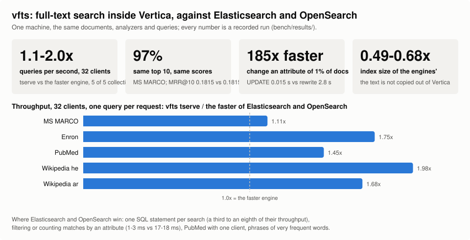

# Full-text search inside Vertica: vfts, side by side with Elasticsearch and OpenSearch

*Search the text where it already lives - with BM25 ranking, phrases, proximity, wildcards and
fuzzy words, in SQL, on new rows the moment they are committed.*

Most analytical databases can filter text with `LIKE` or a regular expression. That finds strings;
it does not rank documents, does not know that *running* and *runs* are the same word, and does not
answer "contract within five words of indemnity". For that, teams copy their text into a search
engine - Elasticsearch or OpenSearch - and keep two systems in sync.

**vfts** is a C++ extension (a UDx library) that adds a real search engine to Vertica: the same
BM25 ranking as Elasticsearch and OpenSearch, a query language with e-discovery operators,
analysis for every language written with spaces (Arabic and Hebrew included), and an index that is
never stale. This article shows what it does, how to use each function, and how it compares with
Elasticsearch 9.5 and OpenSearch 3.10 on the same machine, with the same data and the same queries.

**The results, in one paragraph.** With 32 clients sending one query each, vfts answers 1.1 to
2.0 times as many queries per second as the faster of Elasticsearch and OpenSearch on all five
collections (Enron 6,832 against 3,902; MS MARCO 3,218 against 2,907; Hebrew Wikipedia 20,138
against 10,166), when the searches reach it through `vfts.tserve`: one long statement per user
session that answers searches over a local channel. Sent as one SQL statement each, the same
searches top out at 928 to 1,313 per second, because every Vertica statement that calls an extension
costs about 2 ms of parsing, planning and set-up. With a single client, vfts through `tserve` is
faster on all five collections. Row access policies of the table apply to every search. vfts returns the same
documents with the same BM25 scores for 97% of the MS MARCO queries, the same relevance (MRR@10
0.1815), and its index is half to two thirds the size. Every number here was measured, with the same
load generator for all three, and one script runs it all again.

## Contents

1. [Full-text search, and why it is hard](#full-text-search-and-why-it-is-hard)
2. [Why inside Vertica](#why-inside-vertica)
3. [What vfts is](#what-vfts-is)
4. [The functions in ten minutes](#the-functions-in-ten-minutes) (and [every function on one page](#every-function-on-one-page))
5. [Fresh without rebuilding](#fresh-without-rebuilding)
6. [Languages](#languages)
7. [The benchmark](#the-benchmark)
8. [Results](#results)
9. [Search next to other data](#search-next-to-other-data)
10. [Who may search what](#who-may-search-what)
11. [Where Elasticsearch and OpenSearch win](#where-elasticsearch-and-opensearch-win)
12. [Install it in your Vertica](#install-it-in-your-vertica)
13. [What is in the repository](#what-is-in-the-repository)
14. [Run it yourself](#run-it-yourself)
15. [Conclusion](#conclusion)

## Full-text search, and why it is hard

`LIKE '%contract%'` finds a string. Full-text search finds the documents *about* something, best
first. That takes four things: **analysis** (split text into words, fold case and accents, reduce
*contracts* and *contracting* to *contract*, in every language), **ranking** (BM25: frequent use
of rare query words in a short document scores high), **a query language** (phrases, `w/N`
proximity, boolean logic, wildcards, typos), and **an inverted index** with top-k algorithms that
skip documents which cannot make the top ten.

The hard parts are the same for every engine: many languages, stable scores, fast top-k over
millions of documents, new rows searchable at once, and many users at the same time.
Elasticsearch and OpenSearch answer them with a separate cluster. vfts answers them inside the
database that already holds the text.

## Why inside Vertica

| | Search engine next to the database | vfts inside Vertica |
|---|---|---|
| Joins | none: copy every attribute into every document | results are rows: `JOIN`, `GROUP BY`, window functions over any table |
| An attribute changes | rewrite and re-analyze each affected document | `UPDATE` one table; the text index is untouched |
| Consistency | searchable after a refresh, no transactions | ACID: committed rows are searchable at once |
| Copies of the text | two, plus a sync pipeline | one; the index is half to two thirds the engines' size |
| Security, backup | a second system (Lucene's term statistics include the documents a security filter hides) | Vertica logins, grants, resource pools, backups; row access policies of the table apply to every search, with scores computed over the rows the user may see |

## What vfts is

    source table ──build──▶ index tables (in Vertica) ──load──▶ a cache file on every node ──▶ search
    + journal                term_dict, postings,                (memory-mapped)                 tsearch, tcount,
                             positions, doc_stats                                                tsnippet, hybrid

- The **index lives in Vertica tables**: backed up, replicated and secured with the database.
  Every node keeps a memory-mapped copy for fast reads; a lost copy is rebuilt from the tables.
- **Search is a SQL function.** Results are `(doc_id, score, rank)` rows that you join to your
  table, filter, aggregate - plain SQL.
- **The ranking is BM25** exactly as Lucene computes it (OpenSearch's scores; Elasticsearch's
  scale with `bm25='classic'`): the same idf, the same one-byte document lengths, the same float
  arithmetic, global statistics over all segments and nodes.

## The functions in ten minutes

All examples run on the demo table of `scripts/demo.sh` (eight short "case files" in English,
French, Hebrew and Arabic). The outputs below are copied from a real run.

### Create an index

    CALL vfts.create_index('cases', 'demo.cases', 'lang=en journal=demo.cases_journal margin=0');

The source table needs a `doc_id`, the text, an optional `lang` per row and a version timestamp
(`ver TIMESTAMPTZ DEFAULT CLOCK_TIMESTAMP()`). `create_index` analyzes every row, writes the index
tables, loads the cache on every node, and creates two views: `demo.cases_live` (every committed
row) and `demo.cases_snap` (the rows up to the last refresh). Search functions read one of them.

### What the analyzer sees: `vfts.tokenize`

    SELECT doc_id, pos, term, stem FROM (SELECT doc_id, vfts.tokenize(body, lang) FROM demo.cases
                                         WHERE doc_id IN (3, 6)) t ORDER BY doc_id, pos;

     doc_id | pos |    term     |    stem
    --------+-----+-------------+------------
          3 |   0 | sherlock    | sherlock
          3 |   1 | holmes      | holm
          3 |   2 | notes       | note
          ...
          3 |   7 | holmes      | holm        <- "Holmes-style" gives holmes and style
          3 |   8 | style       | style
          6 |   0 | החוזה       | חוזה        <- the Hebrew article ה removed for the stem
          6 |   2 | בבית        | בית         <- the prefixes ב removed
          6 |   5 | צה"ל        | צה"ל        <- an acronym stays one word

### Ranked search: `vfts.tsearch`

    SELECT * FROM (SELECT vfts.tsearch(* USING PARAMETERS index='cases', query='contract indemnity', k=5) OVER()
                   FROM demo.cases_live) r ORDER BY rank;

     qid | doc_id |       score       | rank
    -----+--------+-------------------+------
       0 |      1 |  1.13803458213806 |    1
       0 |      2 | 0.533722400665283 |    2

The result is rows: join them to your table, filter, aggregate.

    SELECT r.rank, r.doc_id, c.body
    FROM (SELECT vfts.tsearch(* USING PARAMETERS index='cases', query='holmes', k=5) OVER() FROM demo.cases_live) r
    JOIN demo.cases c USING (doc_id) ORDER BY r.rank;

     rank | doc_id |                                  body
    ------+--------+-------------------------------------------------------------------------
        1 |      3 | Sherlock Holmes' notes on the Baskerville case, Holmes-style deduction.

Parameters: `k`, `mode` (`stem` or `exact`), `syntax` (`query` or `plain` for a search box),
`operator` (`or`, `and`), `lang`, `stopwords`, `max_expansions`, `prefix_length`, `bm25`
(`lucene` or `classic`), `threads`, and `queries` for many queries in one statement.

### The query language

| Query | Meaning | Documents |
|---|---|---|
| `contract AND NOT indemnify` | boolean | 1 |
| `"indemnity clause"` | phrase | 1 |
| `"contract supply"~2` | sloppy phrase: reversing two words costs 2 | 1 |
| `contract w/5 indemnity` | within 5 words, any order | 1 |
| `seller pre/3 indemnify` | seller before indemnify, at most 3 words | 2 |
| `indemn*` | prefix | 1 2 5 8 |
| `contr?ct` | wildcard | 1 2 |
| `holmse~1` | fuzzy, one edit (a transposition counts one) | 3 |

`w/N` and `pre/N` take OR groups and nest: `(shred* OR destroy*) w/5 document*`,
`(board w/5 directors) AND meeting`.

### Stem or exact, and other languages

    query='contracts'                 -> documents 1 2   (stem: contract)
    query='contracts', mode='exact'   -> no document     (only the word itself)
    query='contrat', lang='fr'        -> 5               (Les contrats signés...)
    query='בית', lang='he'            -> 6               (בבית: the prefix is stripped)
    query='צה״ל'                      -> 6               (the acronym, with gershayim)
    query='كتاب', lang='ar'           -> 7               (والكتاب: the article and conjunction removed)

### Count, batch, and the score scale

    SELECT * FROM (SELECT vfts.tcount(* USING PARAMETERS index='cases', query='contract OR indemn*') OVER()
                   FROM demo.cases_live) r;
     qid | count
    -----+-------
       0 |     4

    SELECT qid, rank, doc_id FROM (SELECT vfts.tsearch(* USING PARAMETERS index='cases', k=2,
           queries=E'1\tindemnity\n2\tholmes\n3\tcontract w/5 indemnity') OVER() FROM demo.cases_live) r
    ORDER BY qid, rank;
     qid | rank | doc_id
    -----+------+--------
       1 |    1 |      1
       2 |    1 |      3
       3 |    1 |      1

Scores are Lucene's BM25, the scale of OpenSearch; `bm25='classic'` gives Elasticsearch's, which
is k1 + 1 = 2.2 times larger: document 1 scores 0.6636 for `indemnity`, and 1.4600 with
`bm25='classic'`.

### Snippets: `vfts.tsnippet`

    SELECT r.rank, vfts.tsnippet(c.body, 'contract w/5 indemnity' USING PARAMETERS index='cases') AS snippet
    FROM (SELECT vfts.tsearch(* USING PARAMETERS index='cases', query='contract w/5 indemnity', k=3) OVER()
          FROM demo.cases_live) r JOIN demo.cases c USING (doc_id) ORDER BY r.rank;

     rank | snippet
    ------+----------------------------------------------------------------------------------------------------------
        1 | The <b>indemnity</b> clause of the supply <b>contract</b> protects the buyer against third-party claims.

### New, changed and deleted rows, without a rebuild

    INSERT INTO demo.cases (doc_id, body, lang, vec) VALUES (9, 'New contract with an indemnity cap.', 'en', ARRAY[0.85, 0.15, 0.0]);
    UPDATE demo.cases SET body = 'Payment terms only.', ver = CLOCK_TIMESTAMP() WHERE doc_id = 2;
    DELETE FROM demo.cases WHERE doc_id = 8; INSERT INTO demo.cases_journal (doc_id, op) VALUES (8, 'D');
    COMMIT;

    query='indemn*'  -> 1, 5, 9      (9 is new; 2 no longer says indemnify; 8 is deleted)

No refresh was run: the live view hands the three changed rows to the search, which analyzes the
new ones and hides the old versions. `CALL vfts.refresh_index('cases')` then makes them a small
new segment (0.3 s), and `CALL vfts.merge('cases', 1)` merges the segments into one; the answers
stay the same.

### Hybrid search: BM25 and vectors

With [vvector](https://github.com/mogomo/vertica-vector-db) on the same table, `vfts.hybrid` fuses
the two ranked lists with Reciprocal Rank Fusion:

    SELECT h.rank, h.doc_id, h.sources FROM (SELECT vfts.hybrid(src, doc_id, rank, score USING PARAMETERS k=5) OVER() FROM (
        SELECT 'text' AS src, doc_id, rank, score FROM (SELECT vfts.tsearch(* USING PARAMETERS index='cases',
               query='indemnity contract', k=10) OVER() FROM demo.cases_live) t
        UNION ALL
        SELECT 'vector', id, rank, score FROM (SELECT vvector.vsearch(qid, qvec, id, vec, del, ver, snapshot_id
               USING PARAMETERS index_name='cases_vec', query='[0.9, 0.1, 0.1]', k=10) OVER() FROM demo.cases_vec_snap) v
    ) u) h ORDER BY h.rank;

     rank | doc_id |     sources
    ------+--------+-----------------
        1 |      1 | text:2 vector:1
        2 |      9 | text:1 vector:2
        3 |      5 | vector:3
        ...

All of this is `scripts/demo.sh`: it creates the table, runs every step with an explanation, and
`scripts/demo.sh --pause` waits between the steps for a presentation.

## Every function on one page

The README has each one's parameters and a full example with its output (`scripts/examples.sh`
runs them all).

| Function | Syntax | Example |
|---|---|---|
| create_index | `CALL vfts.create_index(index, source_table [, options])` | `CALL vfts.create_index('notes', 'ex.notes', 'lang=en journal=ex.notes_journal');` |
| refresh_index | `CALL vfts.refresh_index(index)` | `CALL vfts.refresh_index('notes');` |
| merge | `CALL vfts.merge(index [, max_segments])` | `CALL vfts.merge('notes', 1);` |
| rebuild | `CALL vfts.rebuild(index)` | `CALL vfts.rebuild('notes');` |
| load_all | `CALL vfts.load_all(index)` | `CALL vfts.load_all('notes');` |
| info | `CALL vfts.info(index)` | `CALL vfts.info('notes');` |
| drop_index | `CALL vfts.drop_index(index)` | `CALL vfts.drop_index('notes');` |
| tsearch | `vfts.tsearch(* USING PARAMETERS index, query \| queries [, k, mode, syntax, ...]) OVER() FROM <view>` | `SELECT * FROM (SELECT vfts.tsearch(* USING PARAMETERS index='notes', query='contract w/5 indemn*', k=10) OVER() FROM ex.notes_live) r;` |
| tcount | `vfts.tcount(* USING PARAMETERS index, query [, ...]) OVER() FROM <view>` | `SELECT * FROM (SELECT vfts.tcount(* USING PARAMETERS index='notes', query='contract') OVER() FROM ex.notes_live) c;` |
| tmatch | `vfts.tmatch(* USING PARAMETERS index, query [, ...]) OVER() FROM <view>` | `SELECT o.owner, COUNT(*) FROM (SELECT vfts.tmatch(* USING PARAMETERS index='notes', query='contract*') OVER() FROM ex.notes_live) m JOIN ex.owners o USING (doc_id) GROUP BY 1;` |
| tserve | `vfts.tserve(* USING PARAMETERS index, endpoint, token [, workers, ...]) OVER() FROM <index>_snap` (run by `tools/vfts_broker`) | `curl -XPOST localhost:9300/notes/_search -d '{"query": "contract"}'` |
| tsnippet | `vfts.tsnippet(text, query [, lang] USING PARAMETERS index [, words, fragments, ...])` | `SELECT vfts.tsnippet(body, 'indemnity' USING PARAMETERS index='notes') FROM ex.notes;` |
| hybrid | `vfts.hybrid(source, doc_id, rank, score USING PARAMETERS [k, method, ...]) OVER()` | fuse `tsearch` with a vector search: `... FROM (<tsearch list> UNION ALL <vsearch list>) u` |
| tokenize | `vfts.tokenize(text [, lang] [USING PARAMETERS ...]) OVER()` | `SELECT * FROM (SELECT vfts.tokenize('Holmes'' contracts') OVER()) t;` |
| tinfo | `vfts.tinfo(USING PARAMETERS index) OVER(PARTITION NODES) FROM vfts.probe` | the cache of every node |
| tversion | `vfts.tversion() OVER()` | `SELECT * FROM (SELECT vfts.tversion() OVER()) v;` |

## Fresh without rebuilding

A search index that has to be rebuilt after every load is a batch job, not a search engine. vfts
works the way Lucene does:

1. New rows go into **small new segments** when you call `vfts.refresh_index` - nothing already
   indexed is rewritten.
2. Rows written after the last refresh are **searched at query time**: the view `<index>_live`
   returns them and `tsearch` analyzes them on the fly. A search sees every committed row.
3. Deleted and changed rows are hidden by a **tombstone bitmap** (a delete, or an update that keeps
   the version, is written to a small journal table).
4. `refresh_index` then runs a **tiered merge** that combines small segments; searches keep
   using the previous generation while it runs.

A refresh is needed for speed, not for correct answers: every query analyzes the rows written since
the last refresh, so refresh often (every minute or hour) and the tail stays small.

An upgrade of Vertica keeps the index as well: it lives in ordinary Vertica tables and in node cache
files whose format belongs to vfts. The library may need to be compiled again for the new Vertica
version; the index does not (vfts has been tested on Vertica 26.3 only so far).

The statistics of BM25 are computed over all of it, so a score never depends on how the rows are
split into segments or nodes. The test suite proves it: after inserts, updates and deletes, the
results without a refresh, after refreshes, after merges and after a rebuild are always identical
- ids, ranks and scores - to an index built from scratch.

## Languages

Every language written with spaces between words works without a dictionary: ICU finds the words,
normalizes them (NFKC, case, accents), and Snowball stems them - English, French, German, Spanish,
Italian, Portuguese, Dutch, the Nordic languages, Polish, Czech, Romanian, Hungarian, Finnish,
Estonian, Lithuanian, Turkish, Indonesian, Irish, Basque, Catalan, Greek, Russian, Serbian,
Ukrainian, Armenian, Arabic, Persian, Hindi, Nepali, Tamil, Yiddish. Arabic gets Lucene's
normalization (diacritics, alef forms, teh marbuta) and light prefixes; Hebrew gets its points
removed and a light prefix stripper (ו ה ב כ ל מ ש), so *בית* finds *הבית* and *ובבית*, and the
acronym צה״ל is one word. Chinese, Japanese, Thai, Lao, Khmer, Myanmar and Korean need dictionaries
or a morphological analyser and are not supported.

A detail that matters in practice: Vertica's built-in text index missed 5 of 37 Sherlock Holmes
films in an earlier test, because `Holmes'`, `Holmes,` and `Holmes-style` were not split from their
punctuation. vfts finds all of them (it is a regression test).

## The benchmark

One machine, one engine at a time: an Intel Core Ultra 7 165H laptop-class CPU (22 logical cores),
61 GB of RAM, NVMe, Ubuntu 26.04. Vertica 26.3.0-2 Enterprise on one node, vfts unfenced.
Elasticsearch 9.5.6 and OpenSearch 3.10.0 from their tarballs, 16 GB heap, one shard, no replica,
force-merged into one segment, with the ICU analysis plugin.

**Five collections**, each loaded from the same prepared file into Vertica (COPY) and into the
engines (`_bulk`):

| Collection | Documents | Queries |
|---|---:|---|
| MS MARCO passages | 8,841,823 | the 6,980 judged dev queries, as plain text |
| Enron email | 517,401 | 40 e-discovery queries: phrases, `w/N`, `pre/N`, wildcards, fuzzy |
| PubMed abstracts | 932,746 | 40 biomedical queries of the same kinds |
| Hebrew Wikipedia | 300,000 | 30 queries |
| Arabic Wikipedia | 300,000 | 30 queries |

**Equivalent analysis.** The engines use the ICU tokenizer, NFKC case folding, Latin accent folding,
Lucene's Arabic and Persian normalization, Hebrew point removal, and an English Snowball field
next to an exact one; vfts does the same steps itself. The syntax queries are parsed by vfts and
translated into the engines' query DSL (bool, match_phrase, span_near, span_multi, prefix,
wildcard, fuzzy), so all three run the same query.

**Measured.** Top 10, no total hit count. Throughput: 32 closed-loop clients, one query per
request, from one native load generator (keep-alive HTTP) for all three; vfts is reached through
`vfts_broker`, an HTTP front end that logs every user in to Vertica with their own credentials.
Each round sends at least 20,000 requests three times after a warm-up; three rounds, the engines in
a different order each time, CPU governor `performance`; the median round is reported. Latency: the
same client with one connection. The first run (latency through vsql, on both of vfts's views:
**live**, every committed row, and **snap**, rows up to the last refresh) is in the repository.

## Results

**Throughput.** Queries per second with 32 clients, one query per request:

| Collection | vfts, tserve | vfts, batches | vfts, one statement per query | Elasticsearch | OpenSearch |
|---|---:|---:|---:|---:|---:|
| Enron | **6,832** | 2,366 | 1,246 | 3,902 | 3,881 |
| PubMed | **11,740** | 3,029 | 1,269 | 7,964 | 8,122 |
| MS MARCO | **3,218** | 1,801 | 928 | 2,729 | 2,907 |
| Hebrew Wikipedia | **20,138** | 3,554 | 1,297 | 10,100 | 10,166 |
| Arabic Wikipedia | **17,559** | 3,413 | 1,313 | 10,050 | 10,469 |

The three vfts columns send the same searches three ways. **One statement per query** is what
an application gets when it runs `SELECT ... vfts.tsearch(...)` for each search: Vertica parses,
plans and starts an executor for every statement, and statements that call an extension peak at
about 2,000 per second on this machine with most cores idle (`SELECT 1` reaches 6,000; a scalar
extension that the planner folds into a constant, 2,571). **Batches** put whatever waits into one
statement and help, but not enough. **tserve** removes the statement from each search: the broker
opens a normal session as the user (Vertica checks the password, the grants and the resource pool),
runs one `vfts.tserve` statement in it, and sends that user's searches to the statement over a
Unix socket. The statement answers from the snapshot it read when it started, on its own threads.

A note on fairness: the first version of this benchmark sent the engines' queries from one Python
process, and that client held them back (PubMed: 4,138 queries per second through it, 5,943 through
a native client on the same requests). All numbers here use the native client for all three.

**Latency, one client** (mean ms per query, same HTTP client):

| Collection | vfts, tserve | vfts, one statement | Elasticsearch | OpenSearch |
|---|---:|---:|---:|---:|
| Enron | **1.77** | 3.88 | 2.75 | 2.40 |
| PubMed | **1.01** | 3.36 | 1.30 | 1.07 |
| MS MARCO | **2.95** | 3.93 | 3.95 | 3.60 |
| Hebrew Wikipedia | **0.58** | 3.17 | 1.09 | 1.06 |
| Arabic Wikipedia | **0.66** | 3.22 | 1.07 | 1.09 |

**By kind of query** (vfts's engine against Elasticsearch's profile, one thread): words and
boolean queries cost about the same; `w/N` is faster in vfts (proximity over OR groups is its
strongest case: `california w/5 (energy OR power OR electricity)` on Enron took 10.5 ms through
SQL against 26.3 and 34.7 ms); phrases of very frequent words and fuzzy words are faster in Lucene.

**Same answers.** For every syntax query but one the three return the same number of matches; for
97% of the MS MARCO queries and 133 of the 140 syntax queries, the same top 10 with the same BM25
scores at every rank. MRR@10 on MS MARCO: 0.1815, 0.1815, 0.1813. What differs: fuzzy words (the
engines blend the statistics of the expansions), Snowball versions (`international` is `internat`
in one and `intern` in the other), and ties broken in a different order.

**Size and build.** vfts's node cache is half to two thirds of the engines' store; the index tables
in Vertica are a third of it or less. Building (and merging into one segment) takes 65 s for Enron
(Elasticsearch 90 s, OpenSearch 53 s) and 377 s for MS MARCO (214 s and 207 s): the merge is still
single-threaded.

**Document order.** A merge can renumber the documents so that documents with similar words sit
next to each other (recursive graph bisection, as Lucene's `BPIndexReorderer` does). The answers
stay the same, hit for hit. It made Enron and PubMed 17 to 19% faster at 32 clients (engine only)
and their postings smaller, but MS MARCO and the Arabic Wikipedia were faster in their own order
(both store their best documents early: MS MARCO groups passages by the search they came from),
and a single SQL statement that splits one search over all cores got slower on the reordered
collections (Enron 3.39 to 3.88 ms). So it is an index option, on for Enron and PubMed in this
benchmark, and the README has the whole comparison.

**New rows.** 88,418 new MS MARCO passages (1%): vfts's refresh makes them a segment in 3.1 s
(Elasticsearch 8.6 s, OpenSearch 8.1 s), and before any refresh they are already found through the
live view. But a live tail that large costs 2 seconds per query: it is meant to stay small between
frequent refreshes.

## Search next to other data

Search rarely stands alone. In e-discovery every email belongs to a custodian, and custodians go on
and off legal hold; in a research warehouse papers have journals, years and grants. A search engine
has no joins, so each attribute is copied into every document. vfts leaves it in a table.

Enron, 517,401 emails, an attribute *custodian* (150 values), 10 custodians on hold:

| Test | vfts (Vertica) | Elasticsearch | OpenSearch |
|---|---:|---:|---:|
| Add the attribute to every document | **0.028 s** | 223 s | 228 s |
| Move 1% of the documents to another custodian | **0.015 s** | 2.8 s | 8.9 s |
| Top 10 of a query among the custodians on hold | 16.8 ms | 2.9 ms | **2.7 ms** |
| Matches per custodian, every match | 18.7 ms | 1.4 ms | **1.2 ms** |

Both sides of this are real. Changing the data around the text is an `UPDATE` of one column in
Vertica, and a rewrite and re-analysis of whole documents in a search engine: three to four orders
of magnitude apart. Filtering and counting by an attribute during the search is faster in the
engines, which keep it next to their postings; vfts passes every match to Vertica's join, which
costs 17 to 18 ms when thousands of documents match. The answers are the same on both sides.

## Who may search what

Search engines bring their own security model; vfts uses Vertica's. A search needs `SELECT` on the
index's views (a statement that makes its own input is refused), and a row access policy on the
source table applies to every search: each user gets the documents they can see in the table, with
the BM25 scores of an index of exactly those rows (in Lucene, a security filter hides the hits but
the term statistics still count the hidden documents). A column mask on the indexed
text makes vfts refuse to search, since a hit would reveal words of the masked text. The price of
a row policy is a join per statement: on Enron 86 ms with nothing hidden and 320 ms with half of the
517,401 documents hidden, instead of 2 ms; through `tserve` that is paid once per session, not per
search.

## Where Elasticsearch and OpenSearch win

Honestly, and with the reasons:

- **Many small searches sent as SQL statements.** One statement per query reaches a third to an
  eighth of the engines' throughput, and a single search as a statement takes 3.2 to 3.9 ms against
  1 to 4 ms. `tserve` is the answer for that traffic; plain SQL stays the
  answer for searches joined with other data.
- **PubMed's 99th percentile with one client**: OpenSearch 2.8 ms against 4.9 ms (vfts's mean is
  lower: 1.01 against 1.07 ms).
- **Filtering or counting matches by an attribute** during the search: 1 to 3 ms against 17 to
  18 ms ([Search next to other data](#search-next-to-other-data)).
- **Phrases of very frequent words and single fuzzy words**: Lucene's phrase matching and its
  Levenshtein automaton are faster for these.
- **Building large collections**: OpenSearch builds fastest everywhere, Elasticsearch beats vfts
  on MS MARCO, because vfts's merge into one segment uses one thread.

## Install it in your Vertica

On a Vertica node (tested on 26.3), as dbadmin, with the vsql connection variables set:

    git clone <the repository> && cd vfts
    ./install.sh       # checks, builds (static: nothing to install on the nodes), tests, deploys to every node, verifies

Then `CALL vfts.create_index('docs', 'app.docs', 'lang=en');` and search. The README's Install
section covers fenced mode, Eon subclusters, grants for the users who search, the broker for many
clients, upgrades and removal.

## What is in the repository

| Path | What it is for |
|---|---|
| `src/engine/` | the search engine in plain C++17: analysis, index format, top-k search, merge, cache |
| `src/udx/` | the Vertica functions: thin adapters to the engine |
| `sql/` | install (tables, functions) and the procedures that manage indexes |
| `tools/` | `vfts_broker` (HTTP front end for many clients), `httpload` (the benchmark's load generator), `vfts_cli` (the engine without Vertica) |
| `tests/` | engine unit tests against brute-force models; SQL tests against plain SQL |
| `bench/` | the benchmark: data download, loaders, runners, join test, report; `results/` every number in this article |
| `scripts/` | `demo.sh` (every function, one command), `examples.sh` (the README's examples), `deploy.sh` |
| `docs/` | design, index format, measured Vertica behavior |

## Run it yourself

Everything above comes from one script, and the README explains every step. On a Linux machine with
Vertica (one node is enough), 32 GB of RAM and about 40 GB of free disk:

    git clone <the repository> && cd vfts
    export VSQL_HOST=localhost VSQL_PORT=5433 VSQL_USER=dbadmin VSQL_PASSWORD=... VSQL_DATABASE=...
    ./install.sh
    bench/run_all.sh data                                       # downloads and prepares the five collections
    bench/run_all.sh engines                                    # installs Elasticsearch and OpenSearch
    bench/run_all.sh env vfts fenced es os refresh throughput report      # about 3 hours
    bench/pool_test.sh msmarco enron                            # optional

The raw results are in `bench/results/*.jsonl`, with the hits and the time of every query in
`bench/results/runs/`; `python3 -I bench/report.py` writes the tables (`bench/results/summary.md`)
and these charts again. Each step is capped in time, so a stalled download or engine never blocks
the run. The datasets have their own licenses (see `bench/data/fetch.sh`); none of their text is in
the repository.

## Conclusion

vfts puts a real search engine where the data already is. It returns the answers Elasticsearch
and OpenSearch return, with the same scores, from SQL, on rows committed a moment ago. Through
`tserve`, many clients get more searches per second from it than from either engine on every
collection measured here, as the user they logged in as and within the table's row access
policies. Sent one SQL statement at a time, small
searches cost what a database statement costs, and a dedicated search engine is faster.

If your text lives in Vertica and you search it with SQL next to your other data - e-discovery
over email, literature in a research warehouse, logs and tickets, Arabic and Hebrew documents - you
can now do it without copying the text into a second system and keeping the two in sync.
