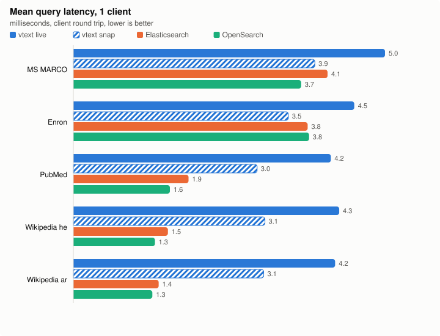
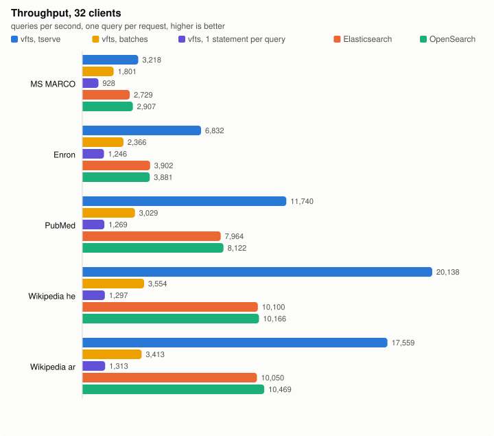
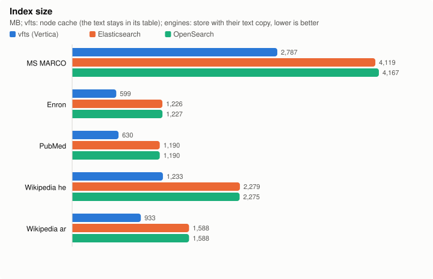
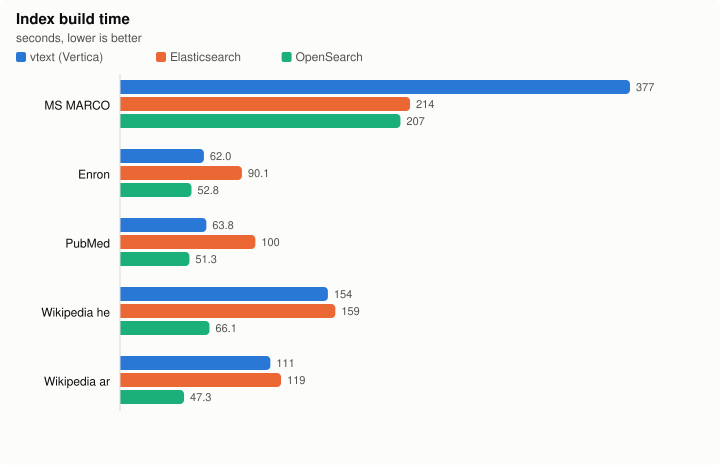

# Full-text search inside Vertica: vtext, side by side with Elasticsearch and OpenSearch

*Search the text where it already lives - with BM25 ranking, phrases, proximity, wildcards and
fuzzy words, in SQL, on new rows the moment they are committed.*

Most analytical databases can filter text with `LIKE` or a regular expression. That finds strings;
it does not rank documents, does not know that *running* and *runs* are the same word, and does not
answer "contract within five words of indemnity". For that, teams copy their text into a search
engine - Elasticsearch or OpenSearch - and keep two systems in sync.

**vtext** is a C++ extension (a UDx library) that adds a real search engine to Vertica: the same
BM25 ranking as Elasticsearch and OpenSearch, a query language with e-discovery operators,
analysis for every language written with spaces (Arabic and Hebrew included), and an index that is
never stale. This article shows what it does, how to use each function, and how it compares with
Elasticsearch 9.5 and OpenSearch 3.10 on the same machine, with the same data and the same queries.

**The results, in one paragraph.** On 8.8 million MS MARCO passages, vtext answers a query in
3.9 ms on average from SQL (5.0 ms when it also searches rows no refresh has seen yet), between
OpenSearch (3.7 ms) and Elasticsearch (4.1 ms), with half their 99th-percentile latency (7.7 ms
against 15 to 16 ms). It returns the same documents with the same BM25 scores for 97% of those
queries, and the same relevance (MRR@10 0.1815). It is fastest on proximity queries and on batched
queries over the Enron email, and its index is half to two thirds the size. Elasticsearch and
OpenSearch are faster on small collections and on throughput with one query per request, because
every Vertica statement costs about 2 ms before the search even starts. Every number here was
measured, and one script runs it all again.

## Contents

1. [What vtext is](#what-vtext-is)
2. [The functions in ten minutes](#the-functions-in-ten-minutes)
3. [Fresh without rebuilding](#fresh-without-rebuilding)
4. [Languages](#languages)
5. [The benchmark](#the-benchmark)
6. [Results](#results)
7. [Where Elasticsearch and OpenSearch win](#where-elasticsearch-and-opensearch-win)
8. [Run it yourself](#run-it-yourself)
9. [Conclusion](#conclusion)

## What vtext is

    source table ──build──▶ index tables (in Vertica) ──load──▶ a cache file on every node ──▶ search
    + journal                term_dict, postings,                (memory-mapped)                 tsearch, tcount,
                             positions, doc_stats                                                tsnippet, hybrid

- The **index lives in Vertica tables**: backed up, replicated and secured with the database.
  Every node keeps a memory-mapped copy for fast reads; a lost copy is rebuilt from the tables.
- **Search is a SQL function.** Results are `(doc_id, score, rank)` rows that you join to your
  table, filter, aggregate - plain SQL.
- **The ranking is BM25** exactly as Lucene computes it (OpenSearch's scores; Elasticsearch's
  scale with `bm25='classic'`): the same idf, the same one-byte document lengths, the same float
  arithmetic, global statistics over all segments and nodes.

## The functions in ten minutes

All examples run on the demo table of `scripts/demo.sh` (eight short "case files" in English,
French, Hebrew and Arabic). The outputs below are copied from a real run.

### Create an index

    CALL vtext.create_index('cases', 'demo.cases', 'lang=en journal=demo.cases_journal margin=0');

The source table needs a `doc_id`, the text, an optional `lang` per row and a version timestamp
(`ver TIMESTAMPTZ DEFAULT CLOCK_TIMESTAMP()`). `create_index` analyzes every row, writes the index
tables, loads the cache on every node, and creates two views: `demo.cases_live` (every committed
row) and `demo.cases_snap` (the rows up to the last refresh). Search functions read one of them.

### What the analyzer sees: `vtext.tokenize`

    SELECT doc_id, pos, term, stem FROM (SELECT doc_id, vtext.tokenize(body, lang) FROM demo.cases
                                         WHERE doc_id IN (3, 6)) t ORDER BY doc_id, pos;

     doc_id | pos |    term     |    stem
    --------+-----+-------------+------------
          3 |   0 | sherlock    | sherlock
          3 |   1 | holmes      | holm
          3 |   2 | notes       | note
          ...
          3 |   7 | holmes      | holm        <- "Holmes-style" gives holmes and style
          3 |   8 | style       | style
          6 |   0 | החוזה       | חוזה        <- the Hebrew article ה removed for the stem
          6 |   2 | בבית        | בית         <- the prefixes ב removed
          6 |   5 | צה"ל        | צה"ל        <- an acronym stays one word

### Ranked search: `vtext.tsearch`

    SELECT * FROM (SELECT vtext.tsearch(* USING PARAMETERS index='cases', query='contract indemnity', k=5) OVER()
                   FROM demo.cases_live) r ORDER BY rank;

     qid | doc_id |       score       | rank
    -----+--------+-------------------+------
       0 |      1 |  1.13803458213806 |    1
       0 |      2 | 0.533722400665283 |    2

The result is rows: join them to your table, filter, aggregate.

    SELECT r.rank, r.doc_id, c.body
    FROM (SELECT vtext.tsearch(* USING PARAMETERS index='cases', query='holmes', k=5) OVER() FROM demo.cases_live) r
    JOIN demo.cases c USING (doc_id) ORDER BY r.rank;

     rank | doc_id |                                  body
    ------+--------+-------------------------------------------------------------------------
        1 |      3 | Sherlock Holmes' notes on the Baskerville case, Holmes-style deduction.

Parameters: `k`, `mode` (`stem` or `exact`), `syntax` (`query` or `plain` for a search box),
`operator` (`or`, `and`), `lang`, `stopwords`, `max_expansions`, `prefix_length`, `bm25`
(`lucene` or `classic`), `threads`, and `queries` for many queries in one statement.

### The query language

| Query | Meaning | Documents |
|---|---|---|
| `contract AND NOT indemnify` | boolean | 1 |
| `"indemnity clause"` | phrase | 1 |
| `"contract supply"~2` | sloppy phrase: reversing two words costs 2 | 1 |
| `contract w/5 indemnity` | within 5 words, any order | 1 |
| `seller pre/3 indemnify` | seller before indemnify, at most 3 words | 2 |
| `indemn*` | prefix | 1 2 5 8 |
| `contr?ct` | wildcard | 1 2 |
| `holmse~1` | fuzzy, one edit (a transposition counts one) | 3 |

`w/N` and `pre/N` take OR groups and nest: `(shred* OR destroy*) w/5 document*`,
`(board w/5 directors) AND meeting`.

### Stem or exact, and other languages

    query='contracts'                 -> documents 1 2   (stem: contract)
    query='contracts', mode='exact'   -> no document     (only the word itself)
    query='contrat', lang='fr'        -> 5               (Les contrats signés...)
    query='בית', lang='he'            -> 6               (בבית: the prefix is stripped)
    query='צה״ל'                      -> 6               (the acronym, with gershayim)
    query='كتاب', lang='ar'           -> 7               (والكتاب: the article and conjunction removed)

### Count, batch, and the score scale

    SELECT * FROM (SELECT vtext.tcount(* USING PARAMETERS index='cases', query='contract OR indemn*') OVER()
                   FROM demo.cases_live) r;
     qid | count
    -----+-------
       0 |     4

    SELECT qid, rank, doc_id FROM (SELECT vtext.tsearch(* USING PARAMETERS index='cases', k=2,
           queries=E'1\tindemnity\n2\tholmes\n3\tcontract w/5 indemnity') OVER() FROM demo.cases_live) r
    ORDER BY qid, rank;
     qid | rank | doc_id
    -----+------+--------
       1 |    1 |      1
       2 |    1 |      3
       3 |    1 |      1

Scores are Lucene's BM25, the scale of OpenSearch; `bm25='classic'` gives Elasticsearch's, which
is k1 + 1 = 2.2 times larger: document 1 scores 0.6636 for `indemnity`, and 1.4600 with
`bm25='classic'`.

### Snippets: `vtext.tsnippet`

    SELECT r.rank, vtext.tsnippet(c.body, 'contract w/5 indemnity' USING PARAMETERS index='cases') AS snippet
    FROM (SELECT vtext.tsearch(* USING PARAMETERS index='cases', query='contract w/5 indemnity', k=3) OVER()
          FROM demo.cases_live) r JOIN demo.cases c USING (doc_id) ORDER BY r.rank;

     rank | snippet
    ------+----------------------------------------------------------------------------------------------------------
        1 | The <b>indemnity</b> clause of the supply <b>contract</b> protects the buyer against third-party claims.

### New, changed and deleted rows, without a rebuild

    INSERT INTO demo.cases (doc_id, body, lang, vec) VALUES (9, 'New contract with an indemnity cap.', 'en', ARRAY[0.85, 0.15, 0.0]);
    UPDATE demo.cases SET body = 'Payment terms only.', ver = CLOCK_TIMESTAMP() WHERE doc_id = 2;
    DELETE FROM demo.cases WHERE doc_id = 8; INSERT INTO demo.cases_journal (doc_id, op) VALUES (8, 'D');
    COMMIT;

    query='indemn*'  -> 1, 5, 9      (9 is new; 2 no longer says indemnify; 8 is deleted)

No refresh was run: the live view hands the three changed rows to the search, which analyzes the
new ones and hides the old versions. `CALL vtext.refresh_index('cases')` then makes them a small
new segment (0.3 s), and `CALL vtext.merge('cases', 1)` merges the segments into one; the answers
stay the same.

### Hybrid search: BM25 and vectors

With [vvector](https://github.com/mogomo/vertica-vector-db) on the same table, `vtext.hybrid` fuses
the two ranked lists with Reciprocal Rank Fusion:

    SELECT h.rank, h.doc_id, h.sources FROM (SELECT vtext.hybrid(src, doc_id, rank, score USING PARAMETERS k=5) OVER() FROM (
        SELECT 'text' AS src, doc_id, rank, score FROM (SELECT vtext.tsearch(* USING PARAMETERS index='cases',
               query='indemnity contract', k=10) OVER() FROM demo.cases_live) t
        UNION ALL
        SELECT 'vector', id, rank, score FROM (SELECT vvector.vsearch(qid, qvec, id, vec, del, ver, snapshot_id
               USING PARAMETERS index_name='cases_vec', query='[0.9, 0.1, 0.1]', k=10) OVER() FROM demo.cases_vec_snap) v
    ) u) h ORDER BY h.rank;

     rank | doc_id |     sources
    ------+--------+-----------------
        1 |      1 | text:2 vector:1
        2 |      9 | text:1 vector:2
        3 |      5 | vector:3
        ...

All of this is `scripts/demo.sh`: it creates the table, runs every step with an explanation, and
`scripts/demo.sh --pause` waits between the steps for a presentation.

## Fresh without rebuilding

A search index that has to be rebuilt after every load is a batch job, not a search engine. vtext
works the way Lucene does:

1. New rows go into **small new segments** when you call `vtext.refresh_index` - nothing already
   indexed is rewritten.
2. Rows written after the last refresh are **searched at query time**: the view `<index>_live`
   returns them and `tsearch` analyzes them on the fly. A search sees every committed row.
3. Deleted and changed rows are hidden by a **tombstone bitmap** (a delete, or an update that keeps
   the version, is written to a small journal table).
4. A **tiered merge** combines small segments in the background.

The statistics of BM25 are computed over all of it, so a score never depends on how the rows are
split into segments or nodes. The test suite proves it: after inserts, updates and deletes, the
results without a refresh, after refreshes, after merges and after a rebuild are always identical
- ids, ranks and scores - to an index built from scratch.

## Languages

Every language written with spaces between words works without a dictionary: ICU finds the words,
normalizes them (NFKC, case, accents), and Snowball stems them - English, French, German, Spanish,
Italian, Portuguese, Dutch, the Nordic languages, Polish, Czech, Romanian, Hungarian, Finnish,
Estonian, Lithuanian, Turkish, Indonesian, Irish, Basque, Catalan, Greek, Russian, Serbian,
Ukrainian, Armenian, Arabic, Persian, Hindi, Nepali, Tamil, Yiddish. Arabic gets Lucene's
normalization (diacritics, alef forms, teh marbuta) and light prefixes; Hebrew gets its points
removed and a light prefix stripper (ו ה ב כ ל מ ש), so *בית* finds *הבית* and *ובבית*, and the
acronym צה״ל is one word. Chinese, Japanese, Thai, Lao, Khmer, Myanmar and Korean need dictionaries
or a morphological analyser and are not supported.

A detail that matters in practice: Vertica's built-in text index missed 5 of 37 Sherlock Holmes
films in an earlier test, because `Holmes'`, `Holmes,` and `Holmes-style` were not split from their
punctuation. vtext finds all of them (it is a regression test).

## The benchmark

One machine, one engine at a time: an Intel Core Ultra 7 165H laptop-class CPU (22 logical cores),
61 GB of RAM, NVMe, Ubuntu 26.04. Vertica 26.3.0-2 Enterprise on one node, vtext unfenced.
Elasticsearch 9.5.6 and OpenSearch 3.10.0 from their tarballs, 16 GB heap, one shard, no replica,
force-merged into one segment, with the ICU analysis plugin.

**Five collections**, each loaded from the same prepared file into Vertica (COPY) and into the
engines (`_bulk`):

| Collection | Documents | Queries |
|---|---:|---|
| MS MARCO passages | 8,841,823 | the 6,980 judged dev queries, as plain text |
| Enron email | 517,401 | 40 e-discovery queries: phrases, `w/N`, `pre/N`, wildcards, fuzzy |
| PubMed abstracts | 932,746 | 40 biomedical queries of the same kinds |
| Hebrew Wikipedia | 300,000 | 30 queries |
| Arabic Wikipedia | 300,000 | 30 queries |

**Equivalent analysis.** The engines use the ICU tokenizer, NFKC case folding, Latin accent folding,
Lucene's Arabic and Persian normalization, Hebrew point removal, and an English Snowball field
next to an exact one; vtext does the same steps itself. The syntax queries are parsed by vtext and
translated into the engines' query DSL (bool, match_phrase, span_near, span_multi, prefix,
wildcard, fuzzy), so all three run the same query.

**Measured.** Top 10. One warm-up run, then three measured runs; for each query the best of the
three. Latency is the whole round trip seen by the client (vsql for Vertica, HTTP for the engines);
throughput is 32 concurrent clients. vtext is measured on both of its views: **live** (every
committed row) and **snap** (rows up to the last refresh, the guarantee the engines give).

## Results

**Latency.** On MS MARCO, the collection that is large enough for the search itself to matter,
vtext's snap view (3.90 ms) sits between OpenSearch (3.68) and Elasticsearch (4.10), and its 99th
percentile is half of theirs (7.7 ms against 15.4 and 15.9). The live view, which also searches
rows that no refresh has seen yet, costs about one millisecond more. On the smaller collections the
engines answer in 1.3 to 1.9 ms and vtext in about 3 ms: the cost of a Vertica statement.

| Collection | vtext live | vtext snap | Elasticsearch | OpenSearch |
|---|---:|---:|---:|---:|
| MS MARCO | 5.03 ms | 3.90 ms | 4.10 ms | 3.68 ms |
| Enron | 4.53 | 3.47 | 3.78 | 3.80 |
| PubMed | 4.16 | 2.97 | 1.86 | 1.56 |
| Hebrew Wikipedia | 4.29 | 3.09 | 1.53 | 1.32 |
| Arabic Wikipedia | 4.22 | 3.07 | 1.38 | 1.27 |

**By kind of query** (the 140 syntax queries, mean ms, vtext snap / Elasticsearch / OpenSearch):
words 2.71 / 1.19 / 0.99; boolean 2.67 / 1.30 / 1.18; phrases 3.46 / 1.93 / 1.82; proximity
3.27 / 3.37 / 3.10; prefix and wildcard 3.29 / 2.55 / 2.52; fuzzy 4.73 / 2.17 / 2.47. Proximity over
OR groups is vtext's strongest case: `california w/5 (energy OR power OR electricity)` on Enron
takes 10.5 ms against 26.3 and 34.7 ms.

**Throughput.** With one query per statement and 32 clients, the engines serve 2.5 to 4 times more
queries per second. Sent in batches of 20 (vtext's `queries` parameter, the engines' `_msearch`),
vtext serves 4,033 queries per second on Enron against 3,172 and 3,276, and 1,669 on MS MARCO
against 2,674 and 2,751.

**Same answers.** For every syntax query but one the three return the same number of matches; for
97% of the MS MARCO queries and 133 of the 140 syntax queries, the same top 10 with the same BM25
scores at every rank. MRR@10 on MS MARCO: 0.1815, 0.1815, 0.1813. What differs: fuzzy words (the
engines blend the statistics of the expansions), Snowball versions (`international` is `internat`
in one and `intern` in the other), and ties broken in a different order.

**Size and build.** vtext's node cache is half to two thirds of the engines' store; the index tables
in Vertica are a third of it or less. Building (and merging into one segment) takes 62 s for Enron
(Elasticsearch 90 s, OpenSearch 53 s) and 377 s for MS MARCO (214 s and 207 s): the merge is still
single-threaded.

**New rows.** 88,418 new MS MARCO passages (1%): vtext's refresh makes them a segment in 3.1 s
(Elasticsearch 8.6 s, OpenSearch 8.1 s), and before any refresh they are already found through the
live view. But a live tail that large costs 2 seconds per query: it is meant to stay small between
frequent refreshes.

## Where Elasticsearch and OpenSearch win

Honestly, and with the reasons:

- **Small queries on small collections.** A Vertica statement costs about 2 ms before vtext runs:
  `SELECT 1` through vsql takes 1.0 ms, a UDx over a one-row view 1.74 ms. vtext's own work for a
  one-word query on Enron is 0.02 ms, and a profile of thousands of search statements shows 2% of
  the time in the library. Elasticsearch and OpenSearch answer such a query in 1 to 2 ms.
- **Throughput with one query per request**, for the same reason. A resource pool tuned for small
  statements did not change it; batches do.
- **Phrases of frequent words and single fuzzy words.** Lucene skips whole blocks of documents that
  cannot reach the top 10 for phrases and matches fuzzy words with a Levenshtein automaton on its
  term dictionary; vtext checks every document that has all the words of a phrase (in parallel),
  and walks its dictionary as a trie with automaton-like jumps.
- **Building large collections**: OpenSearch builds fastest everywhere, Elasticsearch beats vtext
  on MS MARCO, because vtext's merge into one segment uses one thread.

## Run it yourself

Everything above comes from one script, and the README explains every step. On a Linux machine with
Vertica (one node is enough), 32 GB of RAM and about 40 GB of free disk:

    git clone <the repository> && cd vertica-text-udx
    make deps && make && make test
    export VSQL_HOST=localhost VSQL_PORT=5433 VSQL_USER=dbadmin VSQL_PASSWORD=... VSQL_DATABASE=...
    make deploy
    bench/run_all.sh data                                       # downloads and prepares the five collections
    bench/run_all.sh engines                                    # installs Elasticsearch and OpenSearch
    bench/run_all.sh env vtext fenced es os refresh report      # about 2 hours
    bench/pool_test.sh msmarco enron                            # optional

The raw results are in `bench/results/*.jsonl`, with the hits and the time of every query in
`bench/results/runs/`; `python3 -I bench/report.py` writes the tables (`bench/results/summary.md`)
and these charts again. Each step is capped in time, so a stalled download or engine never blocks
the run. The datasets have their own licenses (see `bench/data/fetch.sh`); none of their text is in
the repository.

## Conclusion

vtext puts a real search engine where the data already is. It returns the answers Elasticsearch
and OpenSearch return, with the same scores, from SQL, on rows committed a moment ago. On a large
collection it is as fast as they are for a single user, and it leads on proximity searches, tail
latency, batches and index size. Where every query is tiny and the traffic is high, a dedicated
search engine is faster, because a database statement costs more than an HTTP request to a search
engine.

If your text lives in Vertica and you search it with SQL next to your other data - e-discovery
over email, literature in a research warehouse, logs and tickets, Arabic and Hebrew documents - you
can now do it without copying the text into a second system and keeping the two in sync.
